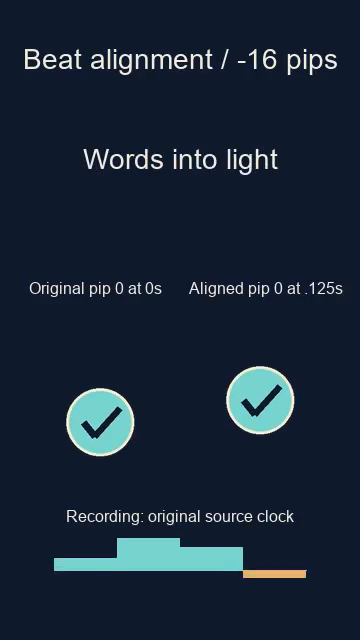

# FrameRudiments

FrameRudiments renders Shorts, Canvas-style clips and full lyric visualisers
from one traceable timeline. It is the offline Python renderer in the
[DanceFlow ecosystem](https://kieransimkin.co.uk/danceflow/).

**0.2.0** accepts source-bound StemLab BPM/first-beat readings through
`clock.beat_alignment`. Procedural motion follows the fractional beat phase
after excerpt/repeat mapping. Audio, lyric/cue timestamps and captured
recordings retain their original source clock. See [beat alignment](docs/beat-alignment.md).



[Play the four-second demonstration](docs/media/beat-alignment.mp4): original
120 BPM clicks start at 0.125 seconds; the right movement uses the -16 pip
reading. Text and recorded bands keep source time. This synthetic example
demonstrates clock composition; it does not establish song-analysis accuracy.
[Encoded-frame verification and hashes](docs/media/beat-alignment-evidence.json).

It consolidates the shared Python/Pillow/FFmpeg mechanisms developed across
the existing Gilt Trip, Blame Putin, Clay, Paper Dreams, Free Danny Tommo,
Silly Sausage Britain and Moderate or Good renderers. Release-specific artwork,
scene layouts and creative decisions belong in project files or Python scene
hooks. Historical render scripts and approved outputs remain preserved.

## Particle and smoke emitters

A new deterministic `type: "emitter"` layer provides continuous smoke,
sparks, embers, snow, rain, confetti and cue-triggered bursts, driven by
independent DanceRudiments. Pinned DanceMoves/StemLab `.lrc`, `.cue`, or
versioned `.json` timing files can trigger one-shot explosions; `hybrid`
mode combines these with constant emission. Every parameter in the engine's
numeric style table supports native `style.*` modulation. Pinned transparent
PNG particles are optional, and the existing element- and frame-level post
passes remain available. See [particle and smoke reference](docs/particle-smoke.md)
and the [CI-generated synthetic gallery](https://kieransimkin.github.io/FrameRudiments/particles/).

## Variable-tempo synchronisation and word subtitles

FrameRudiments accepts a checksum-pinned `stemlab.beat-timeline.v1` in
`clock.beat_timeline` for true piecewise BPM/beat phase at sample-frame anchors,
matching StemLab and the opt-in DanceMoves variable-tempo API. Nominal/fixed
BPM, beat grids, and fixed-tempo `beat_alignment` remain supported independently.
Lyrics, cue timing and recorded Rudiments retain their source audio clock.
A separate pinned `word_lyrics` LRC supports enhanced timestamps, per-word
karaoke highlighting, progressive word colour and a distinct `word_captions`
lane; line captions remain available through `lyrics`. Both per-line and
per-word subtitle exports are generated with the same encoded frame ledger.
See [variable-tempo and word LRC guide](docs/variable-bpm-word-subtitles.md)
and the [synthetic public demo](https://kieransimkin.github.io/FrameRudiments/timing/).

## Install and run

Python 3.11+ and FFmpeg with libx264/AAC are required. Install the package into
its own virtual environment. Published packages use `python -m pip install framerudiments`;
from a source checkout use `python -m pip install .`:

```sh
python -m pip install .
framerudiments --version
framerudiments demo demo --font /path/to/a/font.ttf
framerudiments plan demo/project.json --output demo-plan.json
framerudiments preflight demo/project.json --output preflight --ffmpeg /path/to/ffmpeg
framerudiments render demo/project.json --output render --ffmpeg /path/to/ffmpeg
```

Use a new output directory each time. `--ffprobe` overrides FFmpeg's sibling
ffprobe. Environment alternatives are `FRAMERUDIMENTS_FFMPEG` and
`FRAMERUDIMENTS_FFPROBE`. Fonts are explicit hashed inputs; no platform-specific
font or FFmpeg location is hardcoded into the engine. The synthetic demo creates
its own tone, sprite, LRC, CUE and four-dimensional recording.

## Capabilities

* Portrait, landscape and square frame-addressed Pillow composition, at native
  constant 60 fps by default. Other frame rates require a recorded reason.
* Sample-addressed source excerpts and exact repetitions; no time-stretch,
  resampling, normalization or remix. The master is never changed. Short
  derivatives default to 120 ms quarter-sine endpoint fades; set
  `audio.fade_seconds: 0` to preserve an approved raw seam. Visualisers and
  Canvas-style projects default to no fades. AAC encoding is lossy.
* One caption/cue ledger for actual raster transitions, JSON, SRT and ASS.
  Retains signed frame error, same-frame ordering, explicit clears, carry-in
  lyrics and repeat boundaries. Accepts UTF-8 LRC with offsets/multiple stamps
  and CD CUE INDEX 01 at 75 subframes/s. Section labels never become lyrics.
* Canonical lyric text comparison, exact input hashes, inert text, bounded text
  wrapping and fit-or-fail behavior. Optional previous/current/next captions
  and exact-text-associated lyric artwork (planes, tablets, signs, etc.).
* Native DanceRudiments catalogue sampling at integer pips; optional explicit
  interpolation of adjacent native samples for legacy compositor parity.
  Preserves the distinction between 64 pips/beat and 16 DanceMoves ticks/beat.
* Saved StemLab beat grids, accepted `stemlab.loops.v1` selections, explicitly
  selected `stemlab.dancerudiments.candidates.v1` matches, and native
  `dancerudiments.recording` files. No model execution or copied DSP.
  Match-window extrapolation needs an explicit choice. N-dimensional
  recordings retain their own source clock and never wrap outside capture.
* Transparent sprites, atlas cycles in musical ticks, cue/time-gated layers,
  position/rotation/scale mappings with selectable axes, same-pose directional
  trails, masks, background contain/cover and N-dimensional signed bars.
  Independent composite motion channels preserve separate bounce/sway/tilt.
  All transformed sprite alpha extents are checked against declared bounds
  on every frame. Custom scene drawing has its own review obligations.
* Modular rudiment views: seeded moving particles and trails, signed bar graphs,
  scrolling multi-dimensional waveform traces, XY paths and calibrated Fourier
  spectrum views with local peak analysis and peak holds. Any view can use
  the existing native motion sources; a trusted Python registry supports more
  renderers without another frame loop or clock. See
  [docs/rudiment-renderers.md](docs/rudiment-renderers.md) and run
  `framerudiments demo demo --rudiments --font /path/to/font.ttf`.
* The existing seeded paper-glider flight model and connected-alpha sprite
  cleaner, plus a general frame-addressed lyric-art entrance/hold/exit helper.
  The flight model is stylized animation; it does not simulate real aerodynamics
  or establish musical synchronization by itself.
* H.264/yuv420p + AAC MP4 with fast start, full decoding, exact decoded frame
  count and every decoded timestamp checked for CFR. Audio length, sample
  rate and channel count are checked against the source. Includes encoded QA
  stills, a poster, phone preview, input/output hashes, commands and logs.

The [spectrum guide](docs/spectrum.md) covers saved StemLab Fourier calibration,
frequency labels, peak controls and per-frame JSONL effect signals. Run
`framerudiments renderers` for the current built-in names. The optional
`demo --spectrum` generator uses StemLab 1.6+; rendering its saved recording
keeps the core package lightweight.

## Project format

Start from `framerudiments demo` and replace its synthetic assets. Every file
reference has `path` and `sha256`; paths are relative to the project JSON unless
absolute. See [docs/project-format.md](docs/project-format.md) for all fields and
[docs/extraction.md](docs/extraction.md) for source mechanisms and boundaries.

```python
from framerudiments import Project, render

project = Project.load("release/project.json")

def scene(image, context):
    # Existing custom drawing consumes frame, source_seconds, output_seconds,
    # beat, lyric and cue. Return a frame-sized RGBA image.
    return image

render(project, "release/new-render", scene=scene, ffmpeg="/path/to/ffmpeg")
```

Pin any assets used by a custom scene with `project.ref({"path": ..., "sha256": ...})`
before rendering. The hook is supplied by trusted Python code, never imported
or executed from a project JSON. Do not reproduce clock, sampling, caption,
encode or verification loops in release adapters.

## Evidence and limits

`plan` is preparation, `preflight` checks all composed frames without encoding,
and `render` produces **technical-QA passed; creative and attended listening
review pending**. No command uploads, schedules or publishes anything.
Automatic checks cannot establish sung-word accuracy, pleasant motion, a
musical loop seam, platform preview acceptance, rights or public eligibility.
Caption boxes are composition constraints, not current official platform
safe-zone verification. Review the exact encoded file and destination preview.

Constant-BPM and saved variable-grid clocks record their authority/status;
an estimate never becomes artist confirmation. Beat grids extrapolate from
their first/last interval outside their covered extent; constrain projects to
supported intervals where that is unsuitable. A ranked match does not prove
whole-song alignment. Recording source/axis provenance is retained; the author
must select the correct master/stem association. No live WordPress timing,
sensor or plugin configuration is changed by offline rendering.

All text in `captions.ass` is a portable timing sidecar with neutral styling;
the raster compositor remains the authority for the approved layout.

## Development

```sh
python -m pip install -e '.[dev]'
ruff check .
pytest
python -m build
```

Set `FRAMERUDIMENTS_TEST_FONT` and `FRAMERUDIMENTS_FFMPEG` to run all integration
tests. Without them, corresponding checks report skipped. Tests cover native
sampling, non-looping recordings, input identity, lyric clears, excerpt/repeat
boundaries, text/alpha overflow and actual encoded portrait/landscape/square
outputs. Use synthetic fixtures; never put songs, personal data or private
analysis outputs into the source distribution.

## Source, contribution and releases

[Canonical repository](https://github.com/kieransimkin/FrameRudiments) ·
[Python package](https://pypi.org/project/framerudiments/) ·
[Issues and improvements](https://github.com/kieransimkin/FrameRudiments/issues)

Read [CONTRIBUTING.md](CONTRIBUTING.md) before changing the engine. Improvements
belong in focused pull requests to the canonical repository, with current README,
meaningful tests and reproducible synthetic examples.

The GitHub Actions CI runs the complete render suite on Linux and Windows with
Python 3.11 and 3.13. The release workflow validates the immutable `v<version>` tag,
re-runs tests, builds/checks wheel and source distribution, performs a clean wheel
render and publishes exact checksum-labelled assets. Pushing a new `v*` tag publishes
to GitHub and PyPI automatically after validation; no human reviewer or manual
publication approval is required. The `pypi` environment has no reviewer gate.
An existing release is reused only after its source commit and downloaded checksums
match; assets are never overwritten. Manual dispatch can resume a registry upload
from an existing immutable tag, preserving its exact GitHub bytes. The PyPI job
uses a separately configured trusted publisher; no API token is stored in this project.
A GitHub release and a PyPI listing are separately verified outcomes.


## Full-frame MilkDrop effects, including lyrics and animated sprites

Use optional ordered `effects` stages with **Butterchurn 2.6.7** and **projectM
4.2-dev pinned to 349b7cc2db312d47cef6be24c6856ced6643a385**. They process the
complete image after captions, lyric artwork and DanceRudiments-driven sprites/
atlases. Original feedback, kaleidoscope and Julia-distortion presets work in
either engine, and stages can be chained. Offline clocks and soundtrack-derived
PCM stay tied to the encoded programme. See [setup, format, provenance, GPU
acceptance and limits](docs/visualisers.md).

```sh
framerudiments visualisers
framerudiments demo ./effect-demo --font /path/to/font.ttf --effect butterchurn --effect projectm
framerudiments render ./effect-demo/project.json --output ./effect-render
```

Optional runtime setup is explicit; the base renderer still works without Node,
a browser or projectM. Feedback is sequential, and GPU output can vary by driver.
Inspect processed/encoded glyphs and safe zones; pre-effect text bounds cannot
prove final legibility.

Version 0.1.4 preserves portrait geometry in pinned projectM legacy presets through a recorded square overscan/crop mapping; the upstream engine remains unmodified. Neutral portrait/landscape/square mapping is tested for both backends.


Actual FrameRudiments 0.1.4 candidate output: timed captions and native moving
sprites/atlas before composition effects (left) and after both real engines
(right). Synthetic oscillator audio and example words; this is a software demo.
[Play the four-second demonstration](https://raw.githubusercontent.com/kieransimkin/FrameRudiments/v0.1.4/docs/media/full-frame-demo.mp4)
and [read its transcript](https://github.com/kieransimkin/FrameRudiments/blob/v0.1.4/docs/media/demo-transcript.md).
Playback is user-controlled; no automatic media playback is required.


Generated vector illustration of the processing order. The comparison above
and linked video are captured renderer output; the diagram is explanatory.

## Explore and profile the preset library

Version 0.3.0 adds a separately installed, checksum-pinned library of **14,680
distinct upstream presets** (1,738 Butterchurn and 12,942 projectM), with source
notices, duplicate aliases and 67 shared textures. Real-engine acceptance is
recorded per preset; available catalogue entries are not claimed as tested.

Use `framerudiments presets-install`, then `framerudiments presets-profile` or
`scripts/profile_visualisers.py` to feed ordinary cover/lyric/audio projects and
three static calibration cards through each engine, replay every feedback frame,
capture chosen intervals and invoke released PrismMoves/PixelCue. Reports keep
input/output, temporal, tune/silence and same-card/different-tune comparisons
separate, with measured response ranges and explicit unknowns.


Generated calibration illustrations; not preset-output evidence. The maintained
My Songs suite uses Arcadians and The Truth is a Virus with their canonical
masters, covers and timed lyrics; those private assets are not bundled.
See [the complete capture, analysis and synthesis workflow](https://github.com/kieransimkin/FrameRudiments/blob/v0.3.0/docs/preset-profiling.md)
for pinned packs, licences, runtime setup, resume and interpretation limits.

## Visualisation Atlas and public gallery

FrameRudiments now exposes **161 deterministic built-in Rudiment renderers**,
including spectral waterfall, spectrogram heatmap (linear/log/mel/Bark/ERB
**axis remappings**, not newly computed filterbanks), radial FFT-band views,
and oscilloscope-inspired motion traces. All spectrum renderers require pinned,
calibrated StemLab Fourier evidence; motion traces are not raw PCM audio.

[Browse the CI-generated public visualisation gallery](https://kieransimkin.github.io/FrameRudiments/)
(available after the Pages workflow is enabled and deployed), and read the
[comprehensive method catalogue](docs/visualisation-atlas.md). Each PR checks
and generates every mode; main deploys an interactive searchable gallery with
four reproducible **synthetic** frames per mode. It now also publishes
**20 annotated native DanceRudiment colour/geometry modulation scenes**.

New options include continuous/inward/bipolar/segmented circular spectrum bars,
polar time-frequency heatmaps, annular and spiral waveform plots, custom gradient
stops, 16 built-in colour palettes, glow/hue/rotation/scale effects and up to
32 independent source-clocked Rudiment modulators targeting colour *or* any
validated numeric renderer style parameter. All modulation evidence keeps its
pinned/native input identity. See [all 60 new modes, gradient controls and
modulation examples](docs/annular-modulation.md).

The next generation adds **60 additional display families**: spectrum LED matrices,
cityscapes, ridgetrails and half-circle analysers; time-frequency voxel terrain,
hexagonal mosaics and slit scans; and native-value CRT, triggered, braided and
polar oscilloscope modes. Opt-in deterministic image treatments include scanlines,
pixelation, grain, vignette, edge highlights, halftone, chromatic separation,
solarisation and glitches. All these visual controls can be driven by
source-clocked DanceRudiments. See [expanded effects reference](docs/expanded-effects.md).

## Image-backed Rudiment renderers: 52 additional options

FrameRudiments now offers **213 built-in Rudiment renderers**: the existing 161 vector
options remain registered and unchanged, and 52 sprite-rendered spectrum,
spectrogram, waveform and movement alternatives can be selected independently.
The package bundles **17 PNG sprite atlas themes** (1,088 tiles), including 64
transparent image-generated neon motifs and 1,024 procedurally generated LCD,
LED, VFD, crystal, glass, retro-pixel, flame and other tiles. Pinned custom
PNG atlases, animated cell selection and the existing DanceRudiment geometry/
colour modulation and per-element/full-frame post effects are supported.

[Explore vector and sprite comparisons](https://kieransimkin.github.io/FrameRudiments/sprites/)
and see the [full sprite renderer reference](docs/sprite-visualisations.md).
There are also 40 new per-sprite numeric controls (including size, rotation,
colour channels, jitter, glow and animation speed) and validated native-driven
categorical theme, shape and palette choices. The 16 new modulation lab
scenes show these controls at four encoded-frame moments.

The demo images are synthetic, not measured audio.

Enable Settings → Pages → GitHub Actions as the repository publication source.

## Per-element and full-frame post-render effects

The new `post_effects` project field supports isolated effects for **each**
background, scene, sprite, legacy bars, Rudiment layer, identity caption or
lyric-art element, and separate passes over the **finished frame**. All 161
renderers and the shared gradients/CRT/colour post effects are supported. Numeric
parameters use native DanceRudiment modulation; palettes, colour-stop sets and
gradient modes can switch between validated alternatives. Independent layer
passes cannot recolour already composited neighbours, while a frame pass can
act on everything. These stages run before the existing optional
Butterchurn/projectM feedback chain. See the [compositor effects reference](docs/scoped-post-effects.md)
and the [public scopes gallery](https://kieransimkin.github.io/FrameRudiments/scopes/).

## High-quality antialiasing and motion blur

Opt-in edge-aware antialiasing and premultiplied-alpha directional blur now work in Rudiment `visual` settings and independent per-element or whole-frame `post_effects` stages. Both accept native DanceRudiment modulation of all numeric settings, including direction, shutter distance, samples, strength, thresholds, radius and falloff. A separate `post_effects.temporal` shutter recomposes actual observed encoded frames in linear-light RGB, bounded to the current source repeat. It does not invent subframes or optical flow.

The [CI-generated AA and motion-blur comparison gallery](https://kieransimkin.github.io/FrameRudiments/quality/) combines four existing visualiser modes with nine quality-effect configurations, four observed moments each, and machine-readable parameters. See [the quality-effects guide](docs/quality-effects.md).
