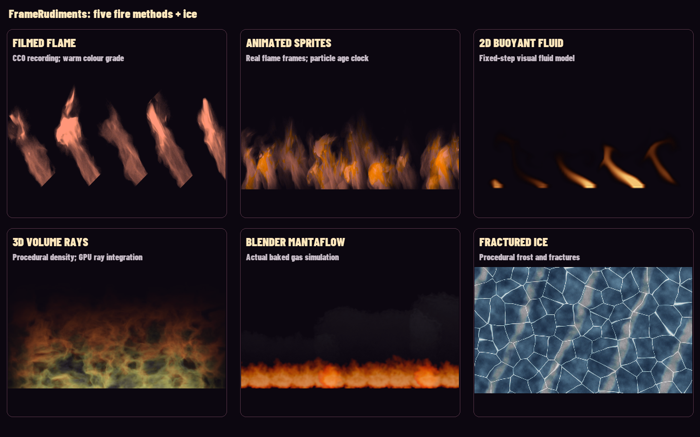
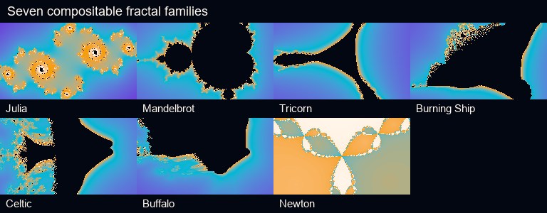
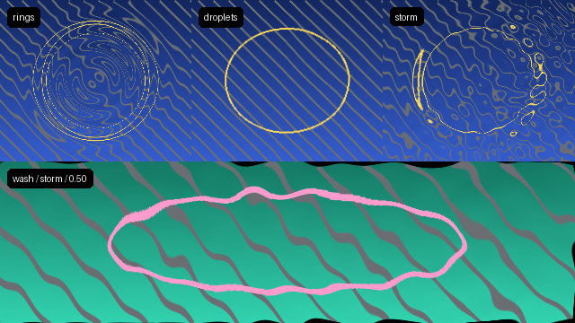
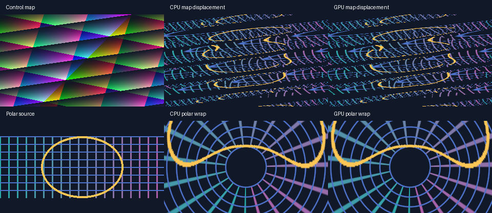
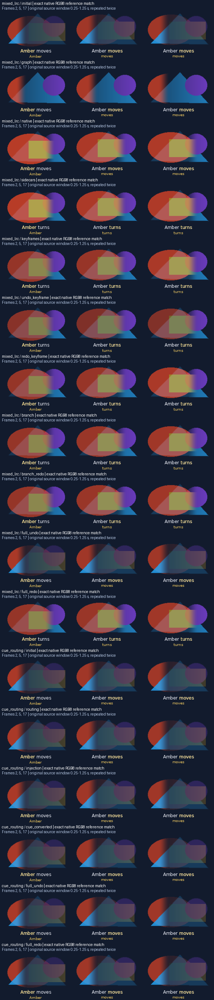
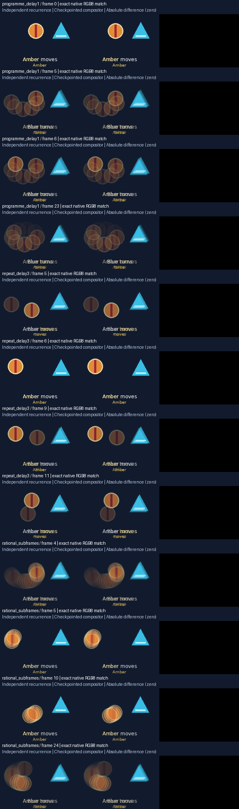
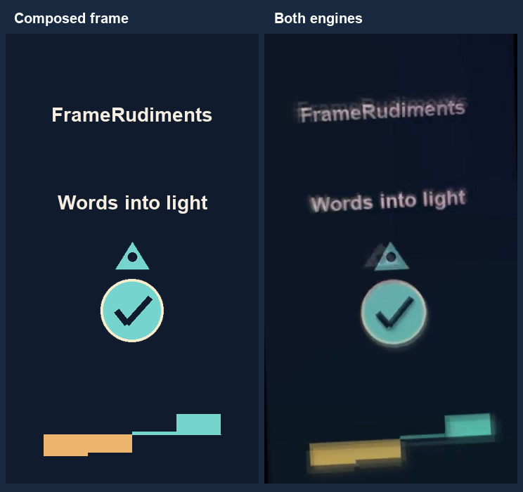

# FrameRudiments

**Beat-synchronised visualisation, compositing and video rendering — driven by real DanceRudiments motion and source-pinned StemLab timing.**

Experimental 0.4.36: [capture MIDI CC/pitchbend as finite source-clocked takes](docs/midi-controls-m15.md)
and replay through the ordinary compositor, alongside the released [OSC route](docs/osc-controls-m15.md).
Native MIDI capture uses an explicitly selected input on qualified Python 3.11/3.12 hosts;
ordinary rendering, including Python 3.13, opens no MIDI input or network socket.
[Actual 60 fps MIDI demonstration](https://kieransimkin.github.io/FrameRudiments/m15-5-midi/).

Create procedural music visuals, character composites, animated typography, particles, fractals, spatial effects and transitions. Preview the same render pipeline on the [CI-generated demo site](https://kieransimkin.github.io/FrameRudiments/).

[**Explore all visualisers**](https://kieransimkin.github.io/FrameRudiments/) · [**Interactive timeline viewer**](https://kieransimkin.github.io/FrameRudiments/timeline/) · [**Character ⇄ visualiser showcase**](https://kieransimkin.github.io/FrameRudiments/m11-5/) · [**Source**](https://github.com/kieransimkin/FrameRudiments) · [**Documentation**](docs/project-format.md)

[](https://github.com/kieransimkin/FrameRudiments/actions/workflows/visualisation-gallery.yml)
[](https://github.com/kieransimkin/FrameRudiments/actions/workflows/ci.yml)

[](https://kieransimkin.github.io/FrameRudiments/)

*Real FrameRudiments output: procedural natural materials. Explore the live CI-built catalogue for more renderers and playback examples.*

## Explore the demos

Every linked section is generated by the [gallery workflow](.github/workflows/visualisation-gallery.yml) from actual renderer outputs or explicitly labelled synthetic test fixtures. They are not marketing mock-ups.

| Watch / explore | What you'll find |
| --- | --- |
| **[Full visualiser atlas](https://kieransimkin.github.io/FrameRudiments/)** | Searchable built-in renderer gallery with multiple frame captures and native modulation examples. |
| **[Interactive timeline viewer](https://kieransimkin.github.io/FrameRudiments/timeline/)** | Play, scrub, zoom and inspect lyric/word/cue timing, layer blocks and keyframes in the real shared React timeline; entirely synthetic public audio, no native backend required. |
| **[OpenTimelineIO interchange](docs/timeline-interchange-m13.md)** | Download a source-pinned `.otio` companion from the live timeline, or import/export frame-exact EDLs with the optional M13 CLI. |
| **[GStreamer VFR and live-capture gallery](https://kieransimkin.github.io/FrameRudiments/m15-2/)** | Play a generated VFR clip; inspect actual decoded presentation timestamps, audio-sample reconciliation and scrub real synthetic GStreamer live frames. |
| **[OpenFX native filter showcase](https://kieransimkin.github.io/FrameRudiments/m15-3/)** | Actual OpenFX v1 C plugin output next to synthetic source frames, with independent pixel comparison and SHA-256 receipts. |
| **[OpenUSD scene and geometry AOVs](https://kieransimkin.github.io/FrameRudiments/m15-4/)** | Real animated USD scene import, camera and constant material, with rendered CPU depth/normal float32 EXRs and inspectable source hashes. |
| **[Kandi Boom ⇄ visualiser](https://kieransimkin.github.io/FrameRudiments/m11-5/)** | M11.5 side-by-side native dissolve, matte and spectral transitions; video, posters and cryptographic source receipts. |
| **[Sprites and neon displays](https://kieransimkin.github.io/FrameRudiments/sprites/)** | Image-backed and vector Rudiment displays, themed atlases and animated style comparisons. |
| **[Motion blur and quality](https://kieransimkin.github.io/FrameRudiments/quality/)** | Native shutter, edge antialiasing and directional motion effects. |
| **[Element / frame effects](https://kieransimkin.github.io/FrameRudiments/scopes/)** | Independent layer styling versus final composite grading. |
| **[Variable BPM and word lyrics](https://kieransimkin.github.io/FrameRudiments/timing/)** | Real compositor frames with independent word timing and variable-tempo clocks. |
| **[Particles and smoke](https://kieransimkin.github.io/FrameRudiments/particles/)** | Source-clocked emission and procedural smoke/particle scenes. |
| **[Rich lyric typography](https://kieransimkin.github.io/FrameRudiments/rich-lyrics/)** | Captions, word indicators, glow, bevel and motion. |
| **[Supersampling](https://kieransimkin.github.io/FrameRudiments/supersampling/)** | Before/after quality captures at native source resolution. |
| **[Visualiser feedback routing](https://kieransimkin.github.io/FrameRudiments/routing/)** | Clearly labelled simulations of which layers enter feedback and which stay clean. |

The M11.5 Kandi Boom comparisons use **authentic source-rendered character stills** from DanceRudiments, not a live rigged character inside FrameRudiments. Spectral values are synthetic display test data, not inferred from music. The [source and frame hashes](https://kieransimkin.github.io/FrameRudiments/m11-5/catalogue.json) make those distinctions auditable.

## The renderer in pictures

| Procedural fractals | Refractive rain and warps |
| --- | --- |
| [](docs/fractal-library.md) | [](docs/raindrop-ripples.md) |
| [**Fractal families**](docs/fractal-library.md) · [Video](docs/media/fractal-library-motion.mp4) | [**Raindrop refraction**](docs/raindrop-ripples.md) · [Video](docs/media/raindrop-ripples.mp4) |

| GPU spatial effects | Character / text authoring UI |
| --- | --- |
| [](docs/effect-graph-m8-9-gpu-spatial.md) | [](docs/authoring-workspace.md) |
| [**Spatial effects**](docs/effect-graph-m8-9-gpu-spatial.md) · [Video](docs/media/effect-graph-m8-9-map-polar.mp4) | [**Visual authoring workspace**](docs/authoring-workspace.md) |

| Feedback and sampling | Finished lyric / visualiser output |
| --- | --- |
| [](docs/feedback-history-m11-2.md) | [](docs/visualisers.md) |
| [**Checkpointed feedback**](docs/feedback-history-m11-2.md) | [**Butterchurn and projectM**](docs/visualisers.md) · [Video](docs/media/full-frame-demo.mp4) |

Screenshots above are real repository render/capture assets. Some show synthetic scenes; no analysis or artistic approval is implied by their appearance.

## Get started

Requires **Python 3.11+**, [FFmpeg/ffprobe](https://ffmpeg.org/) for encoded output, and a font file you have permission to use. GPU visualisers and shader runtimes are opt-in.

```bash
python -m pip install framerudiments

# Create a reproducible example project (prints the project JSON path):
framerudiments demo ./my-demo --font /path/to/your-font.ttf

# Inspect pinned inputs, render or explore the native clock:
framerudiments plan ./my-demo/project.json --output ./plan.json
framerudiments render ./my-demo/project.json --output ./render-output
```

For local development, clone the repository and `python -m pip install -e '.[dev]'`. Native CI uses [separate setup and qualification budgets](docs/ci-setup-budget.md). See [project format](docs/project-format.md), [compositing and effects](docs/effect-graph-design.md), [M11 video I/O](docs/video-io-m11-4.md) and the [implementation roadmap](docs/unified-effects-transitions-rendering-roadmap.md).

## Rendering architecture

**Pinned media and timing → DanceRudiments source-clocked motion → native FrameRudiments layers and effect graph → temporal effects / feedback → validated FFmpeg output.**

The renderer keeps source time and authored frame identity separate. It supports random-access native rendering, independently hash-checked dependencies, bounded resource use, exact rational video frame timing, and frame receipts. Optional Butterchurn/projectM effects are treated as stateful external runtimes with their own reconstruction constraints.

**[All documentation](docs/)** · **[Issue tracker](https://github.com/kieransimkin/FrameRudiments/issues)** · **[DanceFlow project](https://kieransimkin.co.uk/danceflow/)**

MIT licensed. Demo visuals are illustrative renderer evidence; third-party character and media assets retain their own rights and attribution.
