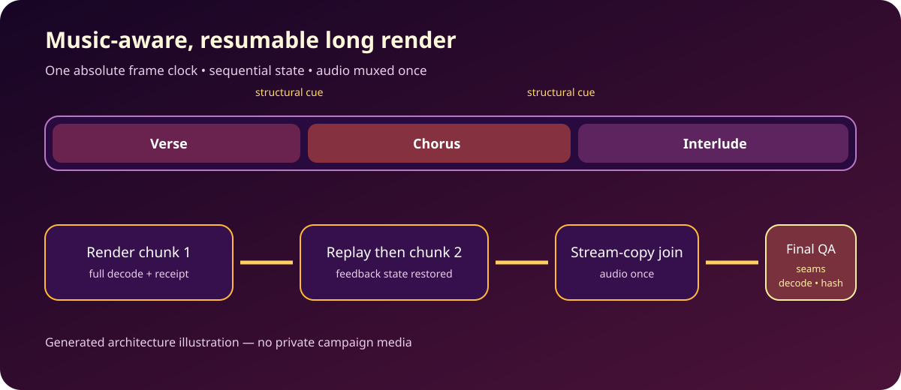
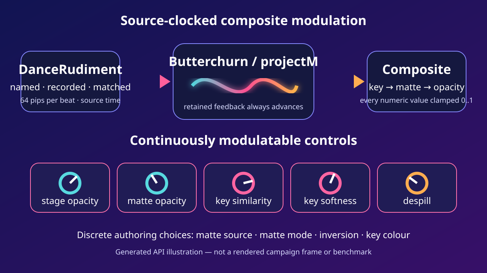
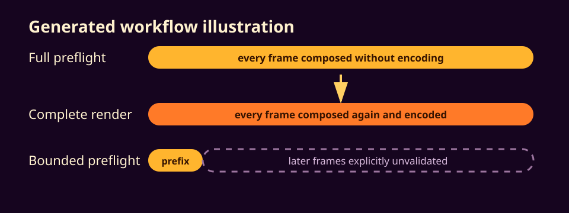
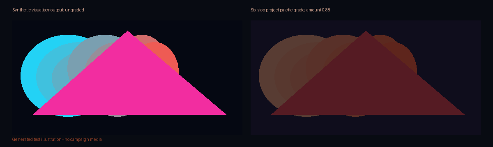

# FrameRudiments 0.4.36 — finite source-clocked MIDI controls

- Add opt-in MIDI 1.0 CC 0..119 and 14-bit pitchbend capture with explicit API,
  exact input name, native numeric endpoints and bounded queues/polls. Use only
  the existing media owner's source frames, source seconds and continuous beat.
- Close/delete the owned native input before freezing finite hash-pinned takes.
  Replay through ordinary projects, plan, preflight, render and input checks;
  preserve lease expiry, random seek and native fractional shutter clocks.
- Share finite numeric take validation, source pins, replay and atomic storage
  with the released OSC route, retaining its v1 schema and exact pinned bytes.
- Keep inspection metadata-only. Use optional official Python 3.11/3.12 RtMidi
  binaries for capture; reject unqualified 3.13+ native entry before import.
  Ordinary 3.13 replay has no MIDI dependency. A local 3.13 source build failed
  native import, so automatic source builds are not a supported capture route.
- Add required native JACK virtual-port qualification with an owned dummy
  server, Windows native binary/closed inspection and a full-decoded 60 fps
  demonstration. Physical controllers and cross-platform pixel parity remain
  separate acceptance, as do remaining M15.5 LAN and GPU-device phases.

# FrameRudiments 0.4.35 — bounded CI setup and source-clocked OSC takes

- Give native visualiser and software-EGL preview CI a bounded 50-minute
  package step within 75 minutes. Bound TERM-to-KILL cleanup and derive budget
  regressions from the actual installer. Keep native GPU/no-skip gates required.
- Add opt-in IPv4 loopback OSC int32/float32 capture through existing typed
  numeric graph targets. One owned bounded socket follows native encoded frame,
  source time and continuous beat positions and closes on context exit.
- Freeze finite takes after the final frame and receiver closure. Hash-pin
  network-free replay through ordinary projects, preflight, render and input
  checks. Validate source/clock/graph identity, release expired controls to their
  native base and preserve deterministic random access and temporal sampling.
- Add inspect/validate CLI, real UDP rejection/ownership tests, Windows/Linux
  qualification and an independently decoded native 60 fps demonstration.

M15.5 remains in progress. MIDI, bundles/timetags, authenticated LAN transport,
NDI/Spout/Syphon, Vulkan/WebGPU hardware and perceptual quality retain separate
acceptance gates, as do the existing M9–M15 additions.

# FrameRudiments 0.4.34 — qualify the current upgrade source

- Restore preview qualification on the shipping cancellable native renderer.
  Injected service/allocation pressure and GPU observations now exercise that
  entry point. A bounded, explicitly injected post-render barrier makes the
  obsolete-result case reproducible without racing native execution.
- Correct the OpenUSD native version gate to compare its actual three-part
  `(0, year, month)` API version. Preserve the required native dependency and
  EXR checks.
- Use an exactly sample-aligned 16 kHz audio fixture for the 60 fps OTIO
  roundtrip, and verify its 53,600-sample duration. Fractional source-frame
  durations still fail admission.
- Replace a superseded single-sample vision test with an actual deterministic
  compositor check for the temporal sampling supported by the current source.
- Remove an unused test import which blocked the full platform CI matrices.
- Route the complete visualiser suites to their GLX host while retaining the
  separate ONNX CPU and physical-provider qualification lanes and no-skip gates.
- Cancel superseded pull-request qualification runs without cancelling main
  or release validation, so obsolete revisions do not occupy runner capacity.
- Preserve context-free legacy graph calls while requiring an explicit frame
  context for opt-in vision inputs. Exercise the required native CPU libraries
  in both PR and release lanes, align their qualified GPU boundaries, and use
  the maintained temporary-directory runner. Retain safe feedback-state
  traceback checks across Python's mapping implementations.

The following M9–M15 source additions remain subject to their documented native,
device, licence and perceptual acceptance boundaries. This release does not
assert physical AMD/Intel, capture-device, RTSP or third-party plugin acceptance.

# FrameRudiments M11.3 native temporal effects candidate

- Add opt-in `post_effects.temporal_fx` with deterministic rational time remap,
  bounded motion echoes, observed native-frame directional blur and x/y slit scan.
  Effects read deduplicated M11.1 schedules; source-bound cycles and requested
  frame clocks stay exact, with no synthetic optical-flow or hidden GPU fallbacks.
- Add native DanceRudiment strength modulation, exact plans/contracts, per-frame
  evidence and preview temporal reach for cache invalidation. A bounded native
  stage feeds into the existing M11.2 checkpointed feedback recurrence.
- Retain a pre-AA RGB8 result, finish once, preserve target metadata and roll
  back on failure/cancellation. Validate fan-out and feedback replay budgets
  before expensive rasterisation. Existing projects stay on the original path.
- Add isolated and real-compositor tests and document exact-clock/resource
  limits in [M11.3 temporal FX](docs/temporal-fx-m11-3.md). New code requires
  exact-head CI, distribution smoke and device/perceptual acceptance separately.

# FrameRudiments M11.2 feedback history candidate (unreleased)

- Add opt-in `post_effects.feedback` with an explicit positive encoded-frame
  delay, linear-light mix and exact repeat/programme reset policy. Native
  DanceRudiments may modulate the mix. Feedback advances after source subframe
  integration and historical shutter processing, before external engines and
  final output antialiasing; clocks, source pins and same-frame DAG rules stay
  authoritative.
- Retain a bounded immutable history ring and complete checkpoints. A request
  reconstructs from an eligible live state, checkpoint or exact reset; cancelled
  or failed requests preserve the prior committed state. Enforce checkpoint
  count, replay work and owned pixel-payload limits before accepting work.
- Bind checkpoint reuse to source content at its document role, clocks, quality,
  implementation, runtime and actual backend. Trusted cross-instance restore
  requires the expected checkpoint digest. Checkpoints contain native RGB8
  history, with no disk import format or opaque external-engine/GPU state.
- Expose native feedback contract, reconstruction plan, state snapshot,
  checkpoint and restore APIs. Extend `plan` and read-only `inspect-temporal`
  reports while preserving the separate native source-sampling plan.
- Add authored-Q5 adaptive preview reconstruction, content-free progress,
  cooperative cancellation, pause/resume checkpoint retention and exact
  repeat-aware dependency closures. Butterchurn/projectM retain S6 independent
  prefix verification; native checkpoints do not qualify external engine state.
- Add independent native recurrence and equivalent-encode fixtures, real
  checkpoint work measurements, retained media, Windows/Linux CI qualification
  and source-package admission. See [the M11.2 guide](docs/feedback-history-m11-2.md).
- Repair the inherited quality-gallery synthetic clock fixture to provide the
  explicit sample bounds required by M11.1's exact shutter planning. Regression
  checks cover gallery presets and repeat resets without weakening native clocks.
  Candidate CI, physical-GPU, browser and perceptual acceptance remain separate;
  M11.3 motion echoes, directional blur, slit-scan and time-remapping follow next.

# FrameRudiments M11.1 temporal scheduling candidate (unreleased)

- Declare exact signed temporal offsets and sample grids with immutable frame
  references. Validate explicit programme/repeat boundary policies, complete
  dependency graphs, cycles and bounded task/edge/live-result counts before
  callbacks. Canonical dependency order preserves ordered repeated input ports
  and evaluates shared sources once per invocation.
- Execute the production native compositor through the declared subframe,
  supersample, history-shutter and final-output stages. Retain native source
  clocks, motion, recording, text, routing and final-quality semantics. Release
  scheduler-owned transient results on completion and failure.
- Correct the historical shutter at short repeated excerpts: exact half-open
  repeat identity excludes a prior whole cycle even when its wrapped source
  timestamp equals the current timestamp.
- Add `Compositor.temporal_plan`, `temporal_contract` and bounded detached
  `sample_frames` results. Add read-only `inspect-temporal` CLI output, native
  contract metadata in `plan`, and last-executed schedule evidence. A schedule
  digest identifies dependencies and order; it is not a source/pixel cache key.
- Derive conservative preview invalidation reach from native history and
  forward subframe sampling. Add independent rational/native pixel fixtures,
  shuffled requests, actual CLI preflight/render and reference-encoded pixel
  comparisons to the existing Windows/Linux CI and source-package checks.
- Repair the inherited archive-admission fixture's Windows separator handling:
  expected names now use the stored ZIP entry metadata, preserving the strict
  unsafe-entry rejection and no-write assertions on every platform.
- See [the M11.1 guide](docs/temporal-scheduling-m11-1.md). M11.2 adds delayed
  feedback, checkpoints and random-access reconstruction above. Candidate CI,
  external-engine, physical-GPU and perceptual acceptance remain distinct.

# FrameRudiments M10.5 round-trip candidate (unreleased)

- Share complete immutable history and export modules between the authoring UI
  and fixture qualification. Retain 100 undo operations, preserve redo for equal
  edits, detach accepted proposals from caller aliases and restore every project,
  sidecar, dirty-flag and cue-format value on navigation.
- Use a fresh history identity for real edits, undo and redo. Fence graph checks,
  native proposals, graph gestures, one-shot previews, asynchronous preset loads
  and exports against that revision, including undo followed by redo to the same
  stored snapshot. Retire the revision during layout cleanup on unmount.
- Settle accepted no-op native proposals without leaving the inspector busy or
  manufacturing an undo entry. Unchanged timing gestures do not mark sidecars dirty.
- Capture all export inputs before asynchronous hashing. Preserve complete valid
  JSON, reject values that serialization would omit or alter, retain sidecar ref
  metadata, and choose deterministic filenames that avoid known pinned inputs.
  Reject source conflicts with required bundle entries. Keep CD CUE conversion
  explicit and write valid fixed 1980-01-01 ZIP dates.
- Add a checked-in fixture with independent expected states, real native HTTP
  proposals, complete undo/redo and branch exports, fresh native session reopens,
  pixel comparisons and CLI plan/preflight/render qualification. Check ZIP paths,
  records, CRCs, bounds and source immutability before extracting fixture bundles.
- Extend authoring CI and source-package checks. Browser paint/layout, physical
  GPU acceptance and exact-candidate CI remain distinct from local qualification.
  See [the M10.5 guide](docs/authoring-roundtrip-m10-5.md). Its successor is the
  M11.1 temporal dependency and deterministic scheduling candidate above.

# FrameRudiments M10.4 preview candidate (unreleased)

- Compare a selected native transition or expanded chain stage as From, Result
  and To at the same output frame, using the ordinary native compositor.
- Add Fast / Authored preview quality and exact preview-frame controls. Preserve
  native clocks, motion bindings and temporal post-effect history; authored
  quality retains spatial and temporal sampling. Preview controls do not edit
  the project or seek the shared timeline's audio transport.
- Share one active request plus one replaceable pending cursor across normal
  and transition previews. Invalidate superseded output immediately, verify
  response identity and PNGs, and publish comparison images only after every
  image decodes. Cancellation, explicit retry and owned image cleanup are bounded.
- Validate the entire native draft and retain pinned inputs. Bound one-shot
  frames to 8,388,608 pixels, each PNG to 24 MiB and transition JSON to 64 MiB;
  oversized requests report a fixed error without silently resizing pixels.
- Qualify actual HTTP/TypeScript previews against independent native rendering:
  thirteen cases, 312 transition images and two normal previews, including
  authored quality, repeated seeks, source clocks, motion, cues and chain stages.
  A 202-intent scrub sequence renders only its first and final requests and
  presents only the final result. Extend authoring CI and package qualification.
- Fix an inherited HTTP test-fixture race by waiting for that request's handler
  cleanup before asserting capacity. Production semaphore behavior is unchanged.
  Browser paint/layout, exact-candidate CI and production visual acceptance need
  their own observed evidence. See [the M10.4 guide](docs/authoring-preview-m10-4.md).

# FrameRudiments M10.3 authoring candidate (unreleased)

- Generate parameter forms from native metadata for all fourteen graph kinds,
  with existing palette/band, vector/colour, timing and chain component paths.
- Add native motion binding forms for released named motions and existing
  pinned sources, including categorical choices and ordered relative controls.
- Validate one immutable native proposal before adding one undo entry; fence
  asynchronous responses to the entire draft/sidecar snapshot and selected target.
- Preserve source clocks, pins, graph topology and shader authority. Validate
  actual HTTP/TypeScript ZIP exports against independent native renders in
  22 synthetic cases / 88 byte-exact RGB8 frame comparisons.
- Extend authoring CI and source-package qualification. Exact-candidate CI and
  browser interaction require their own observed results. See
  [the M10.3 guide](docs/authoring-controls-m10-3.md).
- Correct the inherited GPU-isolation test's obsolete direct-pytest assertion,
  and rehash pinned inputs on Windows preview reuse where creation-time/last-
  write metadata can miss a same-length rewrite. The Windows fallback adds disk
  I/O; POSIX retains its existing metadata fast path.

# FrameRudiments M10.1 authoring candidate (unreleased)

- Introduce a topologically arranged executable `effect_graph` canvas in the
  shared React timeline workspace, with named input/output RGBA8 ports and
  selectable node inspector. The existing renderer preview remains available.
- Allow explicit opt-in graph initialisation, immutable insertion of copy,
  opacity and blur templates, bounded numeric editing and safe output/removal.
- Preserve source audio, DanceRudiment clocks, pinned assets, original graph
  configuration and undo/redo/export semantics. Wire editing remains M10.2.
- Test forked port layout, cycle/dangling-edge rejection, property limits and
  preservation of unrelated project fields in browser-independent Node tests.
- Keep the EGL-only M9.5 golden test out of CPU-only CI matrix jobs; it remains
  mandatory in the dedicated GPU acceptance job.

# FrameRudiments M9.5 development candidate (unreleased)

- Add five pinned, deterministic shader-reference PNGs with explicit progress,
  source pixels, time, frame index, pass-chain and SHA-256 provenance.
- Require actual EGL shader output to match every approved RGBA8 golden byte;
  keep host references explicitly distinct from GPU capture evidence.
- Add a GPU qualification command that records the real renderer, GL version,
  source pins, transfer totals and exact pixel hashes without rewriting goldens.
- Include the reviewed shader fixtures in source distributions and run M9.5
  tests in the existing CPU and mandatory GPU CI matrices. Hardware-vendor
  checks and exact-head CI acceptance remain separate gates.

# FrameRudiments M9.4 development candidate (unreleased)

- Admit only a bounded straight-line `transition(vec2)` GLSL 3.30 subset after
  SHA-256 verification and explicit `trusted_shader: true` review opt-in.
- Reject preprocessor includes, loops, extra functions, extra samplers or image
  resources, direct texture fetches, atomics, resource writes and unknown calls
  before shader compilation. Cap per-pass lexical and expression complexity.
- Scrub comments and remove validated host-uniform declarations safely; retain
  original byte hashes. No claims of GPU execution isolation or time limits.
- Add dedicated CPU security regressions and mandatory EGL compilation and
  rejection cases. Correct M9.3 two-pass RGBA8 alpha golden (222 after rounding).
- Require exact-head CI and cross-vendor review before release acceptance.

# FrameRudiments M9.3 development candidate (unreleased)

- Add explicitly bounded 1–4-pass GL Transitions chains. All shaders require
  verified local SHA-256 pins and share the native progress/time uniforms.
- Two input uploads and one final readback regardless of pass count. Preflight
  pixel payload bytes and the GPU budget before texture allocation.
- Include pass counts in backend planning and transport receipts, register every
  pass source in the project input ledger and bound cached external programs.
- Add focused CPU and real-EGL tests; acceptance requires exact-head CI.
- Repair Windows CI FFmpeg fetch by pinning an existing 8.1 release asset
  and the published SHA-256 digest from its GitHub release metadata.

# Unreleased — M9.2 candidate (not a published release)

- Add a SHA-256-pinned, trusted-only GL Transitions graph style,
  native progress/time bindings and single-pass ModernGL RGBA8 execution.
- Document the GL transition host uniforms, limits, no-fallback behaviour
  and synthetic test fixture; full CI and hardware acceptance remain pending.

# FrameRudiments 0.4.33

- Add `inspect-isf` for local ISF 2 fragments. It reports ordered typed
  controls, supported generator/filter/transition declarations and exact
  source SHA-256, with an optional expected hash.
- Accept a bounded single-pass metadata subset without shader compilation,
  texture imports or an OpenGL context. Document the accepted fields, the
  included tint fixture and the next execution gates.

# FrameRudiments 0.4.32

- Add one portable M8.9 qualification command for renderer identity, CPU/GPU
  spatial warp parity, driver memory scope and bit-identical target reuse.
- On drivers without the optional precision shader extension, verify that
  strict GPU rejects the affected settings before upload and that automatic
  mode produces the CPU reference bytes. Required Mesa/EGL CI covers both
  extension states. Physical AMD and Intel results remain separate.

# FrameRudiments 0.4.31

- Use one effect-graph GPU backend for a project and its temporal subframes.
  Closing the project releases the shared pool. The composition report labels
  last-subframe dispatch and transfers with both sample and encoded rates.
- Exercise native supersampling, CPU/GPU parity, seeking, reuse and cleanup
  in the required Mesa/EGL test suite.

# FrameRudiments 0.4.30

- Reuse resident RGBA8 render targets between evaluations on owned OpenGL
  contexts. Retain at most eight targets of one size and 64 MiB by default;
  count additional idle targets against the next GPU plan. Set
  `max_pooled_target_bytes=0` to disable retention.
- Read optional driver memory hints from supported NVIDIA and ATI OpenGL
  extensions. The driver readings and the graph's texture payload budget
  describe different scopes.
- Compare exact frame bytes and target allocation counts with and without
  pooling in the [GPU resource benchmark](docs/effect-graph-m8-9-gpu-resources.md).

# FrameRudiments 0.4.29

- Render wave and turbulence down to a one-pixel wavelength and up to 4096
  pixels of displacement per axis. Map displacement supports the same
  amplitude range, and radial pinch and bulge use the full `warp_amount` range.
- Support all four polar-wrap borders and preserve the side of a discontinuous
  seam. Tight polar wraps and extreme raindrop settings use a precision shader
  on drivers advertising `GL_ARB_gpu_shader5`. Automatic mode uses the CPU
  reference for those settings on other drivers.
- Check the new limits on the resident and per-node routes, with a required
  Mesa/EGL stress benchmark and a
  [60 fps CPU/GPU seam comparison](docs/effect-graph-m8-9-gpu-spatial.md#full-range-warps).

# FrameRudiments 0.4.28

- Run the rings, droplets and storm raindrop layer warps on OpenGL 3.3 with
  transparent, clamp, repeat and mirror sampling. Both backends use the same
  seeded drop locations and frame timing.
- Keep original alpha aligned with the warped pixels. A standalone resident
  ripple graph makes one source upload and one final readback per frame.
- Use the CPU reference in `auto` for settings outside the GPU precision range.
  The separate wash-away transition runs on the CPU.
- Watch the [three variants side by side at 60 fps](docs/effect-graph-m8-9-gpu-spatial.md#raindrop-ripples)
  and reproduce the HD parity benchmark.

# FrameRudiments 0.4.27

- Run RGBA-map displacement on GPU with all four borders and alpha-weighted
  channel selection, including luminance. A direct source map stays resident.
  A map computed by another node can use the GPU bridge, including an exact
  identity when the map is entirely transparent.
- Run polar wrap on GPU for repeat-border projects, with fractional centres
  and consistent sampling through the angular seam.
- Verify both modes on NVIDIA and through the required Mesa/EGL HD benchmark.
  See the [60 fps map and polar comparison](docs/effect-graph-m8-9-gpu-spatial.md#map-displacement-and-polar-wrap).

# FrameRudiments 0.4.26

- Accelerate wave, turbulence, swirl, radial, mirror, kaleidoscope
  and polar unwrap in OpenGL 3.3, including all four spatial border modes.
- Carry warped original alpha through device-resident forks and into
  host-side mattes and styles. Report the separate transfers when a mixed graph
  needs a host copy of the warped silhouette.
- Keep extreme wave and turbulence parameters and negative radial amounts on the
  CPU reference in `auto`, with a precision-limit rejection in strict GPU mode.
- Include required GPU parity and a [60 fps CPU/GPU comparison](docs/effect-graph-m8-9-gpu-spatial.md).

# FrameRudiments 0.4.25

- Keep prepared plans tied to canonical input paths and checksums when a
  chunked render stages its inputs. Include dependencies registered by the
  compositor in the retained plan.
- Verify newly prepared plans after cache relocation, preserve same-cache
  resume for older plans and reject changed inputs.

# FrameRudiments 0.4.24

- Fix accumulated concat timestamp rounding in stream-copied chunk assemblies.
  Round PTS and DTS independently to the authored frame grid and retain exact
  packet duration without re-encoding pictures or stretching audio.
- Exercise real B-frame H.264/AAC assemblies at 24, 30 and 60 fps, including
  exact native verification and every decoded picture's identity.
- Retain the existing fail-closed frame contract, candidate health and review
  gates. See the measured synthetic timing comparison in the chunk guide.

# FrameRudiments 0.4.23

- Add per-stage visualiser feedback processing scale with full-resolution hooks,
  compositing and clean overlays.

# FrameRudiments 0.4.22

- Register built-in and trusted custom rudiment renderer source through the
  standard pinned input contract. Work-cache staging has both the expected
  checksum and byte count before the first frame.
- Include both cache regressions and a synthetic screenshot and clip.

# FrameRudiments 0.4.21

- Partition mixed effect DAGs into conservative GPU-resident islands around
  unsupported CPU nodes, with exact boundary uploads/readbacks and per-island
  node, draw, allocation and payload telemetry.
- Preserve universal original-alpha semantics by splitting at lineage resets;
  ambiguous multi-exit regions retain the established bridge/CPU route and
  report a machine-readable rejection reason.
- Add a bounded confidence-weighted GPU chroma edge-decontamination pipeline,
  using retained foreground neighbours rather than relabelling feather or
  despill. Radius 0.5–12 is GPU eligible; larger valid CPU radii remain explicit
  auto fallbacks and strict-GPU rejections.
- Exercise real-driver parity on Windows' native NVIDIA standalone context and
  the mandatory Linux Mesa/EGL CI route, including mixed-island transfer counts.
- Include an [actual CPU/GPU comparison](docs/media/effect-graph-m8-8-decontamination.png)
  and retained telemetry generated by the documented integration script. A
  video is omitted because the feature changes execution residency and static
  key-edge reconstruction, not time-varying image behaviour.

# FrameRudiments 0.4.20

- Add `raindrop_ripples`, a deterministic refractive spatial warp with three
  related visual models: travelling rings, bounded droplet lenses and seeded
  multi-source storm interference.
- Add the geometric `wash` transition, which reuses the same ripple field to
  refract both clips around a deterministic advancing reveal boundary while
  preserving exact start and end frames.
- Keep every variant random-access and tile-stable so chunk replay, resume and
  distributed frame evaluation do not require mutable fluid-simulation state.
- Expose native effect-graph controls for variant, seed, wavelength, radius,
  phase, amplitude, source count, centre, border handling and mix. Alpha follows
  the same inverse warp as colour.
- Include an [actual three-variant contact sheet](docs/media/raindrop-ripples.png)
  and [silent two-second wash demonstration](docs/media/raindrop-ripples.mp4),
  with an [accessible description](docs/media/raindrop-ripples-transcript.md)
  and a reproducible media generator.

# FrameRudiments 0.4.18

- Expand `procedural_field` from Julia alone to seven deterministic families:
  Julia, Mandelbrot/Multibrot, Tricorn, Burning Ship, Celtic, Buffalo and
  Newton basins. All remain ordinary compositable RGBA/matte/vector sources.
- Add public `escape_time_field()` and `newton_fractal_field()` scalar APIs while
  preserving `julia_escape_field()` and every 0.4.17 Julia control.
- Give the new escape-time and Newton parameters native effect-graph descriptors,
  validation, work budgets and DanceRudiments modulation. Phase and rotation
  use the canonical finite `[-1,1]` range for one exact `2*pi` period with
  byte-identical endpoints.
- Reuse the shared two-to-sixteen-stop palette, colour-space, interpolation,
  coverage and output pipeline across every family.
- Move Windows pytest runs to a probed, unique owned Local AppData root and
  clean each exact run; this avoids stale shared-temp and workspace ACL failure
  cascades. Local work now runs focused tests, while exact-head GitHub CI owns
  the complete CPU/platform/GPU matrices.
- Normalize repository text to LF in Git and explicitly mark media/archive
  formats binary, preventing Windows CR/LF conversion from invalidating
  source-byte hashes.
- Include an [actual seven-family compositor contact sheet](docs/media/fractal-library.png)
  and [silent two-second native-motion loop](docs/media/fractal-library-motion.mp4),
  with an [accessible description](docs/media/fractal-library-motion-transcript.md)
  and retained generation evidence.

# FrameRudiments 0.4.17

- Add a deterministic Julia-set generator to the shared `procedural_field`
  effect-graph source, so fractals can feed ordinary visible composition,
  mattes, transitions, textures and displacement without a private renderer.
- Support the existing stable multi-stop gradient pipeline with two to sixteen
  colour stops, selectable interpolation and output modes.
- Expose the Julia constant, orbit radius, zoom, rotation, iteration count,
  escape radius and power to native DanceRudiments effect-graph controls.
  Recorded samples remain in the canonical finite `[-1,1]` range; Julia phase
  and rotation map that range onto one exact `2*pi` period with joined endpoints.
- Publish public scalar helpers for normalized turns, Julia constants and
  deterministic smooth escape fields, plus focused and full-project regressions.
- Keep CPU release testing aligned with the expanded GPU suite. Real GPU parity,
  transport, kernels and resident spectral/matte tests continue in the required
  no-skip EGL workflow instead of being accidentally collected by a CPU-only
  release build. Windows CI downloads a checksum-pinned immutable FFmpeg build
  that provides both `ffmpeg` and `ffprobe`, instead of depending on
  Chocolatey's unavailable community feed or a rolling package resolver.
- Include an [actual native-motion compositor contact sheet](docs/media/julia-fractal-composite.png)
  and [silent two-second loop](docs/media/julia-fractal-motion.mp4), with an
  [accessible description](docs/media/julia-fractal-motion-transcript.md).

# FrameRudiments 0.4.16

- Rename the ambiguous spectral colour-conversion `l` variable to `l_channel`.
  This resolves Ruff E741 without changing the numerical conversion.
- The immutable 0.4.15 tag remains preserved. Its package publication was
  blocked by lint; 0.4.16 reruns the required full CI, packaging and installed-wheel
  encoding gates before GitHub/PyPI publication.
- Real GPU parity tests now run in the existing EGL-qualified workflow as a
  required part of CI and release validation. CPU/font/FFmpeg matrices select
  the remaining complete suite; both CPU and GPU routes reject skipped tests.
- Existing [actual underlay frames and video](docs/visualisers.md#isolated-underlay)
  remain the relevant media; the identifier-only repair adds no visual behaviour.

# FrameRudiments 0.4.15

- Visualiser stages accept `composite.underlay.source`, a named isolated RGBA
  compositor surface beneath their processed output.
- Layer providers stay out of the clean composition; alpha order, hidden-source
  fallback, shape/mode validation and unknown-source rejection are covered by
  regressions. Existing stage configurations retain their previous behaviour.
- [Actual synthetic frames and video](docs/visualisers.md#isolated-underlay)
  demonstrate shrinking/rotating/fading output revealing a persistent underlay.

# FrameRudiments 0.4.14

- Preflight and render now write an atomic `render-progress.json` and flush a
  human-readable stderr heartbeat every 10 seconds by default.
- A dedicated heartbeat thread reports liveness even while one expensive frame
  is still composing. Status spans single-pass rendering, chunk replay and
  encoding, assembly, verification and final manifest work.
- The status schema retains current/finalized frame counts, elapsed time,
  observed per-frame cost and a provisional ETA. `--progress-seconds` changes
  the bounded cadence without mixing heartbeat text into final stdout JSON.
- Focused regression coverage verifies timed updates with an unchanged active
  frame, durable failure state and final progress state for single-pass,
  bounded-preflight and resumed chunked integration routes.
- Optional `--work-cache`/`FRAMERUDIMENTS_WORK_CACHE` staging now moves all
  checksum-pinned inputs and high-I/O render artifacts to a selected fast
  workspace, while `--reserve-gib` physically reserves the complete declared
  peak plus 2% at both cache and final locations.
- A final output appears only after cached technical QA, complete staging-tree
  hash/size comparison and final-directory promotion. Successful jobs remove
  their cache; interrupted jobs retain recovery evidence but release reservations.
- `cache-status --expect-empty` provides a bounded, non-recursive periodic cache
  health check. Portable guidance recommends a separate physical device without
  embedding any deployment-specific drive letters.

Generated explanatory diagram. The feature is a file/terminal evidence contract;
timed tests provide the useful demonstration without manufacturing a UI capture.

# FrameRudiments 0.4.13

- The projectM extra now installs NumPy explicitly, matching PyOpenGL's array
  handler and preventing the misleading `No numpy module present` warning in
  minimal release-local projectM runtimes.
- This dependency correction does not change current render pixels or permit a
  live frozen runtime to be mutated underneath an active render.

Generated explanatory diagram; dependency verification is covered by the
package-metadata test and the release pipeline rather than a UI screenshot or
video.

# FrameRudiments 0.4.12

- Render failures now retain structured exception type, module, nonempty
  message, representation, causal chain and traceback evidence. A bare
  `MemoryError()` is explicitly identified instead of becoming a blank error.
- Every render directory receives `candidate-health.json`. In-progress,
  interrupted and unverified MP4s are machine-labelled as unapproved and
  blocked from review/publication; attended review becomes eligible only after
  the existing technical QA passes.
- Setup failures before frame rendering now use the same fail-closed evidence
  path. If memory or storage exhaustion also prevents evidence output, the
  original exception remains authoritative and a missing health file stays a
  closed gate.
- Resumes archive the prior health record, preserve valid finalized chunks, and
  replace the current gate only after full decode, seam and final-output checks.
- Isolated RGBA elements now alpha-composite only their nontransparent bounds,
  avoiding needless full-frame temporary allocation while retaining exact
  pixel output.
- Regression coverage exercises blank memory errors, causal chains, setup
  failures, candidate inventory/gating, pixel equality and interrupted/resumed
  integration output.

Generated explanatory diagram; the executable demonstration uses synthetic
media and no private campaign material.

# FrameRudiments 0.4.11

- Visualiser composites can now drive stage opacity, matte opacity, chroma-key
  similarity, key-edge smoothness and despill from named or recorded
  DanceRudiments on the authoritative source clock.
- Every driver stays inside an explicit 0..1 range, supports the existing
  transfer curves, smoothing and combine modes, and records native motion
  provenance plus its final evaluated value in render evidence.
- Butterchurn/projectM feedback keeps advancing when a modulated stage becomes
  faint, so fading a keyed or matted result does not reset its retained state.
- Focused regression coverage exercises every continuous composite parameter,
  rejects missing or duplicate evidence IDs and preserves the existing
  post-stage compositing order.
- The maintained PowerShell test wrapper now gives every pytest invocation a
  unique project-local base temp and removes it immediately in `finally`, so
  successful and failed runs cannot silently accumulate generated fixtures.

Generated explanatory diagram; no private campaign media.

# FrameRudiments 0.4.10

- Projects longer than 30 seconds now render as finalized sequential chunks by
  default, with boundaries preferring nearby pinned structural cues.
- Resume verifies a contiguous immutable receipt prefix, replays every retained
  frame from zero to restore temporal and feedback state, and encodes only the
  missing suffix.
- The canonical audio is muxed once after stream-copy video concatenation.
  Every chunk and the final MP4 receive exact frame/CFR and full-decode checks;
  decoded seam hashes detect dropped, duplicated or altered join frames.
- Disk-space guards run before each chunk and final assembly, leaving completed
  chunks safely resumable instead of producing an unapproved truncated MP4.
- CLI controls include `--chunked`, `--single-pass`, `--chunk-seconds`,
  `--resume` and `--min-free-gib`.

Generated explanatory diagram; synthetic integration tests contain no private
campaign material.

# FrameRudiments 0.4.9

- Named visualiser matte providers remain available as isolated RGBA data but
  no longer paint their black/white mask artwork into the clean composition.
- A compositor regression test compares the corrected frame with the same
  scene rendered without its provider layer, while confirming that the effect
  chain still receives the provider pixels.
- The existing retained-feedback screenshot in `docs/visualisers.md` remains
  the relevant visual evidence; this patch corrects provider visibility rather
  than changing the demonstrated visualiser output contract.

# FrameRudiments 0.4.8

- Butterchurn and projectM stages now support deterministic post-stage chroma
  keying, edge smoothing and bounded despill.
- The complete VisualStyle effect set can run on a stage's source input,
  retained feedback state, or display output. Retained-feedback treatments are
  written back through Butterchurn's pinned target framebuffer and projectM's
  pinned 4.2 texture-burn API before the next frame.
- A stage can use any named isolated compositor element as an alpha or
  luminance track matte, with inversion and independent matte/stage opacity.
- Keying and matting compose in a documented order over the image that entered
  each stage; later engines receive the already contained result while clean
  routed text remains above the final chain.
- Focused pixel tests cover hard/soft keys, combined key-plus-matte output,
  luminance/alpha multiplication and two-engine stage order.
- Pinned real-engine smoke evidence is included at
  `docs/media/visualiser-feedback-writeback.png`, with source hashes in the
  adjacent JSON receipt.

# FrameRudiments 0.4.7

- `preflight --max-frames N` composes a declared sequential prefix for expensive
  long projects instead of forcing a complete unencoded pass before rendering.
- The manifest records full versus bounded scope, frames rendered, total frames,
  sequential-state behaviour and the explicit later-frame validation limit.
- The final rendered file still receives complete decode, CFR, frame-count,
  audio and encoded-checkpoint verification; bounded preflight does not weaken
  or relabel final technical QA.
- Focused regression coverage preserves default full-preflight behaviour, exact
  prefix boundaries, final-prefix QA capture and fail-closed limits.
- Wrapped-word layout coverage now follows visual reading order across current
  Pillow text metrics instead of assuming every word remains on one row.

Generated explanatory diagram; not a benchmark or rendered campaign frame.

# FrameRudiments 0.4.6

- Encoding now accepts the complete named libx264 preset range: `ultrafast`,
  `superfast`, `veryfast`, `faster`, `fast`, `medium`, `slow`, `slower`,
  `veryslow` and `placebo`.
- Focused regression coverage verifies every accepted preset reaches the exact
  FFmpeg command and that unknown values still fail closed.
- Linux CI, gallery and release jobs now pin Ubuntu 24.04 so runner-image
  migrations cannot silently change the release environment mid-validation.
- Linux render dependencies use one shared installer with bounded timeouts and
  retries, preventing a stalled package mirror from hanging a release forever.
- Preset strength remains separate from composition resolution, visualiser
  mesh density, frame rate and source sampling. Existing public demonstration
  media therefore remains applicable; no new visual was generated for this
  command-validation-only change.

# FrameRudiments 0.4.5

- Word indicators can now travel between encoded word hits with a configurable
  arc and land on the next word's authoritative frame, while retaining the
  existing after-hit mode.
- projectM stages accept source-time preset timelines and perform bounded soft
  transitions on the existing feedback instance, with every switch recorded in
  render evidence.
- Lyric layers can feed the visualiser only during their final bounded pips when
  a real blank gap follows, allowing the departing line to dissolve into the
  background without contaminating immediate line-to-line changes.
- Project-format and visualiser documentation describe the new contracts;
  focused regression coverage preserves clock, preset trust, routing and
  evidence behaviour. Private campaign artwork and audio remain outside the
  distribution.

## High-detail, palette-controlled visualiser output

- Butterchurn stages accept bounded `mesh_width` and `mesh_height` values. The
  existing 64×48 mesh remains the default; projects can request additional
  spatial detail without changing their encoded dimensions or frame rate.
- Any Butterchurn or projectM stage can apply `output_palette_grade` after the
  engine output and before the next stage or clean routing overlay. Two to
  sixteen ordered CSS colours define a deterministic luminance palette; alpha,
  PCM, feedback state and the source clock remain unchanged.
- The exact mesh and grade configuration is retained in plan and manifest
  evidence. Focused validation covers schema bounds, deterministic pixels,
  alpha preservation, stage order and routed overlays.

Generated test illustration; no private campaign media. A video is omitted
because this stateless grade adds no temporal behaviour to demonstrate.

# FrameRudiments 0.4.4

- Spectrum views accept a validated `style.grid` boolean. Set it to `false` to remove the three fixed dB guide lines while retaining calibrated bars and moving peak holds; label visibility remains independent.
- The existing default remains `true` for backward compatibility. Documentation and focused regression coverage include the no-grid, no-label presentation used by clean campaign visualisers.

# FrameRudiments 0.4.3

- Atlas fire accepts an evidence-recorded three-stop CSS palette ordered as
  shadow, body and core. An optional bounded `palette_vertical` bias can carry
  the shadow colour into visible flame tongues after burn-front placement while
  preserving the source alpha silhouette.
- Filmed and Mantaflow layouts vary deterministic jet scale, playback rate,
  phase, mirroring, angle and placement across wide surfaces, reducing obvious
  repeated strips without introducing a new source clock.
- Invalid palette shapes, colours and bounds fail closed. The focused fire
  suite, configured full suite, package checks and clean-wheel palette smoke
  test cover the reusable contract.
- [Actual synthetic still/video, API, settings and limitations](docs/natural-materials.md).

# FrameRudiments 0.4.2

- Five selectable fire routes: hash-pinned CC0 filmed flame, animated flame
  sprites through the native ParticleEmitter, a bounded 2D buoyant fluid solver,
  original GPU volume ray marching, and actual Blender/Mantaflow bake/import.
  Original noise fire is explicitly stylized; ice adds fractures and frost.
- Bounded `type: "material"` layers, source-time progress, ordinary routing,
  masks/keyframes and per-frame method/settings evidence.
- Optional `[materials]` / `[gpu]` extras, reviewed compact atlases and provenance;
  no model weights or render-time downloads. Original RGBA artwork is preserved at zero burn/freeze; completed
  burn is transparent and freezing preserves source alpha.
- Encoded QA checkpoint extraction now uses bounded 32-term batches; full
  lyric/cue ledgers retain every checkpoint without a giant select expression.
- [Actual synthetic still/video, API, settings and limitations](docs/natural-materials.md).

# FrameRudiments 0.4.1

- Native `rangoli` Bezier-petal renderer with independent scale, rotation and
  lift axes, explicit halo/stroke bounds, transparent fills and optional glow.
- Uses the existing genuine high-resolution font/vector rasterization,
  source-clock sampling, saved native recordings and technical video QA.
- Original texture-free projectM background preset composes through existing
  per-element routing, keeping petals and lyrics clean above the GPU output.
- `demo --rangoli`, regression coverage and [actual synthetic video/still with
  transcript](docs/rangoli.md). No private campaign media or downloaded models.
- Stem analysis/smoothing remain in StemLab and native playback remains in
  DanceRudiments; this release does not duplicate either engine.

# FrameRudiments 0.4.0

## Rendering and authoring

- High-quality spatial and temporal supersampling defaults, improved lyric
  typography, word-following indicators and particle effects.
- Configurable Butterchurn/projectM layer injection and final-output overlays.
- Expanded visualisation galleries, source-bound timing and regression coverage.

## Temporal-first preset descriptions

- Dense frame capture and motion measurements precede neural inference.
- PrismMoves selects a bounded set of representative frames rather than
  captioning every capture, then produces one evidence-linked description per
  preset covering supported movement, visual appearance and observed artefacts.
- Released PixelCue 0.9.1 and PrismMoves 0.2.0 are coordinated through
  analysis-releases.json, including source commits, release URLs and wheel hashes.
- Existing analysis reports can be replayed without new model inference. Sparse
  or failed captures retain explicit limits rather than invented motion claims.
- Windows setup collects matching MinGW runtime DLLs into the project-local
  projectM installation and verifies native loading without changing global PATH.

## Release integrity

- Runtime __version__ and distribution metadata both report 0.4.0.
- The source archive includes the analysis release lock, PowerShell launchers
  and Python support scripts. Downloaded models and local analysis outputs are
  excluded; native runtimes remain separate from the portable Python wheel.
- Release checks verify matching source/module versions and required archive
  contents before publication. Existing checksums, source identity, encoded
  smoke tests and GitHub/PyPI publication gates remain in place.

See README.md and docs/preset-behaviour.md for setup and evidence limits.
Optical-flow and semantic hypotheses do not establish flash safety, artistic
intent or complete coverage of the entire preset catalogue. Native rendering
continues to depend on the target GPU, driver and upstream engine behaviour.
