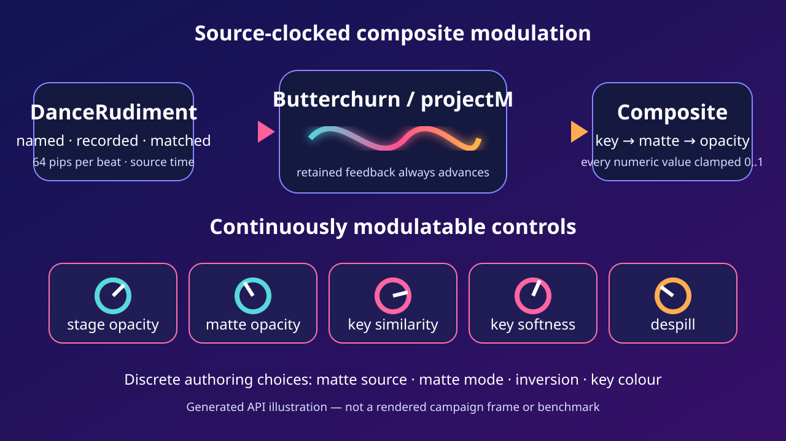
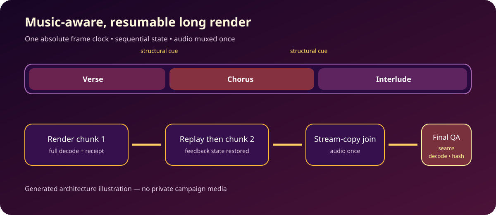
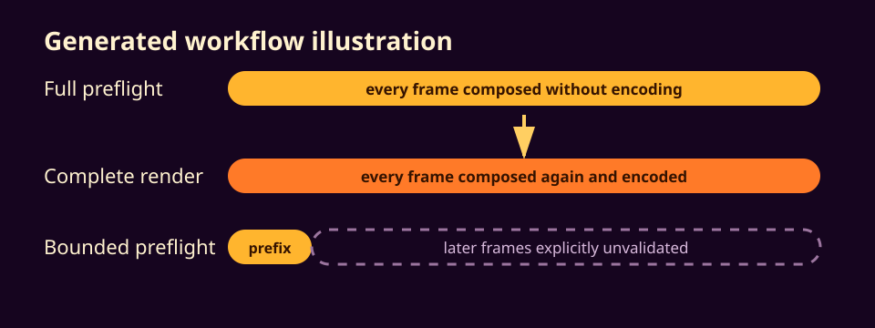
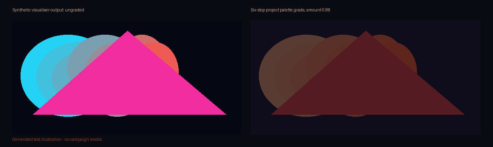

# FrameRudiments 0.4.11

- Visualiser composites can now drive stage opacity, matte opacity, chroma-key
  similarity, key-edge smoothness and despill from named or recorded
  DanceRudiments on the authoritative source clock.
- Every driver stays inside an explicit 0..1 range, supports the existing
  transfer curves, smoothing and combine modes, and records native motion
  provenance plus its final evaluated value in render evidence.
- Butterchurn/projectM feedback keeps advancing when a modulated stage becomes
  faint, so fading a keyed or matted result does not reset its retained state.
- Focused regression coverage exercises every continuous composite parameter,
  rejects missing or duplicate evidence IDs and preserves the existing
  post-stage compositing order.
- The maintained PowerShell test wrapper now gives every pytest invocation a
  unique project-local base temp and removes it immediately in `finally`, so
  successful and failed runs cannot silently accumulate generated fixtures.

Generated explanatory diagram; no private campaign media.

# FrameRudiments 0.4.10

- Projects longer than 30 seconds now render as finalized sequential chunks by
  default, with boundaries preferring nearby pinned structural cues.
- Resume verifies a contiguous immutable receipt prefix, replays every retained
  frame from zero to restore temporal and feedback state, and encodes only the
  missing suffix.
- The canonical audio is muxed once after stream-copy video concatenation.
  Every chunk and the final MP4 receive exact frame/CFR and full-decode checks;
  decoded seam hashes detect dropped, duplicated or altered join frames.
- Disk-space guards run before each chunk and final assembly, leaving completed
  chunks safely resumable instead of producing an unapproved truncated MP4.
- CLI controls include `--chunked`, `--single-pass`, `--chunk-seconds`,
  `--resume` and `--min-free-gib`.

Generated explanatory diagram; synthetic integration tests contain no private
campaign material.

# FrameRudiments 0.4.9

- Named visualiser matte providers remain available as isolated RGBA data but
  no longer paint their black/white mask artwork into the clean composition.
- A compositor regression test compares the corrected frame with the same
  scene rendered without its provider layer, while confirming that the effect
  chain still receives the provider pixels.
- The existing retained-feedback screenshot in `docs/visualisers.md` remains
  the relevant visual evidence; this patch corrects provider visibility rather
  than changing the demonstrated visualiser output contract.

# FrameRudiments 0.4.8

- Butterchurn and projectM stages now support deterministic post-stage chroma
  keying, edge smoothing and bounded despill.
- The complete VisualStyle effect set can run on a stage's source input,
  retained feedback state, or display output. Retained-feedback treatments are
  written back through Butterchurn's pinned target framebuffer and projectM's
  pinned 4.2 texture-burn API before the next frame.
- A stage can use any named isolated compositor element as an alpha or
  luminance track matte, with inversion and independent matte/stage opacity.
- Keying and matting compose in a documented order over the image that entered
  each stage; later engines receive the already contained result while clean
  routed text remains above the final chain.
- Focused pixel tests cover hard/soft keys, combined key-plus-matte output,
  luminance/alpha multiplication and two-engine stage order.
- Pinned real-engine smoke evidence is included at
  `docs/media/visualiser-feedback-writeback.png`, with source hashes in the
  adjacent JSON receipt.

# FrameRudiments 0.4.7

- `preflight --max-frames N` composes a declared sequential prefix for expensive
  long projects instead of forcing a complete unencoded pass before rendering.
- The manifest records full versus bounded scope, frames rendered, total frames,
  sequential-state behaviour and the explicit later-frame validation limit.
- The final rendered file still receives complete decode, CFR, frame-count,
  audio and encoded-checkpoint verification; bounded preflight does not weaken
  or relabel final technical QA.
- Focused regression coverage preserves default full-preflight behaviour, exact
  prefix boundaries, final-prefix QA capture and fail-closed limits.
- Wrapped-word layout coverage now follows visual reading order across current
  Pillow text metrics instead of assuming every word remains on one row.

Generated explanatory diagram; not a benchmark or rendered campaign frame.

# FrameRudiments 0.4.6

- Encoding now accepts the complete named libx264 preset range: `ultrafast`,
  `superfast`, `veryfast`, `faster`, `fast`, `medium`, `slow`, `slower`,
  `veryslow` and `placebo`.
- Focused regression coverage verifies every accepted preset reaches the exact
  FFmpeg command and that unknown values still fail closed.
- Linux CI, gallery and release jobs now pin Ubuntu 24.04 so runner-image
  migrations cannot silently change the release environment mid-validation.
- Linux render dependencies use one shared installer with bounded timeouts and
  retries, preventing a stalled package mirror from hanging a release forever.
- Preset strength remains separate from composition resolution, visualiser
  mesh density, frame rate and source sampling. Existing public demonstration
  media therefore remains applicable; no new visual was generated for this
  command-validation-only change.

# FrameRudiments 0.4.5

- Word indicators can now travel between encoded word hits with a configurable
  arc and land on the next word's authoritative frame, while retaining the
  existing after-hit mode.
- projectM stages accept source-time preset timelines and perform bounded soft
  transitions on the existing feedback instance, with every switch recorded in
  render evidence.
- Lyric layers can feed the visualiser only during their final bounded pips when
  a real blank gap follows, allowing the departing line to dissolve into the
  background without contaminating immediate line-to-line changes.
- Project-format and visualiser documentation describe the new contracts;
  focused regression coverage preserves clock, preset trust, routing and
  evidence behaviour. Private campaign artwork and audio remain outside the
  distribution.

## High-detail, palette-controlled visualiser output

- Butterchurn stages accept bounded `mesh_width` and `mesh_height` values. The
  existing 64×48 mesh remains the default; projects can request additional
  spatial detail without changing their encoded dimensions or frame rate.
- Any Butterchurn or projectM stage can apply `output_palette_grade` after the
  engine output and before the next stage or clean routing overlay. Two to
  sixteen ordered CSS colours define a deterministic luminance palette; alpha,
  PCM, feedback state and the source clock remain unchanged.
- The exact mesh and grade configuration is retained in plan and manifest
  evidence. Focused validation covers schema bounds, deterministic pixels,
  alpha preservation, stage order and routed overlays.

Generated test illustration; no private campaign media. A video is omitted
because this stateless grade adds no temporal behaviour to demonstrate.

# FrameRudiments 0.4.4

- Spectrum views accept a validated `style.grid` boolean. Set it to `false` to remove the three fixed dB guide lines while retaining calibrated bars and moving peak holds; label visibility remains independent.
- The existing default remains `true` for backward compatibility. Documentation and focused regression coverage include the no-grid, no-label presentation used by clean campaign visualisers.

# FrameRudiments 0.4.3

- Atlas fire accepts an evidence-recorded three-stop CSS palette ordered as
  shadow, body and core. An optional bounded `palette_vertical` bias can carry
  the shadow colour into visible flame tongues after burn-front placement while
  preserving the source alpha silhouette.
- Filmed and Mantaflow layouts vary deterministic jet scale, playback rate,
  phase, mirroring, angle and placement across wide surfaces, reducing obvious
  repeated strips without introducing a new source clock.
- Invalid palette shapes, colours and bounds fail closed. The focused fire
  suite, configured full suite, package checks and clean-wheel palette smoke
  test cover the reusable contract.
- [Actual synthetic still/video, API, settings and limitations](docs/natural-materials.md).

# FrameRudiments 0.4.2

- Five selectable fire routes: hash-pinned CC0 filmed flame, animated flame
  sprites through the native ParticleEmitter, a bounded 2D buoyant fluid solver,
  original GPU volume ray marching, and actual Blender/Mantaflow bake/import.
  Original noise fire is explicitly stylized; ice adds fractures and frost.
- Bounded `type: "material"` layers, source-time progress, ordinary routing,
  masks/keyframes and per-frame method/settings evidence.
- Optional `[materials]` / `[gpu]` extras, reviewed compact atlases and provenance;
  no model weights or render-time downloads. Original RGBA artwork is preserved at zero burn/freeze; completed
  burn is transparent and freezing preserves source alpha.
- Encoded QA checkpoint extraction now uses bounded 32-term batches; full
  lyric/cue ledgers retain every checkpoint without a giant select expression.
- [Actual synthetic still/video, API, settings and limitations](docs/natural-materials.md).

# FrameRudiments 0.4.1

- Native `rangoli` Bezier-petal renderer with independent scale, rotation and
  lift axes, explicit halo/stroke bounds, transparent fills and optional glow.
- Uses the existing genuine high-resolution font/vector rasterization,
  source-clock sampling, saved native recordings and technical video QA.
- Original texture-free projectM background preset composes through existing
  per-element routing, keeping petals and lyrics clean above the GPU output.
- `demo --rangoli`, regression coverage and [actual synthetic video/still with
  transcript](docs/rangoli.md). No private campaign media or downloaded models.
- Stem analysis/smoothing remain in StemLab and native playback remains in
  DanceRudiments; this release does not duplicate either engine.

# FrameRudiments 0.4.0

## Rendering and authoring

- High-quality spatial and temporal supersampling defaults, improved lyric
  typography, word-following indicators and particle effects.
- Configurable Butterchurn/projectM layer injection and final-output overlays.
- Expanded visualisation galleries, source-bound timing and regression coverage.

## Temporal-first preset descriptions

- Dense frame capture and motion measurements precede neural inference.
- PrismMoves selects a bounded set of representative frames rather than
  captioning every capture, then produces one evidence-linked description per
  preset covering supported movement, visual appearance and observed artefacts.
- Released PixelCue 0.9.1 and PrismMoves 0.2.0 are coordinated through
  analysis-releases.json, including source commits, release URLs and wheel hashes.
- Existing analysis reports can be replayed without new model inference. Sparse
  or failed captures retain explicit limits rather than invented motion claims.
- Windows setup collects matching MinGW runtime DLLs into the project-local
  projectM installation and verifies native loading without changing global PATH.

## Release integrity

- Runtime __version__ and distribution metadata both report 0.4.0.
- The source archive includes the analysis release lock, PowerShell launchers
  and Python support scripts. Downloaded models and local analysis outputs are
  excluded; native runtimes remain separate from the portable Python wheel.
- Release checks verify matching source/module versions and required archive
  contents before publication. Existing checksums, source identity, encoded
  smoke tests and GitHub/PyPI publication gates remain in place.

See README.md and docs/preset-behaviour.md for setup and evidence limits.
Optical-flow and semantic hypotheses do not establish flash safety, artistic
intent or complete coverage of the entire preset catalogue. Native rendering
continues to depend on the target GPU, driver and upstream engine behaviour.
