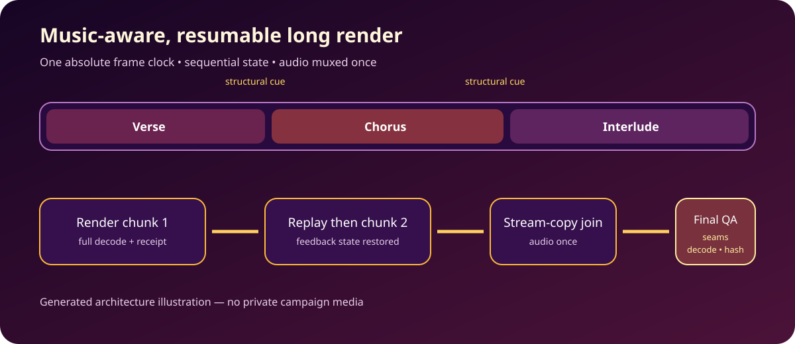
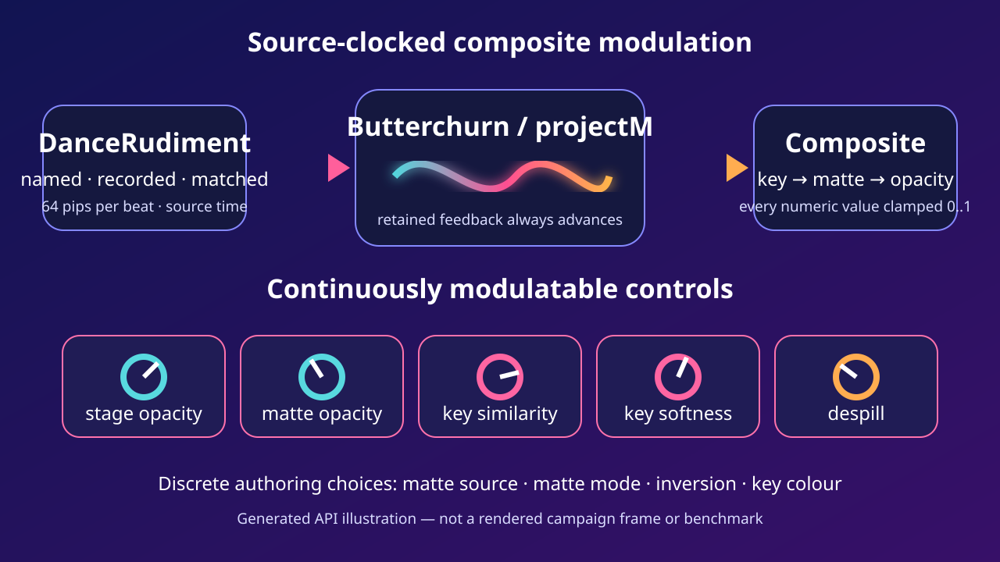
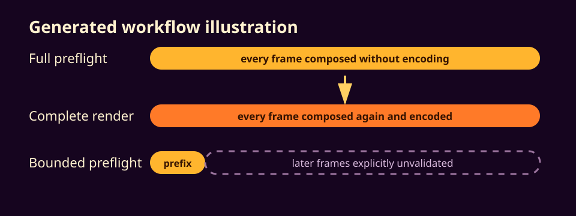
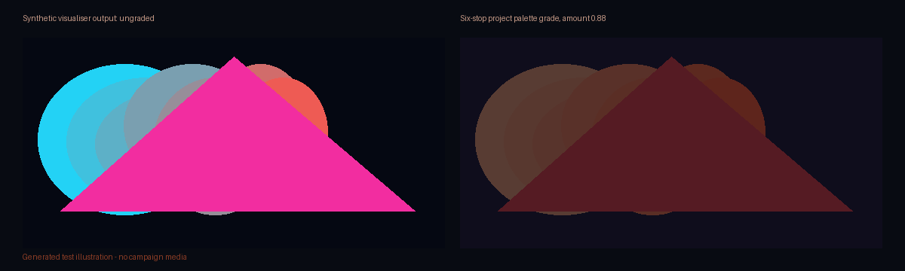

# FrameRudiments 0.4.26

- Accelerate wave, turbulence, swirl, radial, mirror, kaleidoscope
  and polar unwrap in OpenGL 3.3, including all four spatial border modes.
- Carry warped original alpha through device-resident forks and into
  host-side mattes and styles. Report the separate transfers when a mixed graph
  needs a host copy of the warped silhouette.
- Keep extreme wave and turbulence parameters and negative radial amounts on the
  CPU reference in `auto`, with a precision-limit rejection in strict GPU mode.
- Include required GPU parity and a [60 fps CPU/GPU comparison](docs/effect-graph-m8-9-gpu-spatial.md).

# FrameRudiments 0.4.25

- Keep prepared plans tied to canonical input paths and checksums when a
  chunked render stages its inputs. Include dependencies registered by the
  compositor in the retained plan.
- Verify newly prepared plans after cache relocation, preserve same-cache
  resume for older plans and reject changed inputs.

# FrameRudiments 0.4.24

- Fix accumulated concat timestamp rounding in stream-copied chunk assemblies.
  Round PTS and DTS independently to the authored frame grid and retain exact
  packet duration without re-encoding pictures or stretching audio.
- Exercise real B-frame H.264/AAC assemblies at 24, 30 and 60 fps, including
  exact native verification and every decoded picture's identity.
- Retain the existing fail-closed frame contract, candidate health and review
  gates. See the measured synthetic timing comparison in the chunk guide.

# FrameRudiments 0.4.23

- Add per-stage visualiser feedback processing scale with full-resolution hooks,
  compositing and clean overlays.

# FrameRudiments 0.4.22

- Register built-in and trusted custom rudiment renderer source through the
  standard pinned input contract. Work-cache staging has both the expected
  checksum and byte count before the first frame.
- Include both cache regressions and a synthetic screenshot and clip.

# FrameRudiments 0.4.21

- Partition mixed effect DAGs into conservative GPU-resident islands around
  unsupported CPU nodes, with exact boundary uploads/readbacks and per-island
  node, draw, allocation and payload telemetry.
- Preserve universal original-alpha semantics by splitting at lineage resets;
  ambiguous multi-exit regions retain the established bridge/CPU route and
  report a machine-readable rejection reason.
- Add a bounded confidence-weighted GPU chroma edge-decontamination pipeline,
  using retained foreground neighbours rather than relabelling feather or
  despill. Radius 0.5–12 is GPU eligible; larger valid CPU radii remain explicit
  auto fallbacks and strict-GPU rejections.
- Exercise real-driver parity on Windows' native NVIDIA standalone context and
  the mandatory Linux Mesa/EGL CI route, including mixed-island transfer counts.
- Include an [actual CPU/GPU comparison](docs/media/effect-graph-m8-8-decontamination.png)
  and retained telemetry generated by the documented integration script. A
  video is omitted because the feature changes execution residency and static
  key-edge reconstruction, not time-varying image behaviour.

# FrameRudiments 0.4.20

- Add `raindrop_ripples`, a deterministic refractive spatial warp with three
  related visual models: travelling rings, bounded droplet lenses and seeded
  multi-source storm interference.
- Add the geometric `wash` transition, which reuses the same ripple field to
  refract both clips around a deterministic advancing reveal boundary while
  preserving exact start and end frames.
- Keep every variant random-access and tile-stable so chunk replay, resume and
  distributed frame evaluation do not require mutable fluid-simulation state.
- Expose native effect-graph controls for variant, seed, wavelength, radius,
  phase, amplitude, source count, centre, border handling and mix. Alpha follows
  the same inverse warp as colour.
- Include an [actual three-variant contact sheet](docs/media/raindrop-ripples.png)
  and [silent two-second wash demonstration](docs/media/raindrop-ripples.mp4),
  with an [accessible description](docs/media/raindrop-ripples-transcript.md)
  and a reproducible media generator.

# FrameRudiments 0.4.18

- Expand `procedural_field` from Julia alone to seven deterministic families:
  Julia, Mandelbrot/Multibrot, Tricorn, Burning Ship, Celtic, Buffalo and
  Newton basins. All remain ordinary compositable RGBA/matte/vector sources.
- Add public `escape_time_field()` and `newton_fractal_field()` scalar APIs while
  preserving `julia_escape_field()` and every 0.4.17 Julia control.
- Give the new escape-time and Newton parameters native effect-graph descriptors,
  validation, work budgets and DanceRudiments modulation. Phase and rotation
  use the canonical finite `[-1,1]` range for one exact `2*pi` period with
  byte-identical endpoints.
- Reuse the shared two-to-sixteen-stop palette, colour-space, interpolation,
  coverage and output pipeline across every family.
- Move Windows pytest runs to a probed, unique owned Local AppData root and
  clean each exact run; this avoids stale shared-temp and workspace ACL failure
  cascades. Local work now runs focused tests, while exact-head GitHub CI owns
  the complete CPU/platform/GPU matrices.
- Normalize repository text to LF in Git and explicitly mark media/archive
  formats binary, preventing Windows CR/LF conversion from invalidating
  source-byte hashes.
- Include an [actual seven-family compositor contact sheet](docs/media/fractal-library.png)
  and [silent two-second native-motion loop](docs/media/fractal-library-motion.mp4),
  with an [accessible description](docs/media/fractal-library-motion-transcript.md)
  and retained generation evidence.

# FrameRudiments 0.4.17

- Add a deterministic Julia-set generator to the shared `procedural_field`
  effect-graph source, so fractals can feed ordinary visible composition,
  mattes, transitions, textures and displacement without a private renderer.
- Support the existing stable multi-stop gradient pipeline with two to sixteen
  colour stops, selectable interpolation and output modes.
- Expose the Julia constant, orbit radius, zoom, rotation, iteration count,
  escape radius and power to native DanceRudiments effect-graph controls.
  Recorded samples remain in the canonical finite `[-1,1]` range; Julia phase
  and rotation map that range onto one exact `2*pi` period with joined endpoints.
- Publish public scalar helpers for normalized turns, Julia constants and
  deterministic smooth escape fields, plus focused and full-project regressions.
- Keep CPU release testing aligned with the expanded GPU suite. Real GPU parity,
  transport, kernels and resident spectral/matte tests continue in the required
  no-skip EGL workflow instead of being accidentally collected by a CPU-only
  release build. Windows CI downloads a checksum-pinned immutable FFmpeg build
  that provides both `ffmpeg` and `ffprobe`, instead of depending on
  Chocolatey's unavailable community feed or a rolling package resolver.
- Include an [actual native-motion compositor contact sheet](docs/media/julia-fractal-composite.png)
  and [silent two-second loop](docs/media/julia-fractal-motion.mp4), with an
  [accessible description](docs/media/julia-fractal-motion-transcript.md).

# FrameRudiments 0.4.16

- Rename the ambiguous spectral colour-conversion `l` variable to `l_channel`.
  This resolves Ruff E741 without changing the numerical conversion.
- The immutable 0.4.15 tag remains preserved. Its package publication was
  blocked by lint; 0.4.16 reruns the required full CI, packaging and installed-wheel
  encoding gates before GitHub/PyPI publication.
- Real GPU parity tests now run in the existing EGL-qualified workflow as a
  required part of CI and release validation. CPU/font/FFmpeg matrices select
  the remaining complete suite; both CPU and GPU routes reject skipped tests.
- Existing [actual underlay frames and video](docs/visualisers.md#isolated-underlay)
  remain the relevant media; the identifier-only repair adds no visual behaviour.

# FrameRudiments 0.4.15

- Visualiser stages accept `composite.underlay.source`, a named isolated RGBA
  compositor surface beneath their processed output.
- Layer providers stay out of the clean composition; alpha order, hidden-source
  fallback, shape/mode validation and unknown-source rejection are covered by
  regressions. Existing stage configurations retain their previous behaviour.
- [Actual synthetic frames and video](docs/visualisers.md#isolated-underlay)
  demonstrate shrinking/rotating/fading output revealing a persistent underlay.

# FrameRudiments 0.4.14

- Preflight and render now write an atomic `render-progress.json` and flush a
  human-readable stderr heartbeat every 10 seconds by default.
- A dedicated heartbeat thread reports liveness even while one expensive frame
  is still composing. Status spans single-pass rendering, chunk replay and
  encoding, assembly, verification and final manifest work.
- The status schema retains current/finalized frame counts, elapsed time,
  observed per-frame cost and a provisional ETA. `--progress-seconds` changes
  the bounded cadence without mixing heartbeat text into final stdout JSON.
- Focused regression coverage verifies timed updates with an unchanged active
  frame, durable failure state and final progress state for single-pass,
  bounded-preflight and resumed chunked integration routes.
- Optional `--work-cache`/`FRAMERUDIMENTS_WORK_CACHE` staging now moves all
  checksum-pinned inputs and high-I/O render artifacts to a selected fast
  workspace, while `--reserve-gib` physically reserves the complete declared
  peak plus 2% at both cache and final locations.
- A final output appears only after cached technical QA, complete staging-tree
  hash/size comparison and final-directory promotion. Successful jobs remove
  their cache; interrupted jobs retain recovery evidence but release reservations.
- `cache-status --expect-empty` provides a bounded, non-recursive periodic cache
  health check. Portable guidance recommends a separate physical device without
  embedding any deployment-specific drive letters.

Generated explanatory diagram. The feature is a file/terminal evidence contract;
timed tests provide the useful demonstration without manufacturing a UI capture.

# FrameRudiments 0.4.13

- The projectM extra now installs NumPy explicitly, matching PyOpenGL's array
  handler and preventing the misleading `No numpy module present` warning in
  minimal release-local projectM runtimes.
- This dependency correction does not change current render pixels or permit a
  live frozen runtime to be mutated underneath an active render.

Generated explanatory diagram; dependency verification is covered by the
package-metadata test and the release pipeline rather than a UI screenshot or
video.

# FrameRudiments 0.4.12

- Render failures now retain structured exception type, module, nonempty
  message, representation, causal chain and traceback evidence. A bare
  `MemoryError()` is explicitly identified instead of becoming a blank error.
- Every render directory receives `candidate-health.json`. In-progress,
  interrupted and unverified MP4s are machine-labelled as unapproved and
  blocked from review/publication; attended review becomes eligible only after
  the existing technical QA passes.
- Setup failures before frame rendering now use the same fail-closed evidence
  path. If memory or storage exhaustion also prevents evidence output, the
  original exception remains authoritative and a missing health file stays a
  closed gate.
- Resumes archive the prior health record, preserve valid finalized chunks, and
  replace the current gate only after full decode, seam and final-output checks.
- Isolated RGBA elements now alpha-composite only their nontransparent bounds,
  avoiding needless full-frame temporary allocation while retaining exact
  pixel output.
- Regression coverage exercises blank memory errors, causal chains, setup
  failures, candidate inventory/gating, pixel equality and interrupted/resumed
  integration output.

Generated explanatory diagram; the executable demonstration uses synthetic
media and no private campaign material.

# FrameRudiments 0.4.11

- Visualiser composites can now drive stage opacity, matte opacity, chroma-key
  similarity, key-edge smoothness and despill from named or recorded
  DanceRudiments on the authoritative source clock.
- Every driver stays inside an explicit 0..1 range, supports the existing
  transfer curves, smoothing and combine modes, and records native motion
  provenance plus its final evaluated value in render evidence.
- Butterchurn/projectM feedback keeps advancing when a modulated stage becomes
  faint, so fading a keyed or matted result does not reset its retained state.
- Focused regression coverage exercises every continuous composite parameter,
  rejects missing or duplicate evidence IDs and preserves the existing
  post-stage compositing order.
- The maintained PowerShell test wrapper now gives every pytest invocation a
  unique project-local base temp and removes it immediately in `finally`, so
  successful and failed runs cannot silently accumulate generated fixtures.

Generated explanatory diagram; no private campaign media.

# FrameRudiments 0.4.10

- Projects longer than 30 seconds now render as finalized sequential chunks by
  default, with boundaries preferring nearby pinned structural cues.
- Resume verifies a contiguous immutable receipt prefix, replays every retained
  frame from zero to restore temporal and feedback state, and encodes only the
  missing suffix.
- The canonical audio is muxed once after stream-copy video concatenation.
  Every chunk and the final MP4 receive exact frame/CFR and full-decode checks;
  decoded seam hashes detect dropped, duplicated or altered join frames.
- Disk-space guards run before each chunk and final assembly, leaving completed
  chunks safely resumable instead of producing an unapproved truncated MP4.
- CLI controls include `--chunked`, `--single-pass`, `--chunk-seconds`,
  `--resume` and `--min-free-gib`.

Generated explanatory diagram; synthetic integration tests contain no private
campaign material.

# FrameRudiments 0.4.9

- Named visualiser matte providers remain available as isolated RGBA data but
  no longer paint their black/white mask artwork into the clean composition.
- A compositor regression test compares the corrected frame with the same
  scene rendered without its provider layer, while confirming that the effect
  chain still receives the provider pixels.
- The existing retained-feedback screenshot in `docs/visualisers.md` remains
  the relevant visual evidence; this patch corrects provider visibility rather
  than changing the demonstrated visualiser output contract.

# FrameRudiments 0.4.8

- Butterchurn and projectM stages now support deterministic post-stage chroma
  keying, edge smoothing and bounded despill.
- The complete VisualStyle effect set can run on a stage's source input,
  retained feedback state, or display output. Retained-feedback treatments are
  written back through Butterchurn's pinned target framebuffer and projectM's
  pinned 4.2 texture-burn API before the next frame.
- A stage can use any named isolated compositor element as an alpha or
  luminance track matte, with inversion and independent matte/stage opacity.
- Keying and matting compose in a documented order over the image that entered
  each stage; later engines receive the already contained result while clean
  routed text remains above the final chain.
- Focused pixel tests cover hard/soft keys, combined key-plus-matte output,
  luminance/alpha multiplication and two-engine stage order.
- Pinned real-engine smoke evidence is included at
  `docs/media/visualiser-feedback-writeback.png`, with source hashes in the
  adjacent JSON receipt.

# FrameRudiments 0.4.7

- `preflight --max-frames N` composes a declared sequential prefix for expensive
  long projects instead of forcing a complete unencoded pass before rendering.
- The manifest records full versus bounded scope, frames rendered, total frames,
  sequential-state behaviour and the explicit later-frame validation limit.
- The final rendered file still receives complete decode, CFR, frame-count,
  audio and encoded-checkpoint verification; bounded preflight does not weaken
  or relabel final technical QA.
- Focused regression coverage preserves default full-preflight behaviour, exact
  prefix boundaries, final-prefix QA capture and fail-closed limits.
- Wrapped-word layout coverage now follows visual reading order across current
  Pillow text metrics instead of assuming every word remains on one row.

Generated explanatory diagram; not a benchmark or rendered campaign frame.

# FrameRudiments 0.4.6

- Encoding now accepts the complete named libx264 preset range: `ultrafast`,
  `superfast`, `veryfast`, `faster`, `fast`, `medium`, `slow`, `slower`,
  `veryslow` and `placebo`.
- Focused regression coverage verifies every accepted preset reaches the exact
  FFmpeg command and that unknown values still fail closed.
- Linux CI, gallery and release jobs now pin Ubuntu 24.04 so runner-image
  migrations cannot silently change the release environment mid-validation.
- Linux render dependencies use one shared installer with bounded timeouts and
  retries, preventing a stalled package mirror from hanging a release forever.
- Preset strength remains separate from composition resolution, visualiser
  mesh density, frame rate and source sampling. Existing public demonstration
  media therefore remains applicable; no new visual was generated for this
  command-validation-only change.

# FrameRudiments 0.4.5

- Word indicators can now travel between encoded word hits with a configurable
  arc and land on the next word's authoritative frame, while retaining the
  existing after-hit mode.
- projectM stages accept source-time preset timelines and perform bounded soft
  transitions on the existing feedback instance, with every switch recorded in
  render evidence.
- Lyric layers can feed the visualiser only during their final bounded pips when
  a real blank gap follows, allowing the departing line to dissolve into the
  background without contaminating immediate line-to-line changes.
- Project-format and visualiser documentation describe the new contracts;
  focused regression coverage preserves clock, preset trust, routing and
  evidence behaviour. Private campaign artwork and audio remain outside the
  distribution.

## High-detail, palette-controlled visualiser output

- Butterchurn stages accept bounded `mesh_width` and `mesh_height` values. The
  existing 64×48 mesh remains the default; projects can request additional
  spatial detail without changing their encoded dimensions or frame rate.
- Any Butterchurn or projectM stage can apply `output_palette_grade` after the
  engine output and before the next stage or clean routing overlay. Two to
  sixteen ordered CSS colours define a deterministic luminance palette; alpha,
  PCM, feedback state and the source clock remain unchanged.
- The exact mesh and grade configuration is retained in plan and manifest
  evidence. Focused validation covers schema bounds, deterministic pixels,
  alpha preservation, stage order and routed overlays.

Generated test illustration; no private campaign media. A video is omitted
because this stateless grade adds no temporal behaviour to demonstrate.

# FrameRudiments 0.4.4

- Spectrum views accept a validated `style.grid` boolean. Set it to `false` to remove the three fixed dB guide lines while retaining calibrated bars and moving peak holds; label visibility remains independent.
- The existing default remains `true` for backward compatibility. Documentation and focused regression coverage include the no-grid, no-label presentation used by clean campaign visualisers.

# FrameRudiments 0.4.3

- Atlas fire accepts an evidence-recorded three-stop CSS palette ordered as
  shadow, body and core. An optional bounded `palette_vertical` bias can carry
  the shadow colour into visible flame tongues after burn-front placement while
  preserving the source alpha silhouette.
- Filmed and Mantaflow layouts vary deterministic jet scale, playback rate,
  phase, mirroring, angle and placement across wide surfaces, reducing obvious
  repeated strips without introducing a new source clock.
- Invalid palette shapes, colours and bounds fail closed. The focused fire
  suite, configured full suite, package checks and clean-wheel palette smoke
  test cover the reusable contract.
- [Actual synthetic still/video, API, settings and limitations](docs/natural-materials.md).

# FrameRudiments 0.4.2

- Five selectable fire routes: hash-pinned CC0 filmed flame, animated flame
  sprites through the native ParticleEmitter, a bounded 2D buoyant fluid solver,
  original GPU volume ray marching, and actual Blender/Mantaflow bake/import.
  Original noise fire is explicitly stylized; ice adds fractures and frost.
- Bounded `type: "material"` layers, source-time progress, ordinary routing,
  masks/keyframes and per-frame method/settings evidence.
- Optional `[materials]` / `[gpu]` extras, reviewed compact atlases and provenance;
  no model weights or render-time downloads. Original RGBA artwork is preserved at zero burn/freeze; completed
  burn is transparent and freezing preserves source alpha.
- Encoded QA checkpoint extraction now uses bounded 32-term batches; full
  lyric/cue ledgers retain every checkpoint without a giant select expression.
- [Actual synthetic still/video, API, settings and limitations](docs/natural-materials.md).

# FrameRudiments 0.4.1

- Native `rangoli` Bezier-petal renderer with independent scale, rotation and
  lift axes, explicit halo/stroke bounds, transparent fills and optional glow.
- Uses the existing genuine high-resolution font/vector rasterization,
  source-clock sampling, saved native recordings and technical video QA.
- Original texture-free projectM background preset composes through existing
  per-element routing, keeping petals and lyrics clean above the GPU output.
- `demo --rangoli`, regression coverage and [actual synthetic video/still with
  transcript](docs/rangoli.md). No private campaign media or downloaded models.
- Stem analysis/smoothing remain in StemLab and native playback remains in
  DanceRudiments; this release does not duplicate either engine.

# FrameRudiments 0.4.0

## Rendering and authoring

- High-quality spatial and temporal supersampling defaults, improved lyric
  typography, word-following indicators and particle effects.
- Configurable Butterchurn/projectM layer injection and final-output overlays.
- Expanded visualisation galleries, source-bound timing and regression coverage.

## Temporal-first preset descriptions

- Dense frame capture and motion measurements precede neural inference.
- PrismMoves selects a bounded set of representative frames rather than
  captioning every capture, then produces one evidence-linked description per
  preset covering supported movement, visual appearance and observed artefacts.
- Released PixelCue 0.9.1 and PrismMoves 0.2.0 are coordinated through
  analysis-releases.json, including source commits, release URLs and wheel hashes.
- Existing analysis reports can be replayed without new model inference. Sparse
  or failed captures retain explicit limits rather than invented motion claims.
- Windows setup collects matching MinGW runtime DLLs into the project-local
  projectM installation and verifies native loading without changing global PATH.

## Release integrity

- Runtime __version__ and distribution metadata both report 0.4.0.
- The source archive includes the analysis release lock, PowerShell launchers
  and Python support scripts. Downloaded models and local analysis outputs are
  excluded; native runtimes remain separate from the portable Python wheel.
- Release checks verify matching source/module versions and required archive
  contents before publication. Existing checksums, source identity, encoded
  smoke tests and GitHub/PyPI publication gates remain in place.

See README.md and docs/preset-behaviour.md for setup and evidence limits.
Optical-flow and semantic hypotheses do not establish flash safety, artistic
intent or complete coverage of the entire preset catalogue. Native rendering
continues to depend on the target GPU, driver and upstream engine behaviour.
