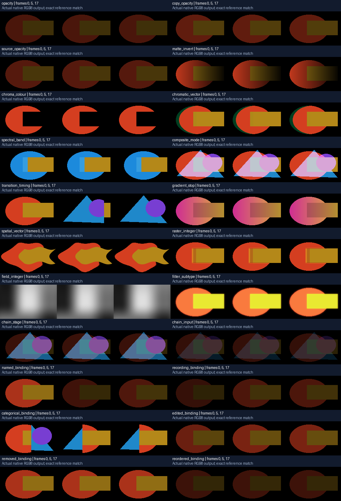

# M10.3 — Generated parameter and DanceNotion control editors

M10.3 extends **Effect DAG** with forms generated from the native effect and
motion registries. Select a node, edit a typed parameter and apply it. Python
validates the proposed project before the browser creates one undo entry.
The same inspector adds, edits, removes and reorders native motion bindings.
This is an unreleased implementation candidate in the consolidated roadmap.

## Editing parameters

The selected node's **Native parameters and controls** panel discovers the
currently applicable paths, values, defaults, units, bounds and discrete choices.
Search the parameter list, expand a group, change a value and press **Apply**.
Typing changes the form only. A rejected proposal keeps the project and undo
history intact; the form retains the proposed value for correction.

| Native node family | Generated editing surface |
| --- | --- |
| `source`, `copy`, `opacity` | Output opacity. |
| `matte` | Alpha/luminance selection, inversion, mask combination/opacity, expansion, feather and alpha lineage. |
| `chroma_key` | RGB components, existing multi-key colours, key space, tolerance, softness and native edge settings. |
| `chromatic_displacement` | Independent red, green and blue X/Y offsets. |
| `spectral_displacement` | Stable band IDs, colours, offsets, selection, recolouring and compositing settings. |
| `composite` | Output opacity and native blend mode. |
| `transition` | Native subtype, progress, applicable geometry/matte/spectral fields, existing beat timing and GL time uniforms. |
| `layer_style` | The shared style registry, including existing stable gradient-stop paths and topology-compatible variants. |
| `spatial_warp` | The shared warp registry, numeric/vector settings and compatible warp modes. |
| `raster_effect` | The shared raster registry, integer/numeric settings and discrete raster variants. |
| `procedural_field` | The shared field/fractal registry, native integer controls and existing palette-stop paths. |
| `filter` | Blur/bloom subtype, radius, mix and applicable bloom settings. |

Colour and vector controls use the renderer's scalar component paths. Existing
gradient stops and spectral bands retain their stable IDs. The inspector also
selects an existing transition-chain stage or input effect through its native
expanded address; accepted edits are projected back into the authored chain
shorthand. Node IDs, input order, stage IDs and unrelated settings are preserved.

Choices that need different inputs or incompatible structural settings are
omitted. For example, a three-input matte transition cannot become a two-input
dissolve in a parameter form. Dormant settings are labelled as inactive.
Creating/removing palette stops, spectral bands, timing keyframe arrays and
chain stages remains outside these scalar forms. Existing timing objects are
editable; the editor does not invent an additional clock or timer.

Factory defaults and configured bases are distinguished. A custom gradient
stop has no factory counterpart. Reset controls only stage a value; Apply still
passes through native validation, including joint stop-order and timing rules.

## Editing native motion bindings

Choose **Add motion binding**, select a bindable parameter and search the native
source catalogue. The chooser paints at most 100 matches plus the selected
source. The complete admitted catalogue remains searchable; the qualification
runtime exposed 1,731 released named motions, with configured sources added as
needed. No movements are copied into TypeScript.

Named sources expose native rate, phase, origin, repeat-clock and interpolation
settings. Existing recording, table, matched-report and composite configurations
can be selected without changing their pins or source-clock rules. Recordings
retain all named dimensions exposed by native playback; their rate/phase and
capture bounds are not rewritten by the form.

Binding forms use native metadata for axis, range, curve, quantisation, power,
inversion, combination, weight, lag, smoothing, deadzone and sample stride.
Discrete parameters use an ordered list of native choices, replacement
combination and weight one. Numeric layer-style controls retain the existing
native interval remapping. Reordering swaps the selected node's neighbouring
bindings while preserving unrelated rows.

Suggested numeric ranges are checked through native parameter validation,
including joint constraints such as ordered gradient stops, spectral windows
and transition duration/period. Continuous motion binding is unavailable for
`timing.steps`: that native field accepts exactly zero or integers 2–64, which
an arbitrary continuous driver cannot guarantee. It remains statically editable.
Existing bindings are retained, including native configurations that the form
cannot replace. Remove remains available for a selected existing binding.

Whole-project validation checks target paths, source admission, categorical
choices and duplicate replacement bindings. Frame evaluation still owns the
final result of ordered relative combinations and motion-dependent constraints.
Use the native preview and normal preflight on the chosen timeline; construction
validation alone does not certify every future frame.

## One native schema and one accepted draft

`EffectGraph.control_descriptors(node_id, active_only=False)` now covers every
supported graph kind and retains specialised registry metadata. The common
scalar bounds and defaults are shared with the renderer. Returned descriptors
are detached from graph configurations and module defaults.

`EffectGraph.apply_control_values({(node_id, property): value})` uses the existing
frame-local resolver without a frame context, then constructs a new validated
graph. It does not mutate the original graph or calculate replacement motion.
The authoring adapter maps the selected node back to its original JSON location
and validates the complete project, all dependencies and existing bindings.

Two same-origin POST routes serve the editor:

| Route | Request and response |
| --- | --- |
| `/api/graph/catalog` | Current `project`, edited `sidecars` and selected `node`; returns typed parameters, native targets, configured bindings and admitted motion sources. |
| `/api/graph/edit` | The same snapshot plus one `set_parameter`, `put_binding`, `remove_binding` or `move_binding` operation; returns a validated project proposal and refreshed catalogue. |

The endpoints retain the loopback/origin policy, strict finite JSON, 2 MiB
request bound and shared concurrency limit. Catalogues are bounded to 256
expanded targets, 2,048 parameters for the selected node, 4,096 motion choices,
1,024 axes per motion and 64 project bindings. Catalogue JSON is at most 8 MiB;
the complete edit response is at most 12 MiB. Neither route renders a frame or
opens a GPU context. Temporary edited sidecars are owned and removed on success
and failure. Returned projects retain original authored paths.

The client checks the response schema, size, types and request digest. Its
request serial, complete project/sidecar snapshot and selected native target
must still match before an edit can enter history. Undo/redo, another draft
edit, target changes, cancellation and unmount invalidate pending work. A
second client projection check preserves unrelated project fields, graph
topology, source pins and shader authority even when presented with an invalid
server proposal. The existing M10.2 native validation gate still applies to
preview and export for the resulting complete snapshot.

Shader source, checksums, trust, pass/resource declarations and frame index
remain read-only. Existing GL `time_seconds` and `time_delta_seconds` are ordinary
native parameter values. The editor does not alter audio, source clocks,
backend selection or original asset files.

## Reproducible native qualification

After the ordinary Python and authoring dependencies are installed, run:

```powershell
$env:POWERSHELL_TELEMETRY_OPTOUT = '1'
./scripts/Invoke-Tests.ps1 -Python python -PytestArgs @('-q', 'tests/test_effect_graph_parameters.py', 'tests/test_graph_authoring_controls.py', 'tests/test_graph_authoring_controls_http.py')
npm --prefix authoring test
npm --prefix authoring run build
python integration/qualify_graph_controls_m10_3.py --output graph-controls-qualification
```

Use Node 24 or newer for the cross-language qualifier. Its fixture runner uses
the real TypeScript operation builders, request fences, bounded response reader
and ZIP exporter against an actual loopback Python authoring server. It reloads
each export through native `Project` validation and `Compositor`, then compares
RGB8 pixels and clocks with independently authored native reference projects.

The synthetic qualification has **22 cases and 88 byte-exact frame comparisons**
at frames 0, 5, 17 and 5 again. It covers all fourteen graph kinds, chain stages
and input effects, named and recorded motion, ordered categorical choices, and
binding add/edit/remove/reorder. Every case must actually change pixels from
its imported configuration. Repeated frame 5 must agree after nonsequential
evaluation. It verifies unchanged input bytes, rejected stale responses and
closed server/temporary resources.



The image contains actual synthetic native frames, not a browser screenshot.
The corresponding [native qualification receipt](media/authoring-controls-m10-3.json)
records per-case hashes, clocks and scope. Structural React tests do not prove
browser interaction, painted layout, physical GPU behaviour or perceptual
approval. The authoring CI workflow runs the native and frontend checks and
publishes the cross-language receipt/contact sheet for the exact candidate.

## Inherited CI corrections included

The merged M10.2 revision's CPU CI exposed an assertion that still expected
direct `pytest` invocation after the GPU jobs adopted the required temporary-
directory wrapper. The regression now checks separate Xvfb processes and the
actual wrapper invocation while preserving both GPU suites and skip checks.

Windows CI also exposed a same-length source rewrite that retained the guard's
metadata signature. Windows creation-time `ctime` does not provide the POSIX
metadata-change signal; see the [Python stat contract](https://docs.python.org/3.13/library/os.html#os.stat_result.st_ctime_ns).
Windows preview guards now rehash the admitted bytes on each reuse and fence
the alias/metadata before and after reading. Deterministic tests reproduce the
unchanged-signature case without sleeps. POSIX retains its existing fast path.
This Windows correctness fallback adds large-media disk I/O; exact-candidate
Windows CI and host performance remain to be observed.

[M10.4 supplies transition comparisons and scrub-safe frame evaluation with a
quality/performance switch](authoring-preview-m10-4.md). The next planned major
authoring milestone is **M10.5: round-trip JSON fixture and undo/redo tests**.
