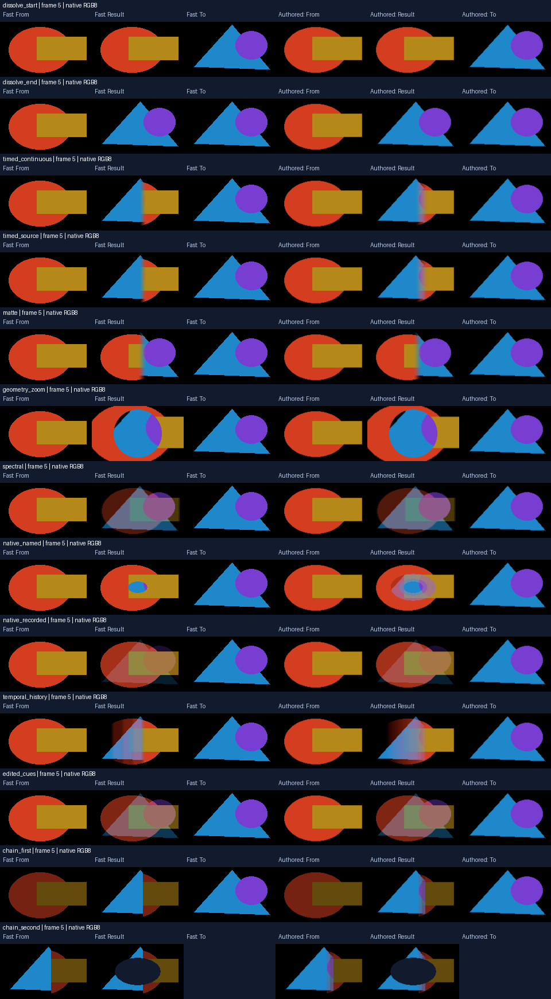

# M10.4 — Transition previews and scrub-safe frame evaluation

M10.4 adds native **From / Result / To** views to the selected transition and
uses one request controller for these views and the ordinary compositor preview.
Preview frames follow the existing project timeline and native source clocks.
This is an unreleased implementation candidate; the qualification below records
the checks actually performed.

## Inspect a transition

1. Open **Effect DAG** and select a transition. For a transition chain, use
   **Parameter target** to choose an existing transition stage. Its native
   expanded address comes from the accepted parameter catalogue.
2. Use **Preview position**, **Preview frame**, or the previous/next-frame
   buttons to inspect an integer frame. The controls stop at the last valid
   project frame. Timeline transport updates that same preview position.
3. Choose **Compare**, **From**, **Result** or **To**. The inputs include their
   authored upstream processing, including a chain's input effects and earlier
   stage outputs. A matte transition applies its mask inside Result.
4. Choose **Fast (1×)** while inspecting changes or **Authored quality** to
   inspect the project's configured output quality. **Cancel preview** retires
   an unwanted request; **Retry preview** requests the current selection again.

These controls inspect output frames without changing the draft, its transition
progress or undo history. They do not seek audio: the installed
`react-timeline-sequence@0.4.0` has an `onTimeChange` callback but no external seek
API. The shared timeline remains the audio transport. There is no extra playback
timer, progress override or movement evaluator in the preview component.

The chain's final copy alias is not a transition. Selecting it shows guidance
to choose a stage. Other non-transition nodes retain their normal parameter
editor without an invented transition comparison.

## Quality and rendering scope

| Choice | Native behaviour |
| --- | --- |
| **Fast (1×)** / `fast` | Disables output `render_quality`: one output sample, unit spatial scale and no finishing AA. Authored native temporal post-effects and their required history remain enabled. |
| **Authored quality** / `full` | Preserves the complete authored output-quality configuration, including spatial supersampling, native source-time temporal samples and finishing AA. If quality is disabled in the project, that authored choice remains disabled. |

Both choices use `Project` and `Compositor`, the unchanged native graph and
bindings, the requested backend, and the same authoritative frame/source/beat
clocks. Native temporal effects reconstruct their required history for arbitrary
frame order. Fast changes output sampling effort; it does not remove artistic
temporal effects. The ordinary `/api/preview` route preserves that distinction
as well.

For each transition view, a detached prepared project selects the appropriate
native graph output. All graph nodes and bindings remain present and validated.
The three compositors open sequentially and close after their respective views.
The authored graph output, source files, pins, shader admissions and clocks are
unchanged.

These are full-size native compositor views **before sequential Butterchurn or
projectM stages**. The response and panel explicitly report when those stages
are excluded. RGB8 PNGs show transparency over black. They are preview evidence,
not production or perceptual approval. They are not resized substitutes for the
authored viewport.

The adaptive S0–S7 stream retains its existing quality profiles, paused refinement
and verified feedback replay. When **Adaptive cache preview** is selected in the
renderer workspace, its own Q controls apply and the one-shot quality selector
is hidden. Entering Effect DAG unmounts the ordinary renderer preview, so a
hidden one-shot view does not keep requesting frames.

## Scrub and response handling

`NativePreviewController` keeps **one active request and one replaceable latest
pending request**. Ordinary cursor or quality changes immediately make previous
pixels ineligible, while the active request is allowed to finish before the
latest pending request begins. Rapid scrubbing does not submit every intermediate
frame or repeatedly abandon expensive native renders.

A result must match the complete undo/redo snapshot, project and sidecar
identities, selected node, absolute output frame, quality and, for transition
previews, the accepted catalogue digest.
The React view checks this identity during render, including the result itself,
before effects can retire older work. A changed draft, selected target or quality
cannot reuse an older image. Returning to a previous frame also cannot revive an
obsolete request.

The controller bounds response reads, checks native metadata and PNG hashes,
and waits for image decoding before accepting the complete image set. Object
URLs are owned and revoked after replacement, cancellation, errors and unmount.
Cancellation aborts the client request and clears pending presentation; it does
not claim that an already-running server render has stopped. Server resources
remain owned until their normal cleanup completes. A timeout or rejected request
has an explicit retry state with no retained stale pixels.

## Native API

`POST /api/graph/preview` accepts the current project, edited sidecars, a selected
native transition ID, an absolute integer output frame and `fast` or `full`:

```json
{
  "project": {"schema": "framerudiments.project.v1"},
  "sidecars": {},
  "node": "mix",
  "frame": 17,
  "quality": "fast"
}
```

The example abbreviates `project`; send the complete admitted draft. A chain
stage's `node` must be the exact ID supplied by the parameter catalogue, not an
ID reconstructed by splitting strings.

The response schema is `framerudiments.authoring-transition-preview.v1`. It
contains the canonical `request_sha256` for the project and sidecars, selected
node metadata, frame, quality, dimensions, native clock and render-quality
evidence, and explicit rendering scope. Its three ordered image entries have
roles `from`, `result` and `to`, with native node/label, dimensions,
`mime: "image/png"`, `png_base64`, encoded PNG SHA-256 and RGB8 pixel SHA-256.
The client compares the digest with its accepted catalogue and checks node,
frame and quality separately.

| Bound | Limit |
| --- | --- |
| Strict finite-JSON request body | 2 MiB |
| Native viewport | 8,388,608 pixels |
| Each encoded PNG | 24 MiB |
| Complete JSON response, including base64 overhead | 64 MiB |

The ordinary compositor preview shares the viewport and PNG bounds. Oversized
requests fail explicitly. The endpoint retains the local same-origin policy,
shared one-shot preview concurrency limit, full-project/hidden-branch validation
and before/after source verification. Edited sidecars live in an owned temporary
tree and are removed on success and failure. Fixed public errors omit local
source paths. No authored project or asset is written by this route.

## Reproducible native qualification

With the repository's Python dependencies, authoring dependencies and Node 24
or newer installed:

```powershell
$env:POWERSHELL_TELEMETRY_OPTOUT = '1'
./scripts/Invoke-Tests.ps1 -Python python -PytestArgs @('-q', 'tests/test_graph_authoring_preview.py', 'tests/test_graph_authoring_preview_http.py', 'tests/test_authoring_preview.py')
npm --prefix authoring test
npm --prefix authoring run build
python integration/qualify_graph_preview_m10_4.py --output graph-preview-qualification
```

The qualifier starts an actual loopback authoring server and runs the actual
TypeScript controller against it. It decodes the returned PNGs with Pillow and
compares every RGB8 byte and transition-response clock against independent native
output projects. The binary normal-preview endpoint does not return a clock;
its receipt labels the independent reference clock separately.
It records **13 cases and 312 transition-image comparisons**: From, Result and
To at frames **0, 5, 17 and 5 again**, in both quality modes. Two additional
comparisons exercise the ordinary compositor preview at frame 5 in both modes.

Cases cover dissolve endpoints, continuous and source-repeat timing, matte,
geometric and spectral transitions, named and recorded native motion, native
temporal history, edited cue sidecars, and two stages of a processed transition
chain. Every case shows a real pixel difference between Fast and Authored quality
in the synthetic fixture, and nonsequential repeated frames agree exactly.
Sources and authored projects remain unchanged; server, compositor, sidecar and
object-URL cleanup is checked.

A separate controller exercise submits **202 frame/quality intents**, issues
only **two render requests**, and accepts only the final requested frame/quality
pair. This checks coalescing and stale-result rejection through the real HTTP
route; it is not a physical-display measurement.



The [native qualification receipt](media/authoring-preview-m10-4.json) contains
per-case hashes, clocks and scope. The image contains actual native compositor
frames. React structure and async controller tests do not establish browser
interaction, browser decode/paint, painted layout, physical GPU behaviour or
perceptual approval. Exact-candidate platform/GPU CI remains separate evidence.

[M10.5 supplies complete history and JSON/native round-trip qualification](authoring-roundtrip-m10-5.md).
It also passes a fresh history revision through the preview controller, so undo
followed by redo cannot revive an obsolete request for the same stored snapshot.
The next planned milestone is **M11.1 — temporal dependency declarations and
deterministic scheduling** in the consolidated roadmap.
