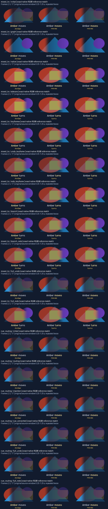

# M10.5 — Round-trip JSON fixtures and undo/redo qualification

M10.5 gives the React editor and native qualification runner the same complete
history and export implementation. A checked-in synthetic JSON fixture follows
graph, motion, timing and routing edits through undo, redo, ZIP export, native
reopen and actual CLI rendering. This is an unreleased implementation candidate
for the [M10 authoring exit criterion](unified-effects-transitions-rendering-roadmap.md#m10--authoring-interface):
the editor exports a valid project that matches CLI-rendered output.

The recorded run passes 306 checkpoint native-frame comparisons, a further
24-frame native programme comparison and 48 decoded-frame comparisons from three
actual CLI encodes. Browser interaction, browser paint, physical devices,
sequential external engines and perceptual approval remain separate evidence.
Exact-candidate platform and required GPU CI must pass before this candidate is
treated as qualified for those environments.

## Complete, immutable browser history

[`authoringHistory.ts`](../authoring/src/authoringHistory.ts) owns the production
`createAuthoringHistory`, `commitAuthoring`, `undoAuthoring` and `redoAuthoring`
operations. Each snapshot contains the complete project JSON, line/word/cue
sidecars, their three dirty flags and the cue format. Import and accepted edits
clone their inputs and deeply freeze the retained data. A caller cannot change
an earlier draft by mutating the object it originally supplied.

| Operation | History behaviour |
| --- | --- |
| Changed edit | Adds one complete undo entry and clears the abandoned redo branch. |
| Equal edit | Keeps the same current snapshot, history revision and redo branch. Object property order does not create a change. |
| Undo or redo | Restores the stored snapshot, including sidecars, dirty flags and cue format, and creates a fresh history revision. |
| Undo or redo at its boundary | Leaves the current revision unchanged. |
| Rejected edit or thrown error | Leaves current, past and future intact. |
| Proposal for an obsolete revision | Rejects the proposal before its change callback runs. |

The limit is **100 retained undo operations**, plus the current snapshot. After
more than 100 changed edits, Undo stops at the oldest retained state. It does not
promise access to the original import beyond that limit. History remains in
browser memory; reopening a project starts with clean sidecar flags and empty
undo/redo stacks. M10.5 adds no autosave, persistent history or ZIP-import UI.

Timing gestures that leave a source event unchanged also leave its dirty flag
unchanged. An accepted native parameter proposal can be a no-op: the inspector
explicitly clears that proposal's matching pending state so its controls remain
usable without manufacturing an undo entry.

## Revisions fence asynchronous work

Snapshot identity alone is insufficient for an asynchronous operation: Undo
followed by Redo can return to that exact stored snapshot. The app therefore
uses the **history object as the revision**, and advances its authoritative
reference synchronously when it accepts an edit or navigation.

Graph validation, parameter catalogues and proposals, connection gestures, and
ordinary/transition previews carry that revision. An old graph check cannot
approve a newly visited draft, even when its project and sidecar objects match
a previous snapshot. Real edits and navigation require the current native graph
check again; no-op edits preserve an existing valid revision. Existing target,
frame, quality, digest and request-serial fences continue to apply.

Preset file reads capture their starting revision. A later completion cannot
overwrite a changed draft, and obsolete file-read/parse errors do not replace
the current draft's alert. Export checks the captured revision and graph approval
around asynchronous hashing and again before download. Unmount retires the
revision during layout cleanup, before a late completion can publish work.

## Exported JSON and source bindings

[`authoringExport.ts`](../authoring/src/authoringExport.ts) supplies the same
`buildAuthoringExport` function to the app and qualification runner. It captures
the whole project and all edited sidecar text before the first asynchronous
digest. Each dirty sidecar is serialized as UTF-8 LRC and hashed with WebCrypto
SHA-256; its exported file reference receives that exact filename and digest.
Unedited sidecar references remain pinned to their original files.

The export retains graph topology and chain shorthand, native motion bindings,
source audio windows and repeats, clock configuration, recording/font/image
pins, and unrelated JSON fields. Additional metadata on a changed file reference
is retained while its `path` and `sha256` are replaced. Source times remain
source times: editing a repeated programme occurrence changes its one underlying
source event, without creating one LRC file per repeat or another motion clock.

Before serialization, the exporter requires finite project JSON. Nonfinite
numbers, omitted values such as `undefined`, functions, symbols, big integers,
custom object types, accessor/nonenumerable properties, sparse arrays and cycles
fail explicitly instead of being dropped or silently converted. Retaining an
unrelated JSON field does not grant it native schema admission: the normal
`Project` and graph validators still decide which projects are supported.

### Portable filenames and deterministic ZIPs

New sidecars start with `authoring-lines.lrc`, `authoring-words.lrc` or
`authoring-cues.lrc`. The exporter reserves basenames from existing pinned
`path`/`sha256` and `shader_path`/`shader_sha256` references, normalizes slash
direction, and compares names without case. A conflict gets a deterministic
suffix, beginning with `-2`. This also protects an original sidecar already
named `authoring-lines.lrc`; the synthetic fixture exercises that case.

The ZIP always needs `project.json` and `AUTHORING-README.txt`. An admitted pinned
input with either basename causes an explicit failure. The browser cannot know
which absolute or relative source directory a user will choose for extraction,
so reserving known source basenames is deliberately conservative.

The existing STORE ZIP writer retains UTF-8 entries and CRC-32 checksums, ordered
entry names, and its bounds of 128 entries and 4 MiB per entry. M10.5 replaces
its invalid zero month/day with the fixed valid DOS date **1980-01-01**, keeping
identical exports byte-for-byte reproducible. A project bundle normally contains
two to five entries: the project, instructions and up to three edited sidecars.

### Explicit CD CUE conversion

A clean CD `.cue` source keeps its original reference. Exporting edited cues
requires explicit conversion to LRC and valid **SECTION**, **ENTRY**, **DROP**
or **BREAK** labels for every cue being exported. Merely setting a dirty flag
or renaming one cue while leaving other CD titles invalid is insufficient.
The cue inspector's rename operation performs the conversion; finish naming
the remaining cues before exporting. Undo restores the original cue format,
labels, timestamps and dirty state together.

### Use the original source layout

The download contains new project JSON and edited sidecars. Existing audio,
fonts, images, models and recordings are not copied into it. Extract beside
the original sources in their original relative layout, as the included
instructions specify, then run the normal `plan`, `preflight` and `render`
workflow against the exported project.

Extraction is a manual file operation. Retain the original project JSON and
review existing destination filenames before placing the new files: the browser
cannot inspect unpinned files already present in that directory. The authoring
server does not extract the ZIP or modify the original project or source bytes.
The qualifier's bounded extraction helper operates only in owned synthetic
directories; it is not a new production import or overwrite API.

## Diagnostics and focused regressions

| Condition | Result and next action |
| --- | --- |
| Draft changed while a proposal or preset was pending | The obsolete edit is rejected. Retry against the current draft. |
| Draft changed or graph approval became unavailable during export | No stale download is issued. Wait for the current native graph check and export again. |
| Unsupported project JSON value | Export fails with the finite-JSON diagnostic. Correct the invalid programmatic value. |
| Pinned input uses a required bundle filename | Export fails before writing ZIP entries. Resolve the source/project naming conflict explicitly. |
| Edited CD CUE or invalid section label | Export asks for valid LRC section conversion; the draft and history remain intact. |

The focused Node regressions cover deep mutation protection, complete snapshot
restoration, the 100-operation limit, branch changes, equal edits, stale native
proposals, and undo/redo revision reuse across the actual graph/preview helpers.
Export tests cover detached asynchronous capture, exact sidecar bytes/hashes,
retained JSON and reference metadata, portable collisions, CUE conversion,
finite JSON, stale exports, and byte-identical undo/redo bundles. ZIP timestamp
checks read both local and central records. Python archive tests exercise
malformed, oversized, duplicate, compressed, linked and conflicting
entries before any qualification extraction writes a file.

The native inspector's pending-state correction is a guarded UI setter change;
validation here consists of the shared no-op history tests and source typecheck.
No mounted-browser interaction regression or measured decode/paint is claimed.

## Reproducible native qualification

Use installed Python dependencies, **Node 24 or newer**, authoring dependencies,
a font, FFmpeg and ffprobe. Before tests or builds, follow the exact-runtime
temporary-directory preflight in [AGENTS.md](../AGENTS.md); cleanup failures
block subsequent substantial work. The native qualifier additionally probes its
Python and Node output paths and owns/removes its generated temporary trees.

From the repository root, with the font path adapted to the installed system:

```powershell
$env:POWERSHELL_TELEMETRY_OPTOUT = '1'
node --experimental-strip-types --test authoring/tests/authoringHistory.test.ts authoring/tests/authoringExport.test.ts authoring/tests/archive.test.ts
npm --prefix authoring run build
./scripts/Invoke-Tests.ps1 -Python python -PytestArgs @('-q', 'tests/test_authoring_roundtrip_archive.py')
python integration/qualify_authoring_roundtrip_m10_5.py --output authoring-roundtrip-qualification --font /path/to/font.ttf --ffmpeg ffmpeg --ffprobe ffprobe
```

The output directory must be new. `FRAMERUDIMENTS_TEST_FONT` can supply the font,
`FRAMERUDIMENTS_FFMPEG` can supply FFmpeg, and the qualifier otherwise finds
FFmpeg/ffprobe on `PATH`. It does not download media tools, fonts or models.

[`authoring_roundtrip_m10_5.json`](../integration/fixtures/authoring_roundtrip_m10_5.json)
contains literal independent expected states, separate from the editor
operations. Its source window starts at sample **12,000**, ends before sample
**60,000**, and uses **48 kHz**, repeated twice to produce **24 frames at 12 FPS**.
Native named motion and a saved native
recording retain their source clocks; an added continuous binding advances
across the repeat. The fixture includes fork/merge/matte connections, transition
chain parameters and controls, all three timing sidecars, keyframes, redo
branching, routing, stage injection and explicit CD CUE conversion.

The TypeScript runner uses the production model, history, native HTTP parsers
and export writer. Python validates the actual ZIP bytes, reopens each exported
project and its sidecars through the native session parser, starts a fresh clean
history, and exports it again. An independent native reference is built from
literal expected values rather than replaying the editor operations.

### Recorded results and scope

| Check | Recorded result |
| --- | --- |
| History checkpoints | 17: eleven mixed LRC checkpoints and six CD CUE/routing checkpoints. |
| Native frame order | 0, 2, 5, 9, 12, 14, 17, 21, then 5 again. |
| Checkpoint native comparisons | 153 exported-versus-reference and 153 reopened/reexported-versus-reference; all 306 RGB8 frame pairs match exactly. |
| Native reopen | All 17 checkpoints reopen with matching project semantics, clean dirty flags and empty history, then reexport successfully. |
| Complete native programme | All 24 frames of the final mixed-LRC export match its independent reference exactly. |
| Public CLI | Actual `plan`, complete 24-frame `preflight`, and three `render` executions for the exported, reference and reexported projects pass technical QA. |
| Encoded comparison | Three 24-frame videos are fully decoded; 48 equivalent encoded-frame pairs match exactly. |
| History/source checks | Full undo/redo restores exact ZIP bytes; no-op retains redo, branching removes it, stale proposals are rejected, and 105 commits retain exactly 100 undo operations. Original projects and source bytes remain unchanged. |
| Resource ownership | Native servers, temporary sidecar trees and the owned qualification tree close and clean up successfully. |

Exported, reference and reopened native clocks and control values agree exactly.
The additional independent rational source-clock formula permits only `1e-12`
absolute floating-point roundoff. Repeated frame 5 agrees after nonsequential
evaluation. Native RGB8 comparisons and decoded encoded-frame comparisons are
separate checks because the encoding path changes the colour representation.

The recorded environment is Python **3.12.14**, Node **24.22.1**, DanceRudiments
**0.3.0**, Pillow **13.0.0** and FFmpeg **7.1.5**. The receipt records runtime,
fixture, implementation, source, archive and frame hashes and the explicit scope
of each check. A fresh run writes `authoring-roundtrip-qualification.json`,
`authoring-roundtrip-contact-sheet.png` and `authoring-roundtrip.mp4`.



The checked-in [qualification receipt](media/authoring-roundtrip-m10-5.json)
and image contain synthetic native compositor and CLI evidence. Routing and
stage injection are retained and admitted as configuration; the qualifier does
not start sequential Butterchurn/projectM engines. Its CPU pixels do not certify
GPU parity, physical-adapter behaviour, browser interaction, painted layout,
listening approval or artistic approval. The existing authoring CI workflow
runs the fixture route and uploads its evidence for the candidate; platform and
required GPU jobs retain their own acceptance results.

The successor in the consolidated roadmap is the
[M11.1 temporal dependency and deterministic scheduling candidate](temporal-scheduling-m11-1.md).
M10.5 provides an authoring-to-native-CLI qualification candidate; delayed
feedback, checkpoints and random-access reconstruction remain M11.2.
