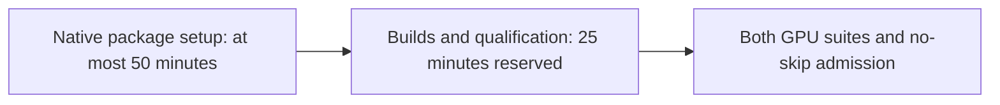

# Native CI setup and qualification budgets

The visualiser and software-EGL preview jobs each allow 75 minutes, including a separately bounded 50-minute
native-package step. This leaves 25 minutes after that ceiling for Python and
visualiser preparation, projectM compilation, the isolated EGL/GLX tests and
artifact retention. All native tests and strict no-skip checks remain required.

Budget illustration, not a measured execution result. Actual job steps and
artifacts provide execution evidence.

The installer permits a 120-second repository-enable command, three attempts
with a 300-second index refresh and 600-second installation, and 10/20-second
backoffs. Each command has an additional 15-second TERM-to-KILL grace period,
so the conservative command ceiling is 2,955 seconds (49.25 minutes). A focused
workflow test derives that ceiling from the actual installer and checks both
setup and whole-job limits in both consumers, so changing retries or timeouts requires a matching budget.

The previous main-branch attempt downloaded 107 MB in three bounded attempts.
Package setup occupied almost 24 minutes of its former 25-minute whole-job
allowance. This was active download work, rather than an inferred deadlock.
[Original run](https://github.com/kieransimkin/FrameRudiments/actions/runs/45304175054).
The equivalent 0.4.34 release qualification passed; no immutable tag or asset
is changed by this correction.

A setup overrun fails its named step. A native test failure or skipped GPU
case still fails qualification. These budgets are CI resource limits, not
render performance promises or physical-device acceptance.

The first corrected visualiser job passed on commit 272bf3b. The parallel preview GPU job still had a 20-minute whole-job limit and was cancelled during its second native-package attempt; it now uses the same 50/75-minute setup/job bounds. Both native qualification routes remain required.
