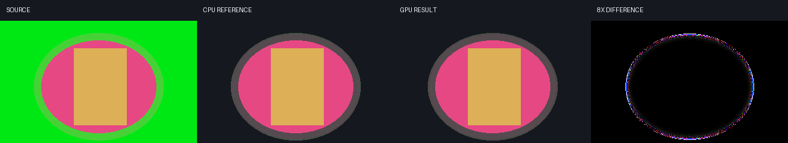

# M8.8 — mixed CPU/GPU islands and edge decontamination

FrameRudiments 0.4.21 no longer treats an unsupported CPU node as a reason to
abandon every GPU-capable part of an effect graph. In `auto` mode it identifies
maximal connected resident regions, uploads each region's host boundary once,
executes its supported nodes in the existing texture pool, and reads back its
single host-visible exit once.

The image is generated by
[`integration/generate_effect_graph_m8_8_media.py`](../integration/generate_effect_graph_m8_8_media.py)
from a synthetic green-edge fixture. It is implementation evidence, not
campaign artwork. The fourth panel amplifies RGB differences so small rounding
differences are visible; the acceptance test compares unamplified pixels.

## Partition contract

- Only nodes with an exact resident shader are candidates.
- A CPU node ends one island and can provide a boundary to the next.
- Transitions and composites establish a new original-alpha lineage and end an
  island. This prevents an implicit output-alpha substitution.
- A candidate region with more than one host-visible exit is rejected with
  `multiple_host_visible_exits`; it retains the established per-node/CPU path.
- A budget or runtime capability rejection restarts the sample on the CPU in
  `auto`. Strict GPU mode retains its existing all-or-nothing semantics.
- The authored graph and resolved native DanceRudiment values are never mutated.

`last_transport.gpu_islands` records members, boundaries, output, resident draw
and surface counts, uploads, readbacks and exact RGBA8 payload bytes. The report
also exposes `gpu_island_count`, `gpu_island_nodes` and detached rejection rows.
Payload bytes are measured transport, not physical VRAM.

## Confidence-weighted edge decontamination

`edge_decontaminate` now has a native GPU route for `edge_radius <= 12`. The
shader derives confidence from source alpha and the retained key matte, blurs
confidence-weighted straight RGB and confidence in two bounded passes, then
replaces only uncertain edge colour. Alpha is unchanged by this step. This is
neighbour colour reconstruction; matte feather and dominant-channel despill
remain separate controls.

Valid CPU radii above 12 are never silently clamped. `auto` uses the CPU
reference, while strict GPU mode raises `GPUUnsupported` before an upload.

## Verification and limits

The required suite covers deterministic planning, multi-exit rejection,
lineage splits, budget fallback, real-driver CPU/GPU parity and exact transfer
counts. Windows runs the native standalone NVIDIA context; the required Linux
job runs Mesa/EGL, providing a second vendor/driver implementation before a
release is accepted.

M8.8 can place supported islands on either side of a CPU spatial warp and
reports both boundary transfers. See the [M8.9 GPU spatial warp increment](effect-graph-m8-9-gpu-spatial.md)
for the current GPU modes and remaining profiling work. A video
would not add useful evidence here: residency and static key-edge reconstruction
have no independent time-varying visual behaviour.
