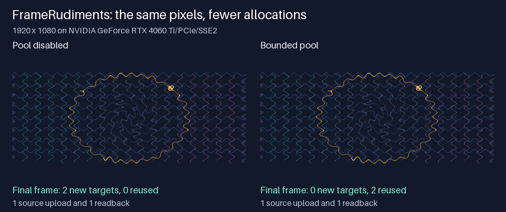

# M8.9 GPU target reuse and memory

FrameRudiments 0.4.30 can reuse the texture and framebuffer for a resident
draw on the next frame. It uploads each source again and reads the finished
output into a new host image. Across six changing 1080p frames on an RTX
4060 Ti, the pool reduced target allocations from two per frame to two for
the sequence. Every corresponding RGBA frame matched byte for byte. The same
counts and byte parity held at 4K.



The [60 fps spatial warp comparisons](effect-graph-m8-9-gpu-spatial.md)
show the effects in motion. The allocation counters above come from the
separate two-pass wave and swirl benchmark.

## Resource lifetime and limits

- An owned OpenGL context can keep up to eight RGBA8 targets of one canvas
  size and at most 64 MiB of texture payload by default. Pass
  `GLMatteBackend(max_pooled_target_bytes=0)` to disable retention, or a
  nonnegative byte limit to change it. Borrowed contexts do not retain
  targets between evaluations.
- A new GPU canvas size releases the old pool, including when the two sizes
  have equal pixel counts. Context close empties it. A draw or readback
  failure releases the affected targets. Source textures and per-node bridge
  textures are invocation-local.
- Admission still uses the graph's planned RGBA8 working set. Reusable
  targets count once. Surplus idle targets are trimmed to the remaining
  payload budget before the next graph or bridge starts allocating.

The transfer report separates `resident_target_allocations` (new
texture/framebuffer pairs) from `resident_target_reuses` (pairs borrowed
from a previous resident evaluation, including an earlier island in the same
frame). The `retained_target_count` and `retained_target_payload_bytes`
fields describe the idle pool at the time of reporting; they are zero after
the context closes. The `resident_peak_allocated_surfaces` and
`resident_estimated_texture_bytes` fields continue to describe the logical
plan, including source textures and targets reused from the pool. Project
composition evidence includes the latest transport report.

From 0.4.31, temporal supersampling shares the parent compositor's backend
and target pool. The project closes the shared backend when it finishes.
For a project with temporal subframes, composition evidence labels
`sampling.scope` as `last_subframe` and includes the sample and encoded
frame rates. The counters describe that sample; they are not totals across
the shutter or the render.

## Optional driver memory snapshot

Call `gpu.sample_driver_memory()` with the backend's own context current to
get a labelled snapshot. Rendering and backend discovery never take this
snapshot automatically.

| Driver extension | What the report describes |
| --- | --- |
| [GL_NVX_gpu_memory_info](https://registry.khronos.org/OpenGL/extensions/NVX/NVX_gpu_memory_info.txt) | Device hints: dedicated capacity, total available to the driver, current available dedicated memory, and eviction counters when valid. |
| [GL_ATI_meminfo](https://registry.khronos.org/OpenGL/extensions/ATI/ATI_meminfo.txt) | Free space and largest free blocks for the texture and auxiliary pools. These figures describe pools and may overlap. |
| Software renderer or no applicable query | `state: unavailable` and a reason. A missing reading does not indicate zero VRAM. |

Sizes are converted from KiB to bytes. These are driver hints shared with
other activity on the system. The report does not derive process usage from
differences between samples. Admission remains deterministic and independent
of these readings; `measured_vram` in the transfer report remains false.

## Reproduce the comparison

```sh
python integration/benchmark_effect_graph_m8_9_resources.py --size hd --backend auto --output hd.json --image comparison.png
python integration/benchmark_effect_graph_m8_9_resources.py --size 4k --backend auto --output 4k.json
```

Use `--backend egl` on systems with a functioning EGL context. The
benchmark warms the shaders on a smaller canvas, varies the wave phase, and
requires identical per-frame hashes with the pool on and off. It reports
steady frame timings including uploads and readback. Decoding, scene
composition and encoding are outside this measurement.

| RTX 4060 Ti, NVIDIA 617.42 | Pool disabled: new targets per warm frame | Pool enabled: new targets per warm frame | Pool enabled: idle RGBA8 payload |
| --- | ---: | ---: | ---: |
| 1920 × 1080 | 2 | 0 | 16,588,800 bytes |
| 3840 × 2160 | 2 | 0 | 66,355,200 bytes |

The NVIDIA OpenGL probe returned 8,585,740,288 bytes of dedicated capacity.
Required CI also runs the HD benchmark and real context tests on Mesa/EGL
software rendering. Mesa can advertise NVX on llvmpipe, so software rendering
is identified before any memory query. ATI values use a synthetic query fixture.
Physical AMD and Intel profiling remains open.
