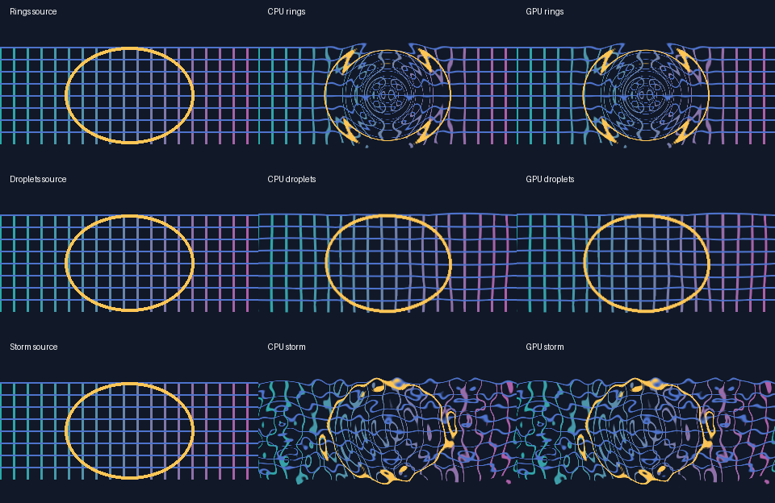
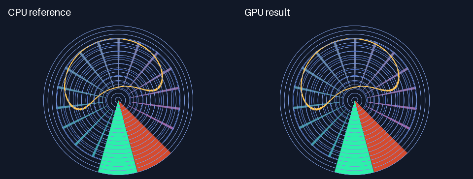

# M8.9 GPU spatial warps

Set `effect_graph_backend` to `"auto"` or `"gpu"` on a project using an
existing `spatial_warp` node. Install the `gpu` extra and use an OpenGL 3.3
context. The default project backend is still CPU. Warp coordinates, the
native DanceRudiment control paths and the project format are shared across
backends.


[Play the two-second, silent 60 fps comparison](media/effect-graph-m8-9-spatial.mp4).
The left panel holds the original blue grid and yellow ring. The middle and
right panels show the same moving deformation as wave phase makes one turn,
with both panels composited onto the same dark background.

## Supported configurations

| GPU warp | Controls and limits |
| --- | --- |
| Wave and turbulence | Up to 4096 pixels of amplitude per axis and wavelengths of at least one pixel. Turbulence supports the authored seed and up to six octaves. |
| Radial | The full `warp_amount` range from −2 to 2. |
| Swirl, mirror, kaleidoscope and polar unwrap | Existing controls and canvas limits. |
| Map displacement | Two same-size RGBA inputs, all four borders and up to 4096 pixels of displacement per axis. |
| Polar wrap | All four borders. Radii under 16 pixels require the precision shader extension. |
| Raindrop ripples | All three variants and four borders. Amplitude above 128 pixels or an X wavelength below 16 pixels for rings and storm requires the precision shader extension. |

These modes support transparent, clamp, repeat and mirror borders. They
sample at pixel centres, interpolate premultiplied colour, and apply warp mix
before quantizing alpha to RGBA8. Zero mix and neutral transforms preserve
the original pixels exactly. Strict GPU mode reports the reason for rejecting
unsupported configurations. `spatial_manifest(gpu_backend=backend)` reports
support for the configured values on the attached backend. Backend preflight
resolves per-frame control overrides before making the same decision.

## Original alpha and transfers

An original-alpha matte follows the warped geometry even when an earlier node
changed the layer's opacity. The resident executor reuses the warped colour
texture for lineage when both input handles share alpha. When they differ,
it warps the original-alpha texture with the same coordinate map. A closed
resident graph still reads back its final image once. If a mixed graph needs
the warped alpha on the host, the per-node bridge returns that alpha separately
and reports both transfers.

## Map displacement and polar wrap

FrameRudiments 0.4.27 introduced these GPU modes. The comparison below shows
RGBA map displacement and repeat-border polar wrap from that release.


[Play the two-second 60 fps comparison](media/effect-graph-m8-9-map-polar.mp4).
The top row shows an RGBA control map and the resulting grid deformation
as the horizontal displacement grows. The lower row shows a rectangular grid
wrapping around a rotating polar origin. Each row shows the CPU reference in
the middle and the actual GPU output on the right.

The map's selected R, G, B, A or luminance channels set the signed X and Y
offsets around `warp_neutral`. Map alpha attenuates both offsets. A closed graph
with a direct source map uploads each source once and reads back its final
result once. With fractional source opacity the host applies the existing
byte rounding before upload, since a one-byte map difference can move a
sample by a pixel. If another node produces the map, the per-node bridge can
recognize an entirely transparent map on the host and preserve every source
byte. Otherwise the bridge uploads the same map for the visible and original
alpha passes and reads both results back. A source map that is already
transparent can alias the original pixels without a warp draw.

Polar wrap keeps the fractional part of its origin separate so a centre
close to a pixel still points in the correct direction. Repeat sampling
joins the left and right source columns at the seam. In 0.4.29, transparent,
clamp and mirror sampling preserve their corresponding CPU seam on GPU.

## Raindrop ripples

FrameRudiments 0.4.28 adds GPU execution for `spatial_warp` nodes with
`warp_type: "raindrop_ripples"`. Rings, droplets and storm support transparent,
clamp, repeat and mirror borders. Rings use the authored centre. Droplets and
storm support up to 32 seeded sources. The CPU prepares the same small set of
drop locations and timing parameters for either backend. The GPU evaluates
refraction at each pixel using those uniforms, with no displacement texture.
With one source and an output that stays resident, each frame transfers the
source to the device once and reads the final image back once.

The base shader accepts 128 pixels of amplitude per axis and an X wavelength
of at least 16 pixels for rings and storm. Droplets use lens geometry without
a wavelength. The 0.4.29 precision shader extends amplitude to 4096 pixels
and wavelength down to one pixel. A zero-amplitude or zero-mix ripple returns
the exact source pixels. The
[wash-away transition](raindrop-ripples.md#wash-away-transition) uses the CPU.



[Play the two-second 60 fps raindrop comparison](media/effect-graph-m8-9-raindrops.mp4).
Read the rows from top to bottom. A ring travels outward in the first row.
Several lens-like distortions pulse in the second row. The last row combines
overlapping rings and lenses. The left column shows the static source, with
the CPU output in the middle and the GPU output on the right.

## Full-range warps

FrameRudiments 0.4.29 computes wave and turbulence coordinates from a
48-bit fixed-point step. The GPU keeps the integer noise cell and its
fraction separate, so short wavelengths retain their subpixel placement
across the canvas and across all six turbulence octaves. Negative radial
warps subtract a split origin before mapping the distance. Map displacement
calculates the offset from exact RGBA bytes, including near-white neutral
thresholds.

The CPU supplies one bit per scanline for the polar seam on transparent,
clamp and mirror borders. The bit identifies the source edge when an angle
rounds onto the cut. The GPU computes the remaining sampling coordinates.
There is no extra image upload or readback.

Radii below 16 pixels and extreme ripples use compensated distance arithmetic.
That shader uses `precise` to retain the order of the rounding corrections
and requires [`GL_ARB_gpu_shader5`](https://registry.khronos.org/OpenGL/extensions/ARB/ARB_gpu_shader5.txt).
On drivers without it, `auto` uses the CPU for those samples and strict mode
reports `warp_precision_limit_exceeded`.



[Play the two-second 60 fps polar seam comparison](media/effect-graph-m8-9-polar-seam.mp4).
A cut rotates through each circle. The green and red bands come from opposite
edges of the source. The CPU sample is on the left and GPU on the right.

## Benchmark

The 1920×1080 wave fixture on an NVIDIA RTX 4060 Ti made one upload and one
readback of 8,294,400 bytes each. Across three samples, the median was 1.349 s on
CPU and 0.057 s on GPU, including transfers. The largest alpha and visible
straight-RGB differences were one 8-bit level each. These timings measure one
effect graph on that driver. They exclude decoding, the rest of the compositor
and encoding. See the separate [GPU resource benchmark](effect-graph-m8-9-gpu-resources.md)
for cross-frame target reuse and the scope of available driver memory readings.

On the same RTX 4060 Ti, the nine-source 1920×1080 storm fixture took a median
of 1.757 s on CPU and 0.032 s on GPU over three renders, including transfers.
One upload and one readback each carried 8,294,400 bytes. The largest alpha,
visible RGB and composited differences were each one 8-bit level. The
precision-boundary fixtures also exercise all three variants at 128 pixels
of displacement per axis. Droplets and storm use 32 sources there.

The 0.4.29 stress benchmark uses 12 fixtures, including 4096-pixel amplitude,
a fractional one-pixel wavelength, a radius close to half a pixel, and
a cut through strongly contrasting source edges. The RTX 4060 Ti passed
the 1080p and 4K comparisons with a maximum difference of one 8-bit level
in alpha and visible RGB. The largest difference after compositing over
black or white was below two levels. Mesa/EGL runs the same 1080p benchmark.

Reproduce the benchmark and optional comparison media from the source checkout.

```sh
python integration/benchmark_effect_graph_m8_9_gpu.py --size hd --backend auto --output m89.json
python integration/benchmark_effect_graph_m8_9_gpu.py --backend auto --output m89-demo.json --media docs/media
python integration/benchmark_effect_graph_m8_9_gpu.py --backend auto --output m89-map.json --media docs/media --map-polar-media
python integration/benchmark_effect_graph_m8_9_gpu.py --size hd --backend auto --raindrops-only --output m89-rain-hd.json
python integration/benchmark_effect_graph_m8_9_gpu.py --backend auto --raindrops-only --output m89-rain-demo.json --media docs/media --raindrop-media
python integration/benchmark_effect_graph_m8_9_precision.py --size hd --backend auto --output m89-precision-hd.json
python integration/benchmark_effect_graph_m8_9_precision.py --size small --case polar_wrap_oblique --backend auto --output m89-seam.json --media docs/media
```

## Potential problems

- **Large coordinates can round away a fraction that determines the sample.**
  The stress benchmark checks the authored wave, turbulence, radial and
  displacement ranges. It also exercises short-radius polar wrap and
  high-amplitude rain, including the precision shader.
- **A nonperiodic polar cut can switch to the opposite source edge.** Check an
  oblique seam and both sides of a cardinal angle with different pixels on
  each source edge. Repeat sampling has the same footprint on either side.
- **Opacity rounding can move a displacement sample by a pixel.** A map
  produced from a source with fractional opacity is prepared on the host
  before the warp runs on GPU. Both GPU routes preserve the CPU map bytes.
- **The Windows glcontext wheel cannot import `egl`.** Run the spatial suite
  through `scripts/Invoke-Tests.ps1`; the fixture selects Windows' native
  standalone OpenGL context. The required Linux GPU job separately exercises
  Mesa/EGL and fails if its parity tests skip.
