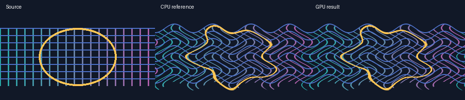
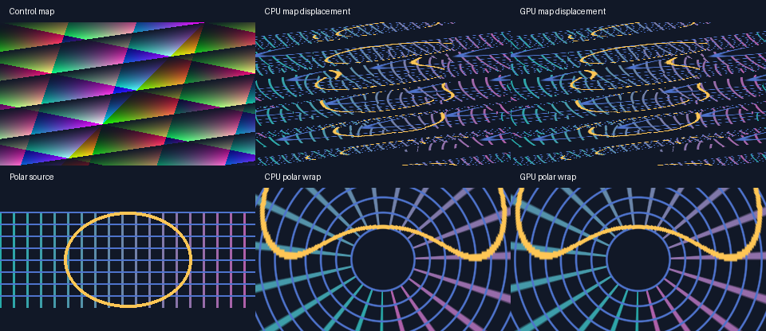

# M8.9 GPU spatial warps

Set `effect_graph_backend` to `"auto"` or `"gpu"` on a project using an
existing `spatial_warp` node. Install the `gpu` extra and use an OpenGL 3.3
context. The default project backend is still CPU. Warp coordinates, the
native DanceRudiment control paths and the project format are shared across
backends.



[Play the two-second, silent 60 fps comparison](media/effect-graph-m8-9-spatial.mp4).
The left panel holds the original blue grid and yellow ring. The middle and
right panels show the same moving deformation as wave phase makes one turn,
with both panels composited onto the same dark background.

## Supported configurations

| GPU warp | Controls and limits |
| --- | --- |
| Wave and turbulence | Up to 128 pixels of amplitude per axis and wavelengths of at least 16 pixels. Turbulence supports the authored seed and up to six octaves. |
| Radial | Nonnegative `warp_amount`. Negative amounts retain the CPU inverse mapping. |
| Swirl, mirror, kaleidoscope and polar unwrap | Existing controls and canvas limits. |

These seven modes support transparent, clamp, repeat and mirror borders. They
sample at pixel centres, interpolate premultiplied colour, and apply warp mix
before quantizing alpha to RGBA8. Zero mix and neutral transforms preserve
the original pixels exactly. Wave and turbulence settings beyond the GPU
precision limits retain their full CPU ranges. The CPU also handles raindrop
ripples. Strict GPU mode reports the reason for rejecting unsupported
configurations. `spatial_manifest()` reports
support and the reason for the configured values. Backend preflight resolves
per-frame control overrides before making the same decision.

## Original alpha and transfers

An original-alpha matte follows the warped geometry even when an earlier node
changed the layer's opacity. The resident executor reuses the warped colour
texture for lineage when both input handles share alpha. When they differ,
it warps the original-alpha texture with the same coordinate map. A closed
resident graph still reads back its final image once. If a mixed graph needs
the warped alpha on the host, the per-node bridge returns that alpha separately
and reports both transfers.

## Map displacement and polar wrap

FrameRudiments 0.4.27 adds the following GPU configurations.

| Warp | GPU configuration | CPU fallback in `auto` |
| --- | --- | --- |
| `displacement` | Two same-size RGBA inputs, all four borders, up to 128 pixels of displacement on each axis. | Amplitude above 128 pixels. |
| `polar_wrap` | Repeat border and a radius of at least 16 pixels. | Transparent, clamp or mirror border, or a radius below 16 pixels. |



[Play the two-second 60 fps comparison](media/effect-graph-m8-9-map-polar.mp4).
The top row shows an RGBA control map and the resulting grid deformation
as the horizontal displacement grows. The lower row shows a rectangular grid
wrapping around a rotating polar origin. Each row shows the CPU reference in
the middle and the actual GPU output on the right.

The map's selected R, G, B, A or luminance channels set the signed X and Y
offsets around `warp_neutral`. Map alpha attenuates both offsets. A closed graph
with a direct source map uploads each source once and reads back its final
result once. With fractional source opacity the host applies the existing
byte rounding before upload, since a one-byte map difference can move a
sample by a pixel. If another node produces the map, the per-node bridge can
recognize an entirely transparent map on the host and preserve every source
byte. Otherwise the bridge uploads the same map for the visible and original
alpha passes and reads both results back. A source map that is already
transparent can alias the original pixels without a warp draw.

Polar wrap keeps the fractional part of its origin separate so a centre
close to a pixel still points in the correct direction. Repeat sampling
joins the left and right source columns even when a coordinate rounds across
the seam. Other borders keep their existing CPU seam behaviour.

## Benchmark

The 1920×1080 wave fixture on an NVIDIA RTX 4060 Ti made one upload and one
readback of 8,294,400 bytes each. Across three samples, the median was 1.349 s on
CPU and 0.057 s on GPU, including transfers. The largest alpha and visible
straight-RGB differences were one 8-bit level each. These timings measure one
effect graph on that driver. They exclude decoding, the rest of the compositor
and encoding. Physical VRAM measurement and persistent cross-frame pooling
remain separate roadmap items.

Reproduce the benchmark and optional comparison media from the source checkout.

```sh
python integration/benchmark_effect_graph_m8_9_gpu.py --size hd --backend auto --output m89.json
python integration/benchmark_effect_graph_m8_9_gpu.py --backend auto --output m89-demo.json --media docs/media
python integration/benchmark_effect_graph_m8_9_gpu.py --backend auto --output m89-map.json --media docs/media --map-polar-media
```

## Potential problems

- **A short wavelength combined with a large amplitude changes edge pixels
  on GPU.** At 1080p, a deliberately extreme wave and turbulence fixture exposed
  large differences between the GLSL and CPU sampling coordinates. Keep the CPU
  range intact and use the shared GPU precision check before upload. The HD
  benchmark tests the admitted boundary and compares alpha plus the result
  composited over both black and white.
- **A radial warp with a negative amount and an almost pixel-centred origin
  can shift the centre pixel.** The CPU and GLSL may round the origin
  differently. The same precision check routes negative radial amounts to
  the CPU, including values reached by a live control.
- **Polar wrap can jump to the opposite source edge at a discontinuous
  angular seam.** GPU wrap requires repeat sampling so both sides of the
  seam interpolate the same source columns. Other border modes use the CPU
  route in `auto`. A split integer/fractional centre also avoids losing the
  direction to the nearest pixel.
- **Opacity rounding can move a displacement sample by a pixel.** A map
  produced from a source with fractional opacity is prepared on the host
  before the warp runs on GPU. Both GPU routes preserve the CPU map bytes.
- **The Windows glcontext wheel cannot import `egl`.** Run the spatial suite
  through `scripts/Invoke-Tests.ps1`; the fixture selects Windows' native
  standalone OpenGL context. The required Linux GPU job separately exercises
  Mesa/EGL and fails if its parity tests skip.
