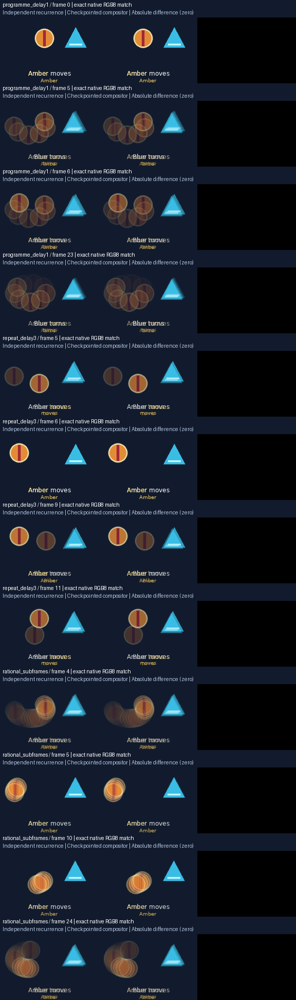

# M11.2 — Delayed feedback, bounded history and checkpoint reconstruction

M11.2 adds an explicit native feedback recurrence to the compositor. An output
can blend its current native image with an earlier feedback output, preserve
the complete delayed history in an immutable checkpoint, and reconstruct a
later or earlier request from an eligible checkpoint or an exact reset.
Sequential rendering and random access use the same recurrence and source clock.

This is an unreleased implementation candidate on the consolidated roadmap.
The new project setting is `post_effects.feedback`. It owns native RGB history
before final output quality and before optional sequential external visualisers.
The existing same-frame effect graph still rejects cycles. M11.1's native
sampling and historical shutter remain the inputs to this recurrence.

## Project configuration

```json
{
  "post_effects": {
    "feedback": {
      "delay_frames": 3,
      "mix": 0.65,
      "reset": "repeat",
      "checkpoint_interval": 30,
      "max_checkpoints": 8,
      "max_replay_frames": 3600,
      "max_state_bytes": 268435456
    }
  }
}
```

| Setting | Default | Accepted values and meaning |
| --- | --- | --- |
| `delay_frames` | Required | Integer 1–64; distance on the encoded-frame ruler. |
| `mix` | `0.5` | Number 0–1; weight of the earlier feedback output. |
| `reset` | `"repeat"` | `"repeat"` clears history at each exact source cycle; `"programme"` retains history across the programme. |
| `checkpoint_interval` | `30` | Integer 1–3,600; checkpoint cadence measured from the current reset. |
| `max_checkpoints` | `8` | Integer 1–64; maximum automatic checkpoint-cache entries. |
| `max_replay_frames` | `3600` | Integer 1–36,000; maximum encoded callbacks in one reconstruction request. |
| `max_state_bytes` | `268435456` | Integer 1–536,870,912; owned immutable feedback payload budget, subject to the minimum required by the canvas and delay. |
| `modulations` | `[]` | At most one existing native DanceRudiments driver, with target `"feedback.mix"`. |

Unknown fields, nonfinite numbers and invalid types are rejected. Integer
settings do not accept booleans. The mix driver uses the existing motion,
recording, source-clock, range, combination and weight contracts; its final
value is clamped to 0–1. For example, this driver can appear inside `feedback`:

```json
{
  "modulations": [{
    "motion": {"kind": "named", "pattern": "circle", "repeat_clock": "source"},
    "target": "feedback.mix",
    "axis": "x",
    "range": [0, 0.6],
    "combine": "add",
    "weight": 0.5
  }]
}
```

Native feedback requires declarative admitted sources. Supplying custom Python
scene hooks or custom renderer mappings with feedback is rejected before native
allocation because those objects have no supported checkpoint identity.

## Exact recurrence and reset semantics

Let `C[n]` be the current native RGB8 image after source sampling, spatial and
temporal supersampling, and any configured historical shutter. Let `d` be
`delay_frames`, `m[n]` the source-clocked mix, and `R(n)` the current reset frame.
The stored feedback output is:

```text
F[n] = C[n]                                      when n - d < R(n)
F[n] = linear_light_blend(C[n], F[n-d], 1-m[n], m[n]) otherwise
```

The first `d` encoded outputs of a cycle therefore retain their current native
image without attenuation. A mix of zero selects the current image. A mix of
one selects the delayed feedback image once that history exists. Each blend
uses the existing linear-light RGB8 compositor, including its established
rounding; stored history contains those resulting RGB8 bytes.

For `reset: "programme"`, `R(n) = 0`. For `reset: "repeat"`, the exact cycle
span is `T = (end_sample - start_sample) * fps / sample_rate`, and
`R(n) = ceil(floor(n / T) * T)`. These calculations use rational coordinates,
including excerpts whose repeat length is not an integer number of frames.
With a six-frame cycle, frame 6 begins a new history. With a `49/10`-frame
cycle, the first reset frames are 5, 10, 15 and 20. No output before the
current reset can supply a feedback tap.

The recurrence advances once per encoded output. Native subframes still use
the existing programme grid and historical-shutter taps still remain within
their exact source cycle. Feedback does not change source sample positions,
audio phase, native beat evaluation or continuous/source repeat-clock choices.

Final output quality is applied after feedback when `apply_quality=True`.
Checkpoint history always contains the pre-finishing pixels, so alternating
`apply_quality=False` and `True` does not accumulate repeated anti-aliasing in
the recurrence. Optional external effects remain downstream of this stage.

## Real checkpoints and bounded random access

`Compositor.feedback_checkpoint()` returns the current immutable
`FeedbackCheckpoint`, or `None` before the owner has successfully rendered or
restored feedback state.
Its payload includes every contiguous RGB frame needed by the complete delay
ring, up to the declared delay, and its `next_frame` identifies the first frame
that has not yet been evaluated. A newly started cycle has a shorter ring
until enough outputs exist. A checkpoint contains actual pixels and can reduce
later native work.

The checkpoint also records the native identity, kernel configuration digest,
reset frame and fixed result byte count. `checkpoint.digest` binds canonical
metadata to the ordered payload digest. `checkpoint.document()` exports
bounded metadata, frame hashes and byte counts; it does not export pixels and
cannot reconstruct a checkpoint. There is no file loader, pickle route or
opaque engine-state serializer in this milestone.

Restoration requires an explicit `expected_sha256` obtained separately from a
trusted producer. A self-consistent hash on arbitrary supplied bytes proves
neither their provenance nor the correctness of their pixels. Admission checks
the expected digest, exact identities, result size, source-cycle boundary,
programme extent and complete contiguous delay ring before accepting state.
It performs no rendering callback.

For a project containing at least 16 output frames:

```python
from framerudiments.compositor import Compositor
from framerudiments.project import Project

producer = Compositor(Project.load("project.json"))
try:
    image, context = producer.frame(11)
    checkpoint = producer.feedback_checkpoint()
    assert checkpoint is not None
    trusted_digest = checkpoint.digest  # Keep this trusted pin with the handoff.
finally:
    producer.close()

consumer = Compositor(Project.load("project.json"))
try:
    consumer.restore_feedback(checkpoint, expected_sha256=trusted_digest)
    print(consumer.feedback_plan(15))
    image, context = consumer.frame(15)
    print(consumer.feedback_snapshot()["last_execution"])
finally:
    consumer.close()
```

The selected state must belong to the target's reset and have
`next_frame <= target_frame`. The compositor then evaluates every encoded frame
from that state through the requested target. The target's native callback
always runs, including repeated requests, so current frame metadata and routing
surfaces are regenerated. If no eligible state remains, reconstruction starts
at the exact reset. Eviction changes the required work without changing the
intended pixels.

Successful requests retain interval checkpoints and the completed request's
state. Oldest automatic cache entries are discarded to satisfy the count and
byte limits. The current state may share immutable payloads with cached
checkpoints; accounting counts each owned payload object once. Closing the
compositor releases its ownership. A caller retaining an exported checkpoint
retains that caller-owned memory separately.

## Identity, budgets and failure behaviour

The native identity binds the authored document, source-content pins at their
document roles, parser suffixes, clock, canvas, quality, feedback settings,
selected renderer backend, implementation fingerprint and Python runtime.
The runtime binding also includes the operating system, machine architecture
and Python implementation/build.
Moving identically pinned inputs into another owned directory preserves their
content identity. Filesystem guards remain attached to each owner's admitted
paths. Source mutations or changed configuration revoke that owner's feedback
state and require a new compositor. A matching visual appearance alone does
not establish a compatible checkpoint.

For RGB size `B = width * height * 3` and delay `d`, the engine reserves
`(d + 1) * B` bytes for its working ring and next output, alongside retained
committed history. The configured limit must admit at least `(2*d + 1) * B`.
Each fixed RGB result is additionally bounded to 64 MiB. Plans reject an
excessive reconstruction count or retained-state budget before native raster
callbacks. Every nested M11.1 native schedule is also admitted before the first
raster callback of a feedback request.

`max_state_bytes` accounts for owned immutable feedback payloads, including
working results and staged checkpoints. Native sampling rasters, renderer
caches, callback-private scratch, caller-held aliases and Python metadata have
their own owners and limits. This setting is not a process-RSS guarantee.

`frame(..., cancelled=predicate, progress=observer)` cooperatively checks
cancellation during planning, native schedule execution and reconstruction.
The callback cannot interrupt an individual native operation already in
progress. Kernel users receive `FeedbackCancelled` for a superseded request;
bounded runtime failures use `FeedbackUnavailable.reason_code`, including
`replay_budget_exceeded` and `state_budget_exceeded`.

New history and checkpoints are published only after all requested frames,
final target quality, source guards and progress callbacks succeed. A failed
or cancelled request discards its staged state, clears its success receipt and
restores public native metadata. Previously committed valid history survives;
an identity failure revokes it. Diagnostic work counters can include attempted
callbacks from failed requests and do not certify completed output.

The reusable `framerudiments.feedback_history.DelayedFeedback` kernel accepts
an owner-supplied deterministic immutable-byte callback and an explicit
identity. It supports ordered delay taps under its own hard limits. Its owner
supplies source semantics and must keep operations on one owning thread; it
does not create rendering workers or transfer GPU contexts.

## Planning, inspection and execution evidence

| Surface | Meaning |
| --- | --- |
| `temporal_contract()` / `temporal_plan(n)` | M11.1 native sampling/shutter capability and the schedule for one recurrence input at encoded frame `n`. |
| `feedback_contract()` | Native feedback settings, identity, source clock, backend and scope. |
| `feedback_plan(n)` | Reconstruction start, target, reset, chosen state, delay references and budgets for the current owner. |
| `feedback_snapshot()` | Current bounded state, cache count, eviction/work counters and last successful reconstruction. |
| `evidence()["feedback"]` | The feedback contract and state snapshot together. |

`temporal_plan(n)` does not expand the recurrence into all earlier native
frames. The feedback plan identifies that reconstruction range separately.
Both planning APIs leave pixels untouched. An execution receipt additionally
records the actual ordered `evaluated_frames`, `executed_steps`, selected
checkpoint digest, peak owned payload bytes and completion status.

```sh
framerudiments plan project.json --output plan.json
framerudiments inspect-temporal project.json --frame 0 --frame 12 --frame 15
```

`plan` includes the structural feedback contract when feedback is configured.
`inspect-temporal` includes that contract at top-level `feedback` and a
reconstruction plan at each `frames[i].feedback`, alongside the existing native
`schedule` and `digest`. A new CLI inspector has no restored history, so these
are cold reconstruction plans. Inspection preserves the existing bounded,
path-free JSON contract and creates no raster output or GPU context. These
plans do not claim that reconstruction has executed.

## Authored Q5 preview and external engines

Native feedback preview stays at the authored Q5 settings. Its seek status uses
`mode: "checkpoint_replay"`, with the current reconstruction frame count,
budget, retained checkpoint count and reconstruction start. The foreground
native preview owner provides cooperative cancellation and per-request progress
on its worker. When that compositor temporarily yields resources, the foreground
owner can retain one immutable checkpoint and restore it into a compatible
rebuilt compositor with its trusted digest.

The separate background Q5 subprocess can reconstruct the requested pixels,
but it does not transport in-memory checkpoints or per-frame checkpoint
progress to its parent. Cancelling background work retires the owned process;
its diagnostics continue through the existing generic worker route. The local
qualification below does not establish a rendered browser interaction.

Checkpoint admission binds the exact Python build/system and actual selected
backend/runtime provenance. The existing persistent native PNG cache keeps its
separate source, section, configuration, implementation and dependency-version
identity. Native seek status names that cache scope
`native_section_dependency_identity`. A native PNG cache hit does not verify
the complete live GPU driver or checkpoint runtime identity; this preserves the
existing independent-frame and shutter-cache contract.

Preview dependency invalidation includes native sampling reach and source-clock
reset boundaries. If the repeat ledger cannot be bounded safely, invalidation
conservatively covers the programme. Browser status exposes bounded counters
and diagnostic reasons; it does not expose checkpoint payloads.

Projects containing sequential Butterchurn/projectM stages keep S6's separate
`verified_prefix_replay` route. Those engines reconstruct their own opaque
state from frame zero and retain their existing verification and work budgets.
A native feedback checkpoint covers only the upstream native RGB recurrence.
It cannot restore an external engine, GPU context, complete rendered frame
pipeline or audio engine. Preview status continues to distinguish these modes.

## Actual synthetic qualification

```sh
python integration/qualify_feedback_history_m11_2.py --output feedback-evidence
```

The checked-in fixture uses pinned synthetic audio, two generated sprites, a
font, synthetic line/word/cue text, native named motion, a saved native recording
and graph-driven source opacity. The reference computes a literal indexed
feedback recurrence over a separate feedback-disabled native compositor. It
uses the established native raster and linear-light blend primitives, and
does not call the production feedback planner, history engine or checkpoint
selection to construct its expected recurrence.

The qualified candidate run completed all three cases below in 19.212 seconds
with zero RGB8 difference. The attached receipt's implementation hashes were
verified against the candidate source after the run.

| Case | Outputs | Reset / delay | Extra native sampling | Checkpoint vs cold native sample callbacks |
| --- | --- | --- | --- | --- |
| `programme_delay1` | 24 | Programme / 1 | One native sample | 4 vs 16 |
| `repeat_delay3` | 24 | Six-frame repeat / 3 | One native sample | 2 vs 6 |
| `rational_subframes` | 25 | `49/10`-frame repeat / 2 | Four subframes, historical shutter and final AA | 32 vs 56 |

The run compared 179 native image pairs: 73 complete-programme outputs, 85
shuffled/repeated requests, nine checkpoint comparisons, nine quality-toggle
comparisons and three seeks after checkpoint eviction. It also checked exact
source clocks, complete delay-ring payloads, detached returned images, source
immutability, checkpoint bounds and actual native work reduction. Automatic
checkpoint evictions were 22, 22 and 23 across the three complete programmes.
Checkpoint restoration saved 12, 4 and 24 actual native sample callbacks for
the three selected target requests. The largest floating-point difference
against the independent rational clock oracle was less than `4.45e-16`
seconds/beats, below the `1e-12` qualification tolerance.

Every case ran actual CLI inspection, plan, complete preflight and FFmpeg
render. All 73 decoded outputs matched separately encoded reference frames.
These are equivalent-encoder comparisons; they do not assert that decoded
compressed video equals unencoded RGB. The owned temporary source/output tree
was removed after qualification. The receipt records runtime versions,
implementation/source hashes, callback counts and execution rows.



See the [synthetic qualification receipt](media/feedback-history-m11-2.json).
The three columns show independent reference, native result and absolute
difference; every difference panel is black in this run. This CPU/CLI evidence
does not establish GPU parity, browser interaction, physical-device behaviour,
listening approval or artistic approval. Exact-candidate CI remains a separate
gate. Creative temporal effects and rational video adapters remain M11.3 and
M11.4 work.
