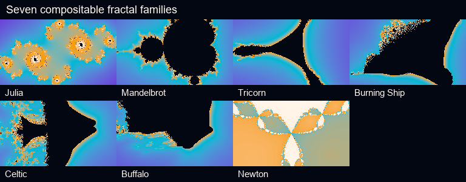

# Compositable fractal library

FrameRudiments 0.4.18 provides seven deterministic fractal families through the
existing `procedural_field` effect-graph node. They are ordinary generated RGBA
surfaces, so the same graph can use them as visible layers, mattes, transition
masks, textures or vector-potential inputs. They own no clock or random state.



Actual compositor output from Julia, Mandelbrot/Multibrot, Tricorn, Burning
Ship, Celtic, Buffalo and Newton configurations. The shared five-stop palette
and all inputs are synthetic; no private media or model-generated art is used.

[Play the silent two-second seven-family native-motion demonstration](media/fractal-library-motion.mp4)
([transcript and accessibility description](media/fractal-library-motion-transcript.md)).
All panels use FrameRudiments compositors and released DanceRudiments named
motions. The first and next-loop frames are byte-identical.

## Families

| `field_type` | Equation/character | Specific controls |
| --- | --- | --- |
| `julia` | `z <- z^p + c`; moving constant | Existing `field_julia_*` controls |
| `mandelbrot` | `z <- z^p + c`; includes Multibrot powers 2–8 | `field_fractal_*` |
| `tricorn` | Conjugated escape-time orbit | `field_fractal_*` |
| `burning_ship` | Absolute real/imaginary orbit before the power | `field_fractal_*` |
| `celtic` | Absolute powered real component | `field_fractal_*` |
| `buffalo` | Absolute powered real and imaginary components | `field_fractal_*` |
| `newton` | Root basins for `z^degree = phase` | `field_newton_*` |

All families share `field_output`, coverage, contrast/bias/gamma/invert,
multi-point `field_palette`, colour space and interpolation controls. Julia's
0.4.17 properties and public `julia_escape_field()` API remain unchanged.

## Escape-time configuration

```json
{
  "id": "fractal",
  "type": "procedural_field",
  "inputs": ["frame"],
  "field_type": "burning_ship",
  "field_output": "color",
  "field_scale": [320, 320],
  "field_fractal_center": [-0.05, -0.08],
  "field_fractal_orbit_radius": 0.12,
  "field_fractal_iterations": 112,
  "field_fractal_power": 2,
  "field_palette": [
    {"id": "ink", "position": 0.0, "color": "#030712"},
    {"id": "violet", "position": 0.28, "color": "#6d28d9"},
    {"id": "cyan", "position": 0.57, "color": "#06b6d4"},
    {"id": "amber", "position": 0.81, "color": "#f59e0b"},
    {"id": "paper", "position": 1.0, "color": "#fff7ed"}
  ],
  "field_color_space": "oklab",
  "field_interpolation": "smoothstep"
}
```

The complete runnable example is
[`examples/effect-graph-fractal-library.json`](../examples/effect-graph-fractal-library.json).
Use `field_newton_degree` (3–8), `field_newton_tolerance` and
`field_newton_relaxation` for the Newton family. Public callers can request raw
normalized scalar fields with `escape_time_field()` and
`newton_fractal_field()` without allocating an image.

## Native DanceRudiments modulation

DanceRudiments recordings store finite components in the fixed `[-1,1]` range.
FrameRudiments revalidates sampled values and maps them into the authored target
range. It does not silently clip or independently wrap a recorded motion.

The `phase` and `rotation` properties below give that fixed range a precise
periodic meaning: `radians = pi * normalized_value`, with `+1` canonicalized to
`-1`. Consequently `-1` and `+1` are byte-identical endpoints of one complete
`2*pi` turn.

| Family | Periodic controls | Other useful motion controls |
| --- | --- | --- |
| Julia | `field_julia_phase`, `field_julia_rotation` | constant x/y, orbit radius, zoom, iterations, radius, power |
| Escape-time library | `field_fractal_phase`, `field_fractal_rotation` | centre x/y, orbit radius, zoom, iterations, radius, power |
| Newton | `field_newton_phase`, `field_newton_rotation` | centre x/y, zoom, iterations, degree, tolerance, relaxation |

Discrete integer controls round after DanceRudiments mapping. The authored
`field_type` is also a discrete effect-graph control, allowing family changes at
sample boundaries when a project intentionally targets it.

## Execution contract

Rendering is deterministic, tiled CPU work. Escape-time work is budgeted per
iteration; Newton work is charged twice per iteration for function and
derivative convergence. Gradient/curl vector outputs add their usual scalar
evaluations. Strict GPU mode rejects this CPU node; `auto` records the existing
whole-node fallback. This release makes no GPU or real-time performance claim.

## Reproduce the media

```powershell
python integration\build_fractal_library_visuals.py out\fractal-library `
  --font C:\Windows\Fonts\arial.ttf `
  --ffmpeg C:\path\to\ffmpeg.exe
```

The builder retains `evidence.json` with project and media hashes, version,
family inventory, endpoint equality and the exact FFmpeg command. The preview
uses 15 fps to keep documentation generation bounded; production delivery
retains the owning project's frame rate.
