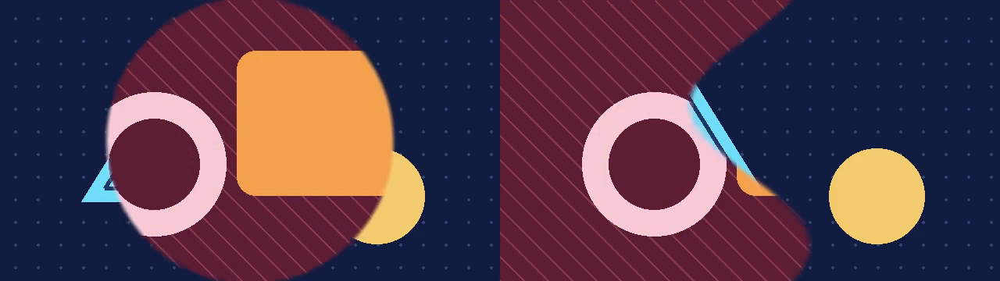

# GL Transitions in FrameRudiments

FrameRudiments 0.4.34 adds two single-pass transition shaders for offline
video. Circular Reveal keeps a round edge on rectangular canvases. Ripple
Wipe moves a wavy edge using the renderer's output clock. Both take two
isolated RGBA sources and use the same beat timing and DanceRudiment
progress controls as native transitions.



[Play the 60 fps comparison](media/gl-transitions-60fps.mp4). Silent, three
seconds. From 0.0 to 0.5 s both panels show the navy source. From 0.5 to
2.5 s the burgundy card expands from the centre on the left and rolls in
from the left edge on the right. Both panels finish on the burgundy card.
The two illustrated test cards are synthetic. The still and video were
captured from the actual FrameRudiments renders.

## Choose and pin a shader

```sh
python -m pip install 'framerudiments[gpu]==0.4.34'
framerudiments gl-transitions
```

Copy the exact `id` and `sha256` pair from that listing into the project's
`shader` field. The listing works without a GPU. The released catalogue
contains `circular-reveal` and `ripple-wipe`, both original MIT-licensed
[shader sources](../src/framerudiments/gl_transition_shaders/). The renderer
checks the packaged shader bytes against the release pin before the first
draw. Accepted shader sources come from that catalogue.

```json
{
  "effect_graph_backend": "auto",
  "effect_graph": {
    "nodes": [
      {"id": "background", "type": "source"},
      {"id": "layer:incoming", "type": "source"},
      {
        "id": "reveal",
        "type": "gl_transition",
        "inputs": ["background", "layer:incoming"],
        "shader": {
          "id": "circular-reveal",
          "sha256": "4c9bf3b99ff6eaf4bc6cecaad26693132ad7e3fcce3c955487b4a75d0216c95b"
        },
        "timing": {"clock": "continuous", "start_beat": 1, "duration_beats": 4}
      }
    ],
    "output": "reveal"
  }
}
```

This fragment uses the project's background and a layer with ID `incoming`.
Input order is outgoing, then incoming. Use `progress` in `[0, 1]` for a
fixed sample, `timing` for beat-driven progress, or bind `progress` in
`effect_graph_controls`. A resolved DanceRudiment `progress` binding takes
precedence over beat timing. The usual per-node `opacity` applies after
the shader.

The node needs an active OpenGL 3.3+ context. `auto` permits other nodes to
use their ordinary CPU fallbacks. It reports a missing GPU or a resource
rejection for the shader node as an error. `gpu` uses the existing strict
GPU policy. Preflight the real output size across a transition interval,
including at least one interior frame. The endpoints only copy source
bytes and do not exercise shader compilation or drawing.

## Bindings and transport

| Binding | Value |
| --- | --- |
| `vec4 transition(vec2 uv)` | GLSL 3.30 fragment entry point. Pixel-centre UVs use a bottom-left origin and a normalised canvas. |
| `getFromColor(uv)`, `getToColor(uv)` | Nearest, clamp-to-edge samples from two equally sized straight RGBA8 inputs. The adapter converts the vertical coordinate at the bridge boundary. |
| `progress` | Fixed or resolved progress. 0 and 1 copy the selected input exactly before optional node opacity. |
| `ratio` | Canvas width divided by height. |
| `time` | FrameRudiments extension. Seconds on the output frame or temporal sample clock, including when a project uses a different source offset. Direct graph calls without a context use zero. |

The GL Transitions v1 convention supplies the entry point, source functions,
progress and ratio. FrameRudiments adds the deterministic time uniform.
[GL Transitions v1 specification](https://github.com/gl-transitions/gl-transitions#gl-transition-specification-v1).

An interior sample uploads two RGBA8 textures, draws once and reads back
one RGBA8 output. The usual bridge texture budget covers those three
surfaces. Both shaders interpolate their feathered edge with premultiplied
colour internally and return straight RGBA. A shader node starts a new
alpha lineage. Graphs containing it use per-node execution. Multipass
shaders and user-supplied GLSL are outside this release's supported subset.

## Reproduce the comparison

```sh
python examples/gl_transitions_demo.py gl-demo-inputs
framerudiments preflight gl-demo-inputs/circular-reveal.json --output circle-qa
framerudiments render gl-demo-inputs/circular-reveal.json --output circle
framerudiments preflight gl-demo-inputs/ripple-wipe.json --output ripple-qa
framerudiments render gl-demo-inputs/ripple-wipe.json --output ripple
```

The example generates hash-pinned test artwork, a silent source and a 120 BPM
clock. Each 640 × 360 project renders 180 frames at 60 fps. Use FFmpeg's
`hstack` to compare the two encoded outputs side by side. On Windows, use
the platform OpenGL backend. Linux CI uses a separate Mesa EGL context.
