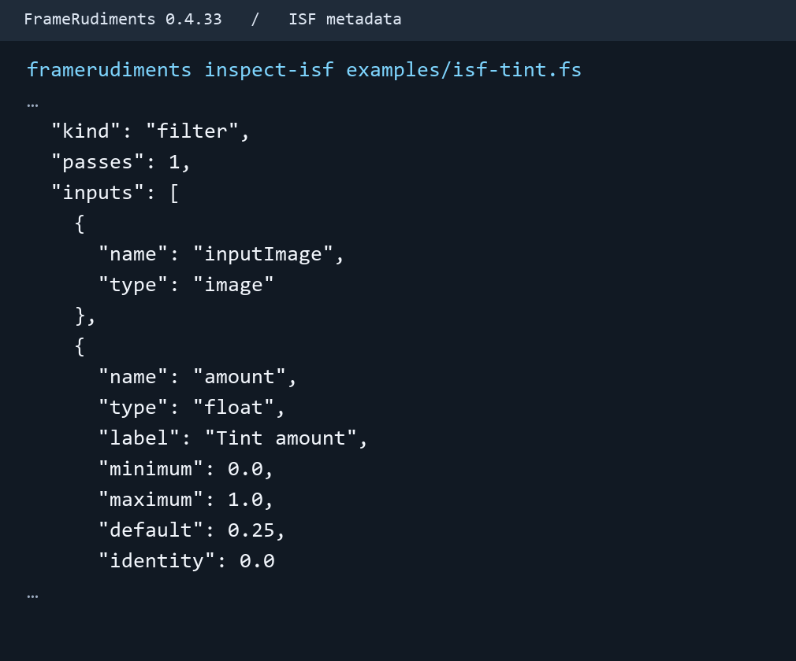

# Inspect Interactive Shader Format metadata

Interactive Shader Format (ISF) places a JSON description at the start of a
GLSL fragment. FrameRudiments 0.4.33 reads that description to identify the
declared image inputs and present typed controls. Use the inspection when
evaluating a new fragment or documenting a pinned source for a later adapter.
[ISF JSON reference](https://docs.isf.video/ref_json.html).

```sh
framerudiments inspect-isf examples/isf-tint.fs
framerudiments inspect-isf examples/isf-tint.fs --expect-sha256 e3dcd8fc66de09b427720e6d1816b38c5f8933bffdbc8e9f57c1ba2e7f524ad3
```

The bundled [tint fixture](../examples/isf-tint.fs) is in the source
distribution and checkout. The optional hash pins the entire file, including
the fragment body and its original line endings. Inspect a new copy without
the pin to record its digest, then use that digest when matching the reviewed
bytes. The command prints JSON to stdout and writes no files.



The image shows selected lines from the real CLI receipt. The tint amount is
a float with a zero-to-one range and a default of 0.25. The full report also
identifies the RGBA control and toggle. This feature produces a static receipt.

## Accepted metadata

| Part | FrameRudiments 0.4.33 subset |
| --- | --- |
| Source | UTF-8, optional BOM and leading whitespace. Up to 256 KiB. One leading JSON block comment followed by a nonempty fragment body. |
| Version and labels | Explicit `ISFVSN` string `"2"` or `"2.0"`. Optional string `DESCRIPTION`, `CREDIT` and `VSN`, and a string array for `CATEGORIES`. |
| Pass | Implicit single pass or `"PASSES": [{}]`. Imported resources, pass targets, persistence, floating targets and size expressions are outside this subset. An empty `IMPORTED` object is accepted. |
| Image conventions | No image means generator. One `inputImage` means filter. The `startImage` and `endImage` pair with a float `progress` from 0 to 1 means transition. Omitted transition bounds have the 0-to-1 meaning. |
| Controls | At most 64 in declared order. `float`, `long` (signed 32-bit integer), `bool` (JSON boolean or numeric 0/1), `point2D` (two finite numbers) and `color` (four RGBA components from 0 to 1). Optional labels are display text. |
| Values and ranges | Explicit `MIN` and `MAX` for numbers, points and colours. Optional `DEFAULT` and `IDENTITY` for controls. The receipt keeps missing fields absent. Checks compare vector bounds component by component. `long` can pair `VALUES` and `LABELS` in order. |
| Exclusions | Audio textures, momentary events, extra fields, duplicate keys and input names, non-finite numbers and reserved host names. |

The versioned `framerudiments.isf-metadata.v1` receipt contains the full-file
digest and byte count, classification, pass count and the typed input list.
The body stays opaque to inspection. `scope: metadata_only` leaves GLSL
syntax, includes, resource use, rights and render eligibility unverified.
The command opens no OpenGL context and accepts no new project node. The
subsequent shader execution milestones have their own acceptance gates.
[Roadmap](unified-effects-transitions-rendering-roadmap.md#m9--external-shader-adapters).

## Potential problems

- **A declared feature is outside the subset.** Read the field named in
  the diagnostic. Preserve the original shader and use a supported local
  sample when comparing the inspection output.
- **The source hash changed.** Compare exact bytes, including line endings
  and the fragment body, with the reviewed source. Retain both digests.
- **Inspection passes and the shader still fails in a host.** A typed
  receipt describes the metadata. Use that host's compiler and resource
  checks to establish its execution result.
