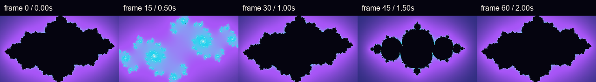

# Julia fractals as compositing sources

`procedural_field` can generate a deterministic Julia escape-time surface inside
the existing effect graph. The mandatory input supplies canvas dimensions and,
when requested, alpha coverage; its RGB is not used. The generated RGBA surface
can therefore be a visible layer, matte, transition mask, pattern texture or
spatial-displacement input without a second frame loop.



Actual FrameRudiments compositor output at frames 0, 15, 30, 45 and 60. The
first and last frames are byte-identical. The five-colour gradient and all
motion inputs are synthetic; no private media or model-generated art is used.

[Play the silent two-second Julia motion demonstration](media/julia-fractal-motion.mp4)
([transcript and accessibility description](media/julia-fractal-motion-transcript.md)).
The MP4 contains frames 0–59 at 30 fps; the next loop frame is the verified
frame-60 state shown in the contact sheet. This documentation preview does not
change the 60 fps production default.

## Configuration

Use `field_type: "julia"` and `field_output: "color"`. `field_palette` is the
existing stable-ID gradient schema: two to sixteen strictly ordered stops, each
with a CSS colour and optional opacity. Interpolation supports sRGB, linear sRGB
and OKLab plus linear, smoothstep or constant interval shapes.

```json
{
  "id": "julia",
  "type": "procedural_field",
  "inputs": ["frame"],
  "field_type": "julia",
  "field_output": "color",
  "field_scale": [320, 320],
  "field_julia_c": [-0.745, 0.113],
  "field_julia_orbit_radius": 0.16,
  "field_julia_iterations": 112,
  "field_gamma": 0.25,
  "field_palette": [
    {"id": "void", "position": 0.0, "color": "#05040f"},
    {"id": "indigo", "position": 0.28, "color": "#312e81"},
    {"id": "violet", "position": 0.50, "color": "#a855f7"},
    {"id": "cyan", "position": 0.76, "color": "#22d3ee"},
    {"id": "white", "position": 1.0, "color": "#fff7ed"}
  ],
  "field_color_space": "oklab",
  "field_interpolation": "smoothstep"
}
```

The public `framerudiments.julia_escape_field()` function returns the normalized
scalar field without allocating an image or owning a clock. The effect graph
applies the shared contrast/bias/gamma/invert stage, multi-point palette and
alpha contract around it.

## Native DanceRudiments modulation and periodicity

DanceRudiments recording schema 1 already requires every stored component to be
finite and inside the fixed `[-1,1]` range. Its Python loader, native C++ sampler
and TypeScript motion-package loader all enforce that contract. FrameRudiments'
existing modulator revalidates each sampled value before mapping it to an authored
target range. There is no second per-recording normalization step and no silent
clipping.

`field_julia_phase` and `field_julia_rotation` use the same `[-1,1]` range for
one complete `2*pi` turn. Internally `radians = pi * normalized_value`, with
`+1` canonicalized to `-1`; the endpoints are therefore exactly the same phase.
The phase moves the Julia constant around `field_julia_c` with radius
`field_julia_orbit_radius`. Rotation turns the sampled complex plane.

```json
"effect_graph_controls": [
  {
    "id": "constant-orbit", "node": "julia", "property": "field_julia_phase",
    "motion": {"kind": "named", "pattern": "akwf_round_saw"},
    "axis": "x", "range": [-1, 1]
  },
  {
    "id": "breathing-zoom", "node": "julia", "property": "field_julia_zoom",
    "motion": {"kind": "named", "pattern": "lfo_breathe"},
    "axis": "x", "range": [0.85, 1.35]
  },
  {
    "id": "slow-turn", "node": "julia", "property": "field_julia_rotation",
    "motion": {"kind": "named", "pattern": "sway"},
    "axis": "x", "range": [-0.12, 0.12]
  },
  {
    "id": "orbit-breath", "node": "julia", "property": "field_julia_orbit_radius",
    "motion": {"kind": "named", "pattern": "lfo_breathe"},
    "axis": "x", "range": [0.08, 0.24]
  }
]
```

The four named patterns repeat at one, two or four beats. The example's four-beat
window consequently returns phase, zoom, rotation and orbit radius to their
opening values. A checksum-pinned `kind: "recording"` motion can drive the same
properties by axis name; it remains non-looping and retains its own source clock.
FrameRudiments never wraps a captured recording to make the fractal repeat.

## Parameter contract

| Parameter | Default | Range and meaning |
| --- | --- | --- |
| `field_julia_c.x/y` | `-0.8, 0.156` | Base complex constant, each `-2..2` |
| `field_julia_orbit_radius` | `0` | `0..2`; radius around the base constant |
| `field_julia_phase` | `0` | Normalized turn `-1..1`; joined `2*pi` endpoints |
| `field_julia_zoom` | `1` | `0.05..32`; larger values zoom in |
| `field_julia_rotation` | `0` | Normalized turn `-1..1` |
| `field_julia_iterations` | `96` | Integer `1..512`; continuous drivers round after mapping |
| `field_julia_escape_radius` | `4` | `2..64` |
| `field_julia_power` | `2` | Integer `2..8` |

`field_scale`, `field_center`, `field_offset` and the static degree-based
`field_angle` still apply before the Julia-specific zoom/rotation. Smooth escape
values map late boundary escapes toward one; interior points are zero. The shared
palette decides their actual colour.

Execution is deterministic tiled CPU work. Its conservative budget charges one
work unit per iteration, per scalar evaluation, and includes the extra evaluations
for gradient/curl vector outputs. Strict GPU mode rejects this CPU node; `auto`
records the existing whole-node fallback. No GPU or real-time claim is made.

## Reproduce the media

Use a fresh output directory:

```powershell
.venv\Scripts\python.exe integration\build_julia_fractal_visuals.py `
  out\julia-demo --font C:\Windows\Fonts\arial.ttf `
  --ffmpeg C:\path\to\ffmpeg.exe
```

The builder uses an actual `Project`, `Compositor`, effect graph and released
DanceRudiments named motions. It retains an evidence JSON with hashes, resolved
midpoint controls and the exact FFmpeg command. A visual demonstration verifies
implemented output and loop identity; it does not establish artistic approval,
production render performance or GPU parity.
