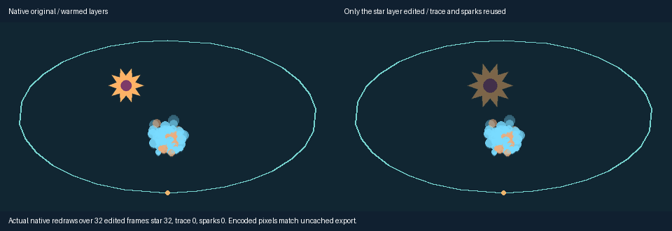

# Separate caches for composited layers

FrameRudiments 0.4.38 retains each native layer's raster separately. Editing one
sprite's position, size or opacity gives that layer new cache keys; it does not
flush the other layers. A new render or preview owner can reuse the unchanged
pixels, including a foreground-to-Q5 handoff.



*Actual native output from the reproducible qualification. During 32 edited
frames, the star draws 32 times, the trace 0 and the particles 0. The edited
export decodes to exactly the same pixels as a separate uncached export.*

[Play the actual 60 fps examples](https://kieransimkin.github.io/FrameRudiments/layer-cache/)
and inspect the [qualification generator](../integration/qualify_layer_cache.py).
The example uses synthetic motion and silent audio. Host timings are measured
evidence, not a universal frame-rate or speed-up claim.

## Use the pipeline

Ordinary compositors use a bounded RAM cache automatically. Supply a separate
directory to retain layer pixels across preflights, complete renders and edits:

```sh
framerudiments preflight project.json --output checks-v1 --max-frames 8 --layer-cache .layer-cache
framerudiments render project.json --output video-v1 --layer-cache .layer-cache
# After editing one layer, retain the same cache directory:
framerudiments render project.json --output video-v2 --layer-cache .layer-cache
```

This also works with chunked output and resume. Keep the cache outside every
final output directory. Use project-owned local storage that supports SQLite WAL
locking, and include its configured cache budget in a complete storage estimate.
Layer pixels are independent of the optional staged-input/encoding working cache.

```python
from framerudiments import Compositor, Project
from framerudiments.layer_frame_cache import LayerFrameCache

cache = LayerFrameCache(".layer-cache")
try:
    compositor = Compositor(Project.load("project.json"), layer_cache=cache)
    try:
        pixels, clock = compositor.frame(120)
        print(compositor.layer_cache_stats())
    finally:
        compositor.close()
finally:
    cache.close()
```

The ordinary APIs also accept a path or shared cache:
`preflight(project, output, layer_cache=path)` and
`render(project, output, layer_cache=path)`.
A path-owned cache closes with its compositor; a caller-supplied cache remains
owned by that caller. Cached images and technical reports are returned as
detached copies.

Use `--no-layer-cache`, or `layer_cache=False`, for an uncached
reference. These options do not disable input validation or final export QA.

Native adaptive editor previews share a persistent layer cache within their
existing preview workspace. Quality changes and Q5 subprocesses use the same
content identities. Source-pinned temporary sidecar paths do not force a miss
when their bytes and effective timing remain identical. The stream status
includes `layer_cache`; Q5 receipts include a bounded per-layer summary
and an explicit truncation flag for stacks larger than 16 layers.

## What invalidates a layer

A key contains the layer's own configuration and pins, its relevant native clock,
sample, tracks, font or motion dependencies, canvas/raster quality and the actual
Python/native implementation identity. Different native sample grids never
borrow pixels from an incompatible quality or source time. Static layers can
reuse one raster across frames. A reordered layer stack recomposes in the new
order while retaining each layer's own pixels.

Keys are immutable. An older worker may finish a valid old input, but its result
cannot replace a changed layer's key. An input change is distinct from
capacity eviction: bounded caches may evict an otherwise valid entry.

The background stays an immutable resident bitmap on its compositor. Sprites,
native rudiments, deterministic emitters, declarative materials, identity text,
captions, word captions, word indicators and lyric art have separate namespaces.
Large rasters or reports that exceed the cache's bounded admission budget render
normally and record a bypass.

Raw pixels are cached **before** per-element effects, animations, displacement,
masks, routing and the effect graph. Those stages run again in their existing
order. Changing a mask provider therefore updates the dependent result even when
the target's raw raster is reused. Final-frame grading and temporal/feedback
owners retain their existing behaviour.

Legacy text drawn directly into an existing canvas keeps its historical alpha
semantics. Its incoming backdrop is a real cache dependency. Isolated text in
the compositing pipeline can reuse its raster independently. Custom scene hooks,
custom renderer registries and sequential 2D fluid simulations continue to draw
when their hidden state cannot be proved reusable.

Treat each Compositor as an immutable admitted snapshot. Build a new Project
and Compositor after changing authored configuration; the editor already does
this. Directly mutating a live object's dictionaries is not an edit API.

## Storage, source checks and recovery

The default retained RAM budget is 32 MiB. Pending pixels are separately bounded
to 32 MiB and are admitted only after the native frame/source checks succeed.
The default persistent budget is 256 MiB of logical PNG and metadata bytes;
SQLite indexes, its journal and short-lived atomic-write files are additional.
All layers share these limits. Cropped tiles preserve every nonzero RGBA channel,
including hidden RGB beneath zero alpha.

The index uses one serialized SQLite WAL connection per cache owner, with NORMAL
synchronization. Raw working pixels are recomputable: system or power failure
may lose recent entries. Atomic blob replacement and PNG, pixel and typed-report
hash verification turn missing/partial/corrupt entries into cache misses.
Existing durable final-frame cache storage is unchanged. This follows
[SQLite's documented WAL/NORMAL tradeoff](https://www.sqlite.org/pragma.html#pragma_synchronous).

Verified RAM hits avoid SQLite writes and PNG decoding. A changed blob signature
forces disk validation. Consumed raw asset/timing pins are checked around native
admission; the ordinary renderer still owns complete soundtrack and project
verification. Raw drawing does not repeatedly hash soundtrack PCM it never reads.

## Reproduce and inspect

```sh
python integration/qualify_layer_cache.py --output new-cache-proof
```

The generator compares native pixels before and after a one-layer edit, counts
actual native draw calls, reopens the cache, verifies all encoded frames at 60 fps
and compares the complete edited and uncached decoded hashes. It records a
representative render estimate before encoding and removes its owned temporary
cache after closing every owner. Timings exclude compositor setup and are
specific to the measured host.

Regression coverage includes source changes during a render, aborted admission,
cache corruption, quotas, native text and particle reports, masks, reordering,
quality views, real spawned Q5 reuse, CLI/preflight, complete single/chunked
exports and resume. `layer_cache_stats()` and render manifests retain
per-layer hits, misses, writes, evictions, corruptions and bypasses. Manifest
snapshots explicitly precede compositor resource closure.

## Potential problems

- **A cheap scene is slower on a slow disk.** Keep frequently reused tiles in
  the bounded RAM tier and choose fast local cache storage. Compare actual
  measurements; avoiding a native draw is not by itself a speed-up.
- **Durability syncs dominate rendering.** The initial cache prototype closed
  its index and synchronized each blob for every layer. The raw working cache
  now keeps its WAL connection alive and verifies disposable atomic blobs.
  Final output checks and the durable final-frame cache retain their gates.
- **A backdrop-dependent caption misses after another layer moves.** Its legacy
  canvas is an input to that raster. The isolated compositing path avoids that
  dependency while preserving its established pixel semantics.
- **A custom or sequential source does not reuse pixels.** It must keep advancing
  its native state; it is explicitly bypassed rather than silently freezing.
