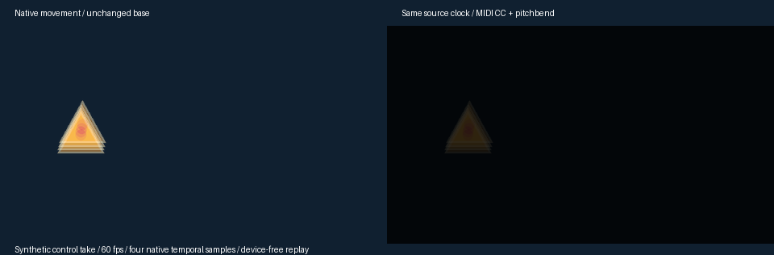

# M15.5 — finite MIDI control takes (0.4.36)

Opt in to MIDI 1.0 control-change and pitch-bend input, record changes on the
existing video clock, close the input, then replay a hash-pinned finite take
through ordinary FrameRudiments projects. No MIDI device is opened by loading,
planning, preflighting or rendering a project.

Actual native compositor output from an authored synthetic MIDI take at frame
30, with four native temporal samples per encoded frame. This local reference
image demonstrates replay, not physical capture. The [native 60 fps gallery](https://kieransimkin.github.io/FrameRudiments/m15-5-midi/)
uses real RtMidi/JACK virtual ports and retains separate capture, closure and
full-decode receipts. Synthetic audio is silent; playback is user controlled.

## Select a qualified capture host

Ordinary replay supports Python 3.11 and later, including the normal 3.13
renderer, without the MIDI extra. Native capture is qualified on Python 3.11
and 3.12 with the official `python-rtmidi==1.5.8` binary. That upstream version
publishes no Python 3.13 wheel; a local Windows 3.13 source build crashed on
import. The extra therefore excludes 3.13+, and native entry rejects it before
import. There is no automatic native source-build fallback or interpreter switch.

    python3.12 -m pip install --only-binary python-rtmidi 'framerudiments[midi]'
    framerudiments-midi inspect
    framerudiments-midi ports --api windows-mm

`inspect` reads package metadata without importing the native extension or
enumerating ports. `ports` explicitly probes one compiled API, lists its exact
current input names and deletes the inspection client without connecting.
Supported explicit API names are `windows-mm`, `coremidi`, `alsa` and `jack`.
Compiled availability, native virtual-port qualification and physical-controller
acceptance remain distinct. Windows CI verifies native import and closed input
inspection; Linux CI verifies real virtual-port capture on an owned JACK server.

## Capture from the existing media owner

    from framerudiments import Project
    from framerudiments.midi_controls_m15 import MIDIControlCapture

    project = Project.load('source-project.json')
    bindings = [{
        'message': 'cc', 'channel': 1, 'controller': 7,
        'node': 'gain', 'property': 'opacity', 'minimum': 0, 'maximum': 1,
    }]
    with MIDIControlCapture(
        project, bindings, api='windows-mm', port_name='Exact current input name',
        lease_frames=45,
    ) as capture:
        for frame in existing_transport_frames:
            capture.sample(frame)
    take = capture.freeze()
    reference = take.write('midi-take.json')

Construction validates the project, numeric mappings and explicit selection
before allocating a native client. Context entry opens exactly one matching
current input; absent, ambiguous or changed names fail. Context exit closes and
explicitly deletes that owned native instance. It cannot be re-entered. No
background media thread, MIDI clock, automatic discovery, reconnect or sender
is created. RtMidi owns its platform input implementation.

The caller supplies increasing encoded frame positions starting at zero.
Pending messages belong to the next supplied frame, and the last valid value
per binding wins there. Optional `capture.wait_for_input(1, minimum_messages=2)`
waits for bounded I/O without advancing media time. RtMidi's arrival delta is
not used as a clock. Raw bytes, mapped value, encoded frame, original source
seconds and continuous beat are saved. Repeated audio retains source wrapping
while take frame/continuous beat move forward.

CC uses controller 0..119 and raw value 0..127; 120..127 are channel-mode
messages and are rejected. Pitch bend uses `message: 'pitchbend'`, no controller
field, and unsigned raw 0..16383; the centre is 8192. Channels are explicit
1..16. Mapping is linear between required native `minimum` and `maximum`
endpoints, including reversed ranges. Integer targets require integer endpoints
and use exact rational half-up rounding. Native ranges and cross-property
constraints still apply; an invalid combined sample is rejected atomically.

Version 0.4.39 adds a separate [note timeline and keyboard/highway visualisers](note-visualisers.md), with note-on/off, sustain and optional SMF import. The following exclusions describe this numeric-control receiver only.

Unknown controls and unsupported messages are counted. Notes, SysEx,
clock/transport, paired 14-bit CC, RPN/NRPN, SMF files and MIDI 2.0 are not
implemented. These limits are deliberate; no unsupported message changes time.

## Pin and replay through the ordinary renderer

After the final programme frame, close the healthy input and freeze a nonempty
take. Add the returned pin to the original project:

    'midi_control_take': {'path': 'midi-take.json', 'sha256': '<returned SHA-256>'}

(The surrounding project is JSON and uses double quotes.)

    framerudiments-midi validate project.json
    framerudiments plan project.json
    framerudiments preflight project.json --output preflight
    framerudiments render project.json --output render

The take joins the ordinary input ledger. Source audio, sample slice, repeats,
FPS, frame extent, clock, effect graph and native binding configuration must
match. Events validate their raw-to-native mapping and source/beat clock.
Frozen input bytes, including legal whitespace, remain the exact receipt and
re-export identity. The atomic writer refuses overwrite.

Values hold through `event_frame + lease_frames`; the next frame returns the
native base. Skipped capture positions do not extend a lease. Random A/B/A
seeks return the same values/pixels. During native temporal sampling controls
hold for their encoded frame while native movement retains fractional clocks.
MIDI and OSC reuse one finite numeric take engine and typed target admission.
Attach one recorded take per project (MIDI or OSC); native motion bindings may
still target other properties within the combined 64-target limit.

## Resource, failure and native proof

Limits: 64 bindings, 64 messages per sample, a 66-entry requested native ring,
64 bounded readiness entries, 8,192 accepted events and a 2 MiB take. Native
errors/queue warnings, per-sample overflow, source changes and caller failures
prevent freezing a partial take. Ports are closed/deleted on all owned exits;
a cleanup failure is an error. Driver/kernel loss is not observable from these
counters; the saved accepted take is the replay authority.

Run native qualification on Linux Python 3.11/3.12 with FFmpeg, the MIDI extra
and `jackd2` installed:

    python integration/qualify_midi_controls_m15.py --output midi-proof

It starts a uniquely named local JACK dummy server, owns its process group,
creates an independent virtual MIDI producer, captures CC and 14-bit pitchbend,
then verifies input/producer/server closure before rendering. The normal native
compositor/preflight/export runs with new MIDI clients and sockets forbidden.
The receipt includes actual source SHA, native package/API, process cleanup,
random seeks, expiry, 240 decoded frames at 60 fps and duplicate-frame checks.
Required CI retains this proof and refuses dependency skips/fallbacks.

This is synthetic virtual-port qualification, not a physical instrument,
phone, LAN or perceptual-quality claim. Bundled OSC/timetags, NDI/Spout/Syphon
and physical Vulkan/WebGPU parity remain separate M15.5 work. The actual frame
and playable demonstration explain this contract; an invented illustration
would add no implementation evidence.

Sources: [MIDI Association message summary](https://midi.org/summary-of-midi-1-0-messages),
[python-rtmidi input and ownership API](https://spotlightkid.github.io/python-rtmidi/rtmidi.html),
[official binary availability](https://pypi.org/project/python-rtmidi/1.5.8/#files).
