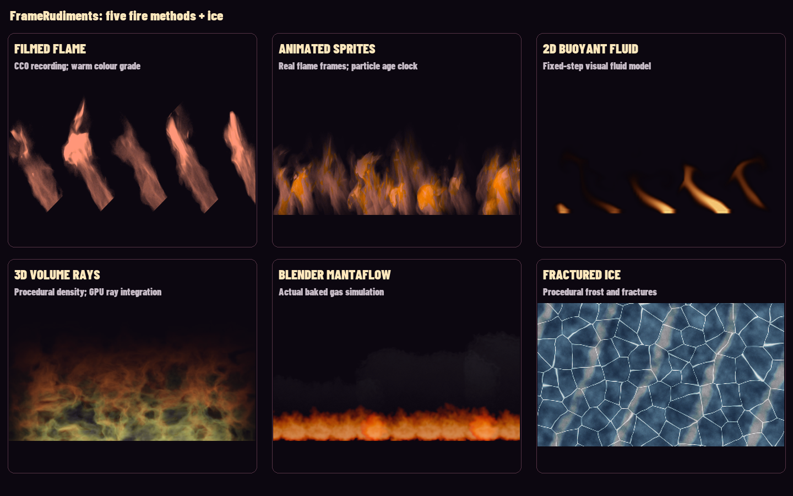

# Five fire methods and ice

FrameRudiments 0.4.2 offers five distinct fire routes through one RGBA and
artwork-burn API. Recorded flame preserves photographed detail; sprite
particles rearrange that detail; a 2D fluid solver, a GPU volume renderer and
a Blender/Mantaflow bake offer different degrees of simulation and control.
The original noise effect remains explicitly `stylized`. A successful render
is technical evidence, not a claim of photorealism or scientific combustion.



[Play the actual four-second comparison](media/natural-materials.mp4).
User-controlled video with a synthetic tone. Transcript: the six panels show
“Filmed flame”, “Animated sprites”, “2D buoyant fluid”, “3D volume rays”,
“Blender Mantaflow” and “Fractured ice”. The first two use an explicitly
labelled warm colour grade. After 1.8 seconds the five paper cards burn away
while the sixth freezes. This is actual software output on synthetic artwork,
separate from any artist's campaign, listening approval or public endorsement.

## Choose a method

| `FireRenderer` method | Actual computation / asset | Access and limits |
| --- | --- | --- |
| `footage` (default) | Hash-pinned filmed flame atlas, phase-offset tiles, premultiplied resampling | Bundled CC0 derivative; no downloads at render time. Finite recorded detail and an explicit repeat/clamp clock. |
| `sprites` | Existing bounded ParticleEmitter births, movement and per-particle age; animated real-flame atlas | Same reviewed recording; fixed 60 Hz particle reconstruction, finite lifetime and bounded active horizon. No copied motion engine. |
| `fluid_2d` | Semi-Lagrangian fuel/heat advection, buoyancy, vorticity confinement, 24-iteration pressure projection, cooling | CPU NumPy; fixed 30–120 Hz, 48–192 field height, up to eight checkpoints. Source time × speed must be ≤30 s. Not chemical combustion. |
| `volume` | Original 3D advected density field and emission/absorption ray marching | Explicit `[gpu]` extra and actual OpenGL 3.3; 16–96 steps. Procedural volume, not fluid simulation. GPU pixels may vary. |
| `mantaflow` | Transparent frame atlas from an actual Blender gas-domain bake | Bundled original bake, or the maintained bounded Blender script plus a reviewed imported atlas. Blender is needed only for a new bake. |
| `stylized` | Original advected multiscale noise field | Fast compatibility / graphic treatment; not described as realistic fire. |

The two synthetic simulation routes use a three-wavelength Planck-inspired
colour approximation with fixed exposure. This is not measured temperature,
full spectral radiometry or a physically validated combustion model. Ice uses
procedural cellular fractures, frost and moving surface highlights; no claim
of physical refraction is made.

## Install and compose

```sh
python -m pip install 'framerudiments[materials]'
# For the explicit volume route:
python -m pip install 'framerudiments[materials,gpu]'
```

NumPy is optional for existing non-material projects. Missing dependencies or
assets fail clearly; methods never silently substitute another backend.

```python
from framerudiments import FireRenderer, NaturalMaterial

fire = FireRenderer(ticket.size, method="sprites", seed=21,
                    resolution=0.75, warmth=1.0, glow=0.1)
ice = NaturalMaterial(ticket.size, "ice", seed=21, resolution=0.75)
try:
    burning = fire.burn(ticket, source_seconds, progress=0.5)
    frozen = ice.freeze(ticket, source_seconds, progress=0.7)
finally:
    fire.close()
```

`render(seconds, front=0.96, amount=1)` returns a standalone RGBA tile.
`burn(..., 0)` preserves the original artwork and `burn(..., 1)` is fully
transparent. Freeze preserves source alpha exactly. Artwork must be same-sized
RGBA. Flames can occupy transparent space within the tile; allocate sufficient
headroom. Keep held lyrics clean and apply destructive burn only during exit.
Travel and sequential handoffs belong to the release scene adapter. The old
ticket should clear before the next appears when that is the chosen design.

Material layers compose with existing masks, routing and keyframes:

```json
{
  "id": "hearth", "type": "material", "kind": "fire", "method": "footage",
  "bounds": [100, 200, 900, 650], "start_seconds": 1, "end_seconds": 8,
  "style": {"seed": 21, "warmth": 1.0, "flame_height": 0.65, "glow": 0.1},
  "progress": {"keys": [{"time": 1, "value": 0}, {"time": 2, "value": 1}]}
}
```

Use `kind: "ice"` without fire-only options for ice. Progress and layer gates
use original source seconds; there is no hidden clock reset. A `fluid_2d` layer
must set an explicit `end_seconds` with `end_seconds * speed <= 30`; bake a
bounded atlas for a later section or longer sequence. Keep a declared external
source-to-asset time mapping in the scene if a bake represents another interval.

## Settings and source identity

Shared controls are `seed`, `speed`, `glow` and `opacity`. `resolution` declares
the synthetic working tile scale (0.1–1). Atlas detail remains bounded by its
actual cell resolution. `flame_height` controls the tiled footage/bake layout;
sprite shape and simulation shape are owned by their respective backends.
The legacy noise `scale`/`turbulence` controls apply to `stylized`, and to the
shared scorched burn mask, rather than altering recorded motion. `warmth`
(0–1) grades only atlas-based methods, preserves alpha and is a creative colour
grade, never a new source or temperature observation.

Simulation controls are explicit `backend_settings`: `fluid_2d` accepts
`simulation_hz`, `resolution` and `warmup`; `volume` accepts `steps`. Atlas
methods accept a pinned `asset` and boolean `repeat`. Defaults repeat; set
false to clamp to the final atlas frame. Individual particle animation clamps
by particle age while new births continue. Document a loop seam if visible;
do not claim an arbitrary source is seamlessly loopable.

Outputs are capped at four megapixels and synthetic working tiles at one
megapixel. Atlases have ≤480 frames and ≤64 megapixels, with a bounded cell
cache. Inputs, implementation hashes, method settings, source/atlas clocks,
backend identity and cleanup enter evidence. Close standalone renderers;
the normal compositor closes owned layers. Seeking restores/replays the fluid
state or addresses deterministic atlas/volume/particle time. It does not rely
on wall-clock playback. Same-runtime repeatability is tested independently
of cross-platform floating-point or GPU identity.

## Import reviewed footage or bake a gas simulation

`FireAtlas` uses `framerudiments.fire-atlas.v1`: an exact SHA-pinned manifest,
relative pinned RGBA sheet, grid, frame count, rational FPS and provenance.
Both manifest and image hashes are checked. Render-time code never downloads
media or infers rights from a filename.

```sh
python scripts/prepare_fire_atlas.py footage /reviewed/fire.mp4 /new/atlas \
  --sha256 EXACT_SHA256 --source-url https://original-source.example/fire \
  --licence 'Reviewed licence' --ffmpeg /path/ffmpeg --ffprobe /path/ffprobe \
  --start 2 --duration 4 --fps 60 --crop 600 60 985 830 --rotation -50

blender --background --factory-startup --python scripts/bake_mantaflow_fire.py -- \
  --output /new/bake --resolution 96 --frames 120 --warmup 60 --burning-rate 0.85
python scripts/prepare_fire_atlas.py mantaflow /new/bake /new/atlas \
  --licence 'Original generated simulation, MIT'
```

The first command keys a supplied black-background source, unpremultiplies
emission, preserves a stable crop and records explicit FPS resampling. The
second creates a bounded original Blender scene, bakes and renders actual gas
frames; packing retains Blender/build/settings, source-blend and frame hashes,
a stable luminous crop, and a public-safe receipt. It removes private output
paths. Packing derives emission alpha from the RGB output over black rather
than treating low smoke extinction alpha as flame brightness. Neither command installs Blender, downloads media/models or validates
someone else's rights. Custom atlas use:

```python
fire = FireRenderer((640, 240), "mantaflow",
                    asset={"path": "/new/atlas/atlas.json", "sha256": "EXACT_SHA256"})
```

## Research and bundled rights

The recorded atlas derives from the [Marburg studio's CC0 gas-burner footage](https://www.uni-marburg.de/en/fb12/research-groups/grafikmultimedia/research/studio).
The source page/filename advertises 720p/120Hz, whereas the downloaded file
actually probes as 1920×1080 at 60000/1001 fps. The derivative is explicitly
resampled to 60 fps. Its exact source SHA, crop, rotation, key, source URL and
rights are in the bundled manifest/notice. The optional warm grade preserves
filmed motion. The Mantaflow atlas is an original generated simulation under
MIT. The large original recording, Blender caches and private evidence are
excluded from distributions; compact reviewed atlases and notices are included.

The original implementations draw on published principles, without copying
upstream shader/code or redistributing papers:

- [NVIDIA: Fire in the Vulcan demo](https://developer.nvidia.com/gpugems/gpugems/part-i-natural-effects/chapter-6-fire-vulcan-demo): photographed flame textures, particles and volumes.
- [NVIDIA: Real-time simulation/rendering of 3D fluids](https://developer.nvidia.com/gpugems/gpugems3/part-v-physics-simulation/chapter-30-real-time-simulation-and-rendering-3d-fluids): advection, buoyancy and ray integration.
- [Stam: Stable Fluids](https://graphics.stanford.edu/courses/cs468-05-fall/Papers/p121-stam.pdf): stable advection/projection principles.
- [Nguyen, Fedkiw and Jensen: Physically based modelling and animation of fire](https://www.graphics.stanford.edu/papers/fire-sg02/): combustion interfaces and emission context.
- [Blender 5.0 fluid manual](https://docs.blender.org/manual/en/5.0/physics/fluid/introduction.html): Mantaflow domains, flows and baking.

## Verification and potential problems

Inspect actual encoded video for bright cores, thin tips, repeated tiles,
blue/graded fringes, loops, smoke rectangles and text interference. Preview a
short transition before a full film. The comparison shows differences and
limits; it is not an assertion that every route looks equally realistic.
No audio, lyric onsets or official artwork is changed by material selection.

Checkpoint extraction for long lyric/cue ledgers now uses batches of ≤32 terms,
preserving every exact selected encoded frame. A large-select parser failure
does not by itself prove physical RAM exhaustion.

Reproduce the comparison, including the actual GPU volume backend:

```sh
python scripts/render_natural_material_demo.py /new/output \
  --font /path/to/font.ttf --ffmpeg /path/to/ffmpeg
```

The focused tests check hashes, particle-age animation, bounded reconstruction,
seek/replay, fluid divergence reduction, burn/freeze endpoints, alpha, invalid
settings and cleanup. The separate real OpenGL acceptance suite must run without
skips. Technical tests do not establish attended listening, artistic approval,
physical accuracy, musical phase or publication.
