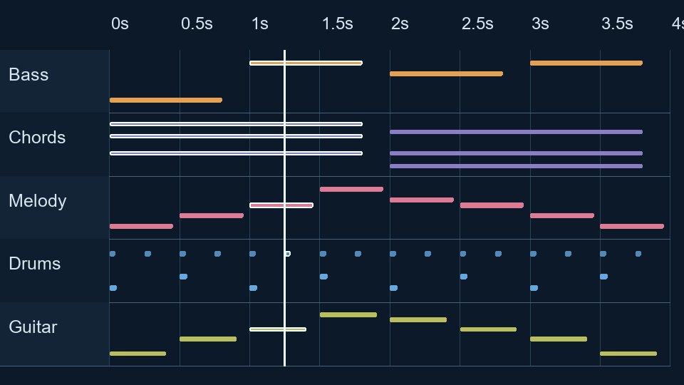
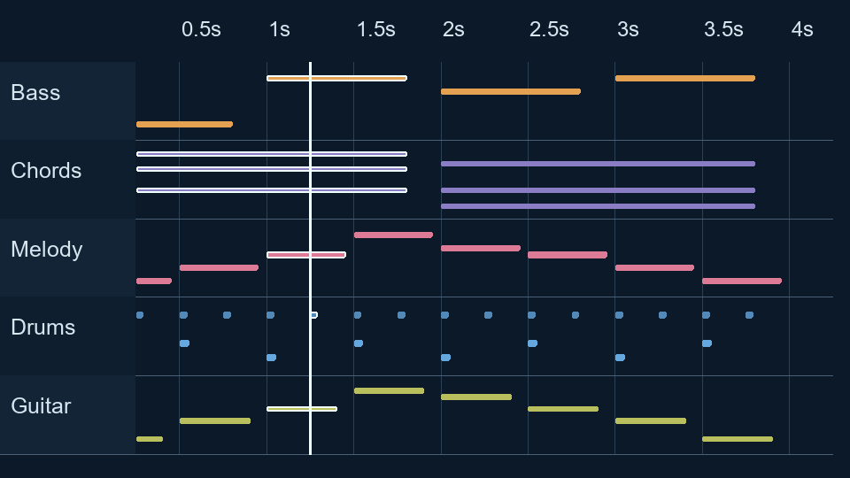
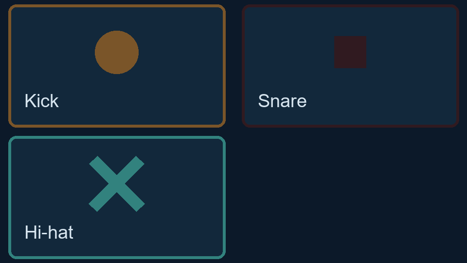
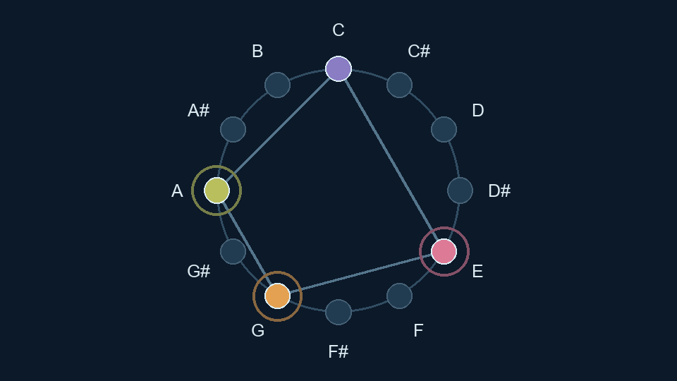
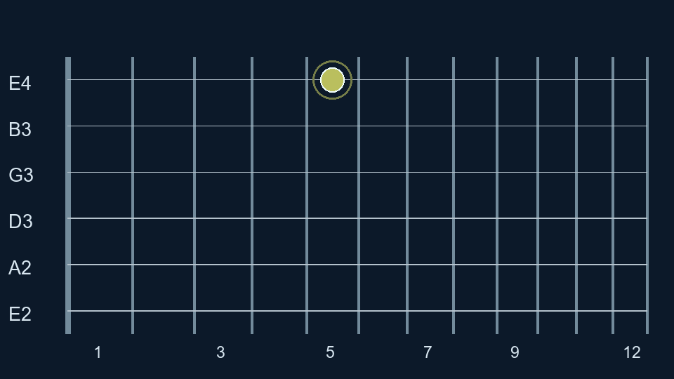
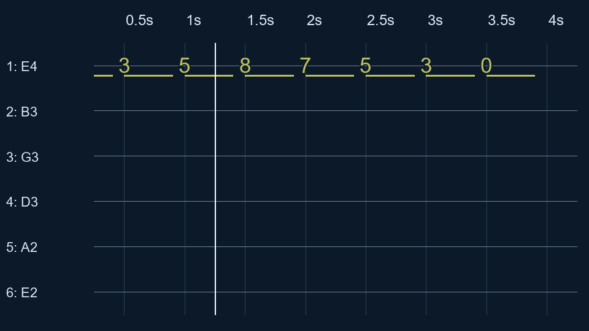
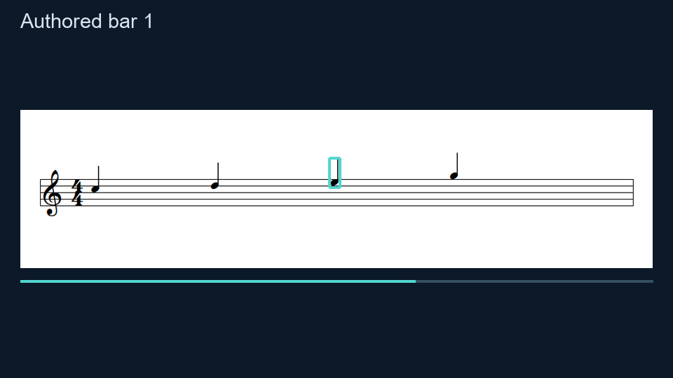
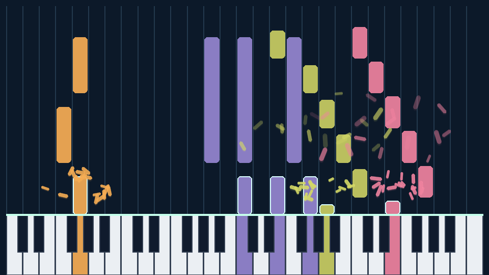

# Arrangement and note-view suite (0.4.40)

The horizontal arrangement is the main view: each named part keeps its own row,
with pitch inside the row, note duration along continuous output seconds and a
moving playhead. Use a scrolling window while following the performance, or
keep the whole piece visible in an overview. The original MIDI track names are
retained as authored metadata; no instrument classifier is involved.



*Actual native output from an original, silent, authored five-part MIDI fixture.
[Play the arrangement overview and scrolling demonstration at 60 fps](https://kieransimkin.github.io/FrameRudiments/note-suite/).
The gallery also demonstrates every view below. These are encoded renderer
outputs, rather than interface mockups or recordings of a physical performance.*

## Shared input and composition

All views are ordinary `type: "notes"` layers with a pinned finite
`framerudiments.note-timeline.v1` file. They share the [released note semantics,
SMF import and capture contracts](note-visualisers.md): physical release and
sustain end remain separate, velocity-zero note-on closes a key, and replay opens
no MIDI input or socket. There is one existing source clock. Notes have stable
canonical indices, ordered by start time, track, channel and key, with source
order retained for ties. An index always names an occurrence, including repeated
pitches. Editing the note file changes its SHA-256 and requires rebinding every
fingering/score mapping.

Common fields include `file`, integer-pixel `bounds`, optional `tracks` (0..127),
`channels` (1..16), `note_range`, `colour_by: "track" | "channel"`, `palette`,
`panel`, `opacity`, `lookahead_seconds` and `history_seconds`. Bounds retain
native preview normalization. Durations remain seconds rather than frames.
Named new views default to `labels: true` and require the explicit pinned project
`font`. `score` and `note-impacts` default to no text. Set `labels: false` when a
textless view is intended; no ambient font is silently selected. Settings for a
different view are rejected.

Each layer participates independently in the native [frame cache](layer-frame-cache.md),
Q0/Q5 previews, spawned refinement, normal export and input staging. Editing a
part layout invalidates its arrangement layer. An unchanged pad, keyboard or
other composited layer reuses its own raster. The qualifier compares edited
cached pixels to fresh output, reopens the cache, compares a complete encoded
arrangement to its uncached reference, and stages the score images through the
working cache. Cache identity includes each admitted pin and relevant setting.

## Scrolling arrangement and overview

```json
{
  "id": "arrangement", "type": "notes", "view": "arrangement",
  "file": {"path": "notes.json", "sha256": "REPLACE_WITH_NOTES_SHA256"},
  "bounds": [0, 0, 1920, 1080], "colour_by": "track",
  "history_seconds": 2, "lookahead_seconds": 6,
  "arrangement": {"group_by": "track", "time_mode": "overview"}
}
```

`time_mode` is `scroll` (default) or `overview`; `group_by` is `track` (default)
or `channel`. The default parts retain source track names, falling back to a
literal track/channel number. There may be 1..32 parts. For a dense take, select
tracks/channels explicitly rather than silently dropping data.

Use `arrangement.parts` to author a different grouping: each object accepts a
unique `id`, `label`, and optional `tracks`, `channels`, `keys`, `note_range` and
`colour`. Every selected note must belong to exactly one part. Missing or
ambiguous assignments fail admission. `note_range` controls the part's visual
pitch span and must contain all its assigned notes. Optional `grid_seconds`
sets a positive second-grid spacing (0.025..3600); `label_fraction` (0.08..0.4)
reserves the label column. The overview retains at most 32 MiB of static raster;
larger native surfaces draw the same geometry without retaining that buffer.
Sounding outlines and the playhead remain time-dependent.



## Percussion lanes and pad matrix

Use `view: "drum-lanes"` or `"pad-grid"`, and an explicit `drums.pads` array:

```json
{"pads": [
  {"id": "kick", "label": "Kick", "keys": [36], "shape": "circle", "colour": "#f6ad54"},
  {"id": "snare", "label": "Snare", "keys": [38], "shape": "square"},
  {"id": "hat", "label": "Hi-hat", "keys": [42], "shape": "cross"}
], "columns": 3, "decay_seconds": 0.45}
```

These are authored identities, not an assumed General MIDI kit. There may be
1..32 pads; selected keys must map unambiguously. Shapes are `circle`, `cross`,
`diamond`, `square` and `bar`; `columns` is 1..8. Attack decay is 0.05..8 seconds.
The lane view also accepts `grid_seconds` and `label_fraction`. Note-on queries
retain a zero-duration drum hit even after its note-off.



## Pitch-class wheel

`view: "pitch-wheel"` accepts `wheel.pitch_names` (exactly twelve literal names),
`connections` (boolean), `decay_seconds` and `start_angle` (-360..360). Nodes
aggregate active pitch classes while the frame report retains exact keys,
octaves, tracks, channels and voice counts. The wheel draws at most twelve
attack ripples, using the latest attack in each class. It does not invent chord
or key labels. Filter percussion tracks when they should not contribute.



## Authored fretboard and scrolling tablature

`view: "fretboard"` and `"tablature"` share a `fretboard` object:

```json
{
  "notes_sha256": "REPLACE_WITH_NOTES_SHA256",
  "tuning": [64, 59, 55, 50, 45, 40], "capo": 0, "fret_count": 12,
  "positions": [{"note_index": 0, "string": 1, "fret": 3, "finger": 3}]
}
```

String 1 is the first declared tuning entry (1..12 strings). Every selected
occurrence needs one explicit position; `tuning[string-1] + capo + fret` must
match its MIDI pitch. Fret numbers are relative to the capo. Capo is 0..24,
visible frets 1..36. Optional `string_labels` must match the tuning. Optional
`finger` is 1..5; `technique` is a literal `none`, `slide`, `bend`, `hammer-on`,
`pull-off`, `harmonic` or `tap`. Technique metadata is retained without inventing
physical hand movement. Tablature adds `time_mode`, `grid_seconds` and
`label_fraction`; attack rings use `decay_seconds`. Scrolling tails remain
visible when their heads are before the left edge.





## Reviewed score highlighting

`view: "score"` consumes reviewed, pinned raster pages and authored glyph
rectangles. Use an actual engraver/exporter such as VexFlow or a reviewed score
export. Ordinary MIDI does not identify correct spelling, notation duration,
voices, beams or layout; this view performs no automatic engraving/transcription.

```json
{
  "notes_sha256": "REPLACE_WITH_NOTES_SHA256", "reviewed": true,
  "provenance": "Reviewed score export and authored occurrence mapping",
  "pages": [{"image": {"path": "bar-1.png", "sha256": "REPLACE_WITH_IMAGE_SHA256"},
             "start_seconds": 0, "end_seconds": 2, "label": "Bar 1"}],
  "glyphs": [{"page": 0, "note_indices": [0], "bounds": [100, 50, 125, 110]}],
  "highlight": "#52d6cf", "allow_upscale": false
}
```

The object is the layer's `score` setting. Page windows are increasing,
nonoverlapping and half-open. Each selected note needs a mapping intersecting
its page; tied glyphs can map to the same occurrence on successive pages. Pixel
rectangles use original image coordinates. The renderer contains the page in
its viewport; an independent progress strip represents linear time without
pretending engraved spacing is proportional to duration. No physical-piano
input or automatic score following is claimed. Set `labels: true` with a pinned
font for page labels. Images are revalidated before loading; at most one page is
retained. Limits: 32 pages, 8192 pixels per side, 16 megapixels/page, 64 megapixels
combined; 4096 glyphs/page, 65536 total, 128 references/glyph and 262144 references.



The original [two-bar fixture](../integration/fixtures/note-suite-score/layout.json)
uses VexFlow **5.11.0** (MIT) and its bundled Bravura (SIL OFL 1.1).
[The exporter](../integration/export_note_score.mjs) explicitly declares spellings
and quarter-note durations, exports actual SVG-rendered PNG pages and records
glyph boxes. To reproduce it, install pinned optional VexFlow 5.11.0 and
Playwright 1.62.1 in a disposable project directory, provide their module paths
through `FRAMERUDIMENTS_VEXFLOW` and `FRAMERUDIMENTS_PLAYWRIGHT`, and run the
exporter with an explicit output directory. `FRAMERUDIMENTS_BROWSER_CHANNEL`
can select an installed browser. All owned contexts close in `finally`; no
notation dependency is added to normal Python installs. See the fixture's
[licence notice](../integration/fixtures/note-suite-score/NOTICE.md).

## Note-triggered native particles

`view: "note-impacts"` accepts `impacts`: an existing particle `kind`, ordinary
particle `style`, `particles_per_note` (1..128), `max_events` (1..256),
`max_particles` (1..2000) and normalized `origin_y`. It composes the existing
`ParticleEmitter`; source note-on seconds and canonical occurrence identities
seed its bounded bursts independently of output FPS. Emission rate/count and
origin fields are owned by this adapter. Velocity scales burst count. The
panel is transparent by default, so this layer can sit above the piano roll or
another scene. Event and particle drops are explicit in frame reports. Keep
reduced-motion requirements at the destination/player.



## Verification and practical limits

Run focused tests through `scripts/Invoke-Tests.ps1` with the explicit test font
and FFmpeg. `integration/qualify_note_suite.py --output NEW_DIRECTORY` renders
the twelve gallery presentations, compares fresh/cached/edited/reopened pixels,
checks a complete encoded reference, verifies score staging and reports every
decoded frame, unique-frame count and natural duplicate count. Q0/Q5 and real
spawned-worker checks cover each new view. The original note qualifier retains
native MIDI capture, timeline tempo/sustain and chunk/resume acceptance.
Source CI owns the full CPU/platform/GPU matrices. Software verification is
separate from attended musical review, physical controllers or phones.

No generated illustration is used as feature evidence here; the relevant
native stills and linked actual videos explain the implementation directly.
