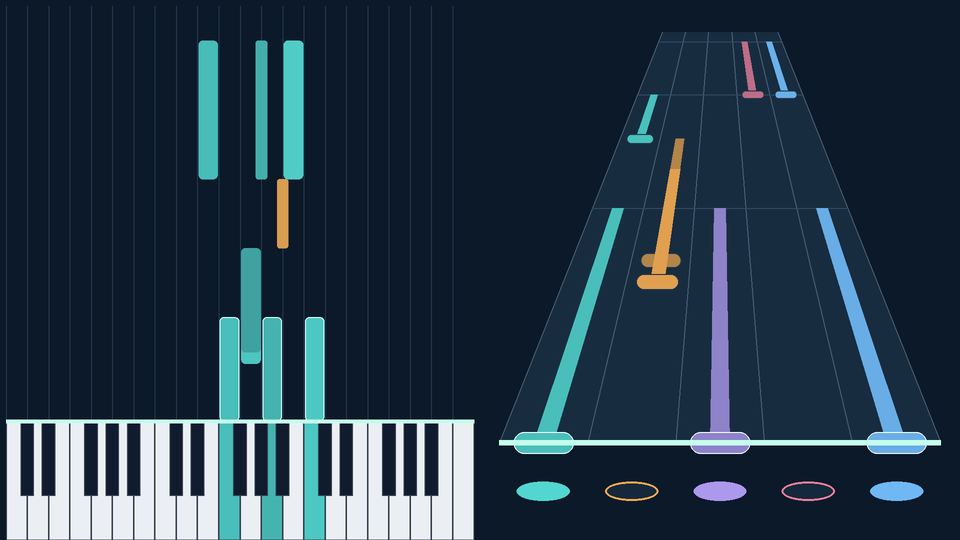

# Note visualisers: research and next additions

Research checked 24 November 2026 against creators' documentation and published
project pages. The design ideas below are our implementation choices, not
claims that FrameRudiments already includes every referenced product feature.
No third-party code, artwork or game assets are incorporated.

*Actual synthetic FrameRudiments output. [Play the three native examples](https://kieransimkin.github.io/FrameRudiments/note-visualisers/).
The original demonstrations are retained. The [0.4.40 suite](note-suite.md) implements the remaining shortlist with actual native demonstrations.*

| View | Reader/player value | Decision for FrameRudiments |
| --- | --- | --- |
| Falling piano roll and bottom keyboard | Makes pitch, key position, chords and length immediately visible. | Implemented: aligned white/black geometry, channel/track colours, velocity and sustain-aware tails. |
| Rising keyboard history | Shows notes only after they occur, without claiming future knowledge during a performance. | Implemented as a second direction of the same renderer and timeline. |
| Perspective note highway | Gives an approaching rhythm-game presentation and clear held-note tails. | Implemented with 2..8 explicitly mapped lanes; no score/gameplay or inferred guitar fingering. |
| Drum/pad lanes | Makes kick, snare, hats and percussion parts visually separable. | Implemented: named drum lanes and a pad matrix from explicit mappings, including zero-duration attacks. |
| Pitch-class/chord wheel | Makes simultaneous pitch classes and harmonic movement easy to compare. | Implemented: twelve pitch classes, retained exact voicing and bounded attack ripples; no inferred chord label. |
| Horizontal multi-part roll | Shows counterpoint or an arrangement over time without requiring a bottom keyboard. | Implemented first in 0.4.40: labelled parts, scrolling and overview, moving playhead and explicit grouping. |
| String/fretboard view | Shows playable guitar/bass locations and techniques. | Implemented with source-bound authored tuning, strings, frets/capo and optional metadata; scrolling tablature shares the map. |
| Cinematic note impacts | Adds controllable light/particle response at note onset. | Implemented through the existing native particle engine, with exact source note-ons, stable seeds and explicit budgets. |

## References and what they informed

[Synthesia](https://www.synthesiagame.com/About) describes falling-note piano
learning. Its legible keyboard relationship informed the first view; our
renderer remains an offline compositor rather than a lesson/game system.

[SeeMusic's own feature guide](https://www.seemusicapp.com/features) covers
MIDI/live recording, note editing, falling-note videos and visual effects.
It supports the usefulness of preserving note length, velocity and performance
identity in a common input before choosing an art style.

[kosua20's MIDIVisualizer](https://github.com/kosua20/MIDIVisualizer) documents
OpenGL MIDI visualisation and image/video export; its
[release notes](https://github.com/kosua20/MIDIVisualizer/releases) describe
key outlines, colour sets, pedal/particle customisation and aligned falling
notes. Those are useful presentation references. Its code and visual assets
are not copied into this implementation.

[Clone Hero's official dictionary](https://wiki.clonehero.net/books/general-info/page/dictionary)
distinguishes the highway, strike line, sustains and visual scrolling speed.
That separation informs our decision to change view speed through lookahead
without changing the underlying note or audio clock. Our highway is a visual
presentation with an authored map and does not implement its scoring rules.

[Stephen Malinowski's Music Animation Machine player guide](https://www.musanim.com/Player/MAMPlayerUserGuide.pdf)
describes piano-roll, pitch-class wheel, interval and lattice displays, with
colour by part or pitch class. This supports the next wheel and multi-part
ideas; chord interpretation would need its own stated evidence rather than
being inferred from a decorative colour.

[Ubisoft's Rocksmith Workshop basics](https://www.ubisoft.com/en-us/game/rocksmith/plus/rocksmith-workshop/tutorials/basics)
uses explicit string/fret note entry. Its
[additional features guide](https://www.ubisoft.com/en-us/game/rocksmith/plus/rocksmith-workshop/tutorials/additional-features)
retains tuning/capo and arrangement details. These make a real fretboard view
a different data contract from a five-lane pitch projection.

[Keysight's creator-published Steam page](https://store.steampowered.com/app/1325730/Keysight/Official?l=english)
presents a real-time MIDI platform aimed at piano-focused creators. Cinematic
customisation is a useful later direction; first acceptance here remains
source-bound notes, clear keys, deterministic views and verified export.

## Implemented order and score extension

Kieran prioritised the arrangement view. Version 0.4.40 implements both horizontal
modes first, followed by named drum lanes/pads, a pitch wheel, authored fretboard
and tablature, reviewed-score highlighting and shared-engine note particles.
[Actual suite screenshots and videos](note-suite.md) distinguish those results
from the research proposals. The score demonstration uses explicitly authored
VexFlow 5.11.0 notation and reviewed glyph mappings; automatic MIDI engraving is
outside this change. [VexFlow's primary documentation](https://vexflow.github.io/vexflow-examples/guides/getting-started/)
provides the maintained engraver API; no handwritten notation engine was added.

This shortlist adds no model downloads, transcription job, controller session,
third-party account or purchase. Use reviewed source notes and retain platform
safe regions when designing an actual music video or Short.
