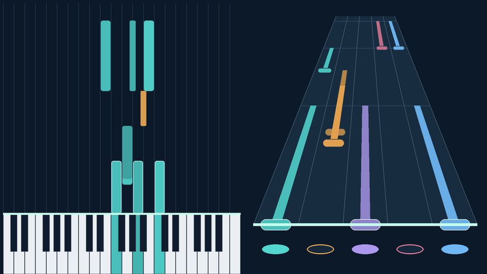

# Notes, a keyboard and a highway — 0.4.39

FrameRudiments renders pinned MIDI note intervals as a bottom keyboard with
falling blocks, a causal rising history, or a perspective note highway. These
are ordinary `type: "notes"` composited layers, with bounds, opacity, masks,
animation, displacement and graph routing. Each view uses the same note data.



*Actual synthetic native composition. The keyboard lights physical key presses;
blocks and tails include explicitly captured sustain. The five highway lanes
are authored pitch mappings. No real song, inferred guitar fingering or game
score is represented.*

[Play the three actual 60 fps demonstrations](https://kieransimkin.github.io/FrameRudiments/note-visualisers/)
· [Research and next-view shortlist](note-visualiser-research.md)
· [Reproducible generator](../integration/qualify_note_visualisers.py)

## Import a performance

Use your DAW's MIDI export, an authorised recorded performance, or a reviewed
native `.mid` from StemLab. Transcription remains analysis evidence: this
renderer does not infer notes from audio or establish transcription accuracy.
The soundtrack remains the project's pinned audio.

```sh
python -m pip install 'framerudiments[notes]'
framerudiments-midi import-notes source-project.json performance.mid --offset-seconds 0 --output notes.json
```

`--offset-seconds` is required: zero is an explicit alignment decision. SMF 0/1
with positive PPQN retains its tempo changes through Mido's file parser;
conversion uses exact rational tick accumulation. Import never plays the file,
opens a MIDI device or creates a second playback clock. SMF type 2, SMPTE
resolution and conflicting simultaneous tempo declarations fail explicitly.
The input is hash-pinned and checked after conversion. Notes outside the chosen
programme are clipped and counted. Original track and 1..16 channel identities
remain available; same-pitch voices pair FIFO within track/channel/key.

The [Mido file reference](https://mido.github.io/mido/files/midi.html) explains
SMF delta ticks and tempo. The importer uses those file semantics; the resulting
note timeline runs in continuous output seconds, without replacing the song's
existing source or beat clock. Repeated audio does not silently repeat a note
take: author its complete continuous programme explicitly.

The command returns the saved file's SHA-256. Add that exact pin to a project
using the same source audio, excerpt, sample rate and repeat count:

```json
{"id":"keyboard","type":"notes","view":"piano-roll",
 "file":{"path":"notes.json","sha256":"<returned SHA-256>"},
 "bounds":[0,0,1920,1080],"note_range":[48,84],
 "lookahead_seconds":3,"keyboard_fraction":0.22}
```

Use your actual canvas dimensions. `note_range` accepts MIDI keys 0..127,
including black-key endpoints; the default keyboard range is 21..108. White and
black blocks align with their actual key widths. Colour follows channel by
default; `colour_by: "track"` uses retained track identity instead. Velocity
changes note intensity. Optional `labels: true` draws C-octave labels and
requires the project's explicit pinned font. A custom `palette` has 1..16 CSS
colours. `channels` can select unique channels 1..16.

```sh
framerudiments-midi validate-notes project.json
framerudiments preflight project.json --output checks --max-frames 8 --layer-cache .layer-cache
framerudiments render project.json --output video --layer-cache .layer-cache
```

Keep the layer cache separate from output directories, on suitable project-owned
local storage. It contains reusable working pixels, not a published deliverable.

## Rising notes and the bottom keyboard

Set `direction: "rising"` and optionally `history_seconds: 3` for a causal
history. Future notes stay hidden. A block starts when its note-on is reached,
grows while the note sounds, then continues upwards through the history window.
The falling view uses the saved performance's lookahead. Both views preserve
half-open key intervals: the key is lit at note-on and unlit at key release.

CC64 sustain keeps a sounding block/tail alive after key-up; it does not leave
the key falsely pressed. Note-on velocity zero is note-off. CC123 releases all
keys on its channel with pedal semantics; CC120 silences sounding notes on that
channel. Unmatched note-offs are counted. Notes still held when a finite take
ends are closed at the programme boundary and explicitly counted as clipped.

## Perspective note highway

```json
{"id":"highway","type":"notes","view":"note-highway",
 "file":{"path":"notes.json","sha256":"<returned SHA-256>"},
 "bounds":[0,0,1920,1080],"lane_count":5,"lookahead_seconds":3,
 "note_map":{"60":0,"62":1,"64":2,"65":3,"67":4}}
```

Every selected pitch must have an explicit `note_map` lane; missing mappings are
errors. Use 2..8 lanes. Several pitches may share a lane when that is the
intended visual arrangement. Upcoming heads approach the strike line in
perspective; held-note tails and active lane pads share the original timing.
Horizontal markers are seconds, not an inferred musical metre. The view is a
visualisation: it does not award scores or turn pitch into string/fret data.
A real guitar-fingering view needs an additional authored fingering source.

## Capture real note presses

The existing qualified RtMidi input owns port selection, its bounded queue and
exact close/delete. Capture uses Python 3.11/3.12 with official
`python-rtmidi==1.5.8`; normal replay and file import work on Python 3.13 too.
Install `framerudiments[midi]` on that explicitly chosen capture host. Do not
source-build an unqualified native binary as an automatic fallback.

```python
from framerudiments import Project, MIDINoteCapture

project = Project.load('source-project.json')
with MIDINoteCapture(project, api='windows-mm', port_name='Exact current input name') as capture:
    for frame in existing_transport_frames:
        capture.sample(frame)
# Freeze only after the existing transport sampled its final programme frame.
take = capture.freeze()
pin = take.write('notes.json')
```

The caller supplies increasing existing encoded-frame positions starting at
zero. Messages belong to the next supplied frame; RtMidi arrival deltas never
become a media clock. This API records a finite take for composition; it does
not create a standalone live piano application. Unknown messages are counted;
native queue errors, overflow or source changes stop capture and prohibit a
healthy freeze. Closing deletes the exact owned native instance. Replay opens
no devices, sockets or MIDI outputs. Numeric CC/pitch-bend controls retain their
separate [control-take contract](midi-controls-m15.md).

## Author intervals without a MIDI file

```python
from framerudiments import NoteTimeline

take = NoteTimeline.from_notes(project, [
    {'key': 60, 'velocity': 100, 'channel': 1, 'start_seconds': 0.25, 'end_seconds': 1.0},
    {'key': 64, 'velocity': 80, 'channel': 2, 'start_seconds': 0.5,
     'release_seconds': 0.75, 'end_seconds': 1.25},
], provenance={'kind': 'authored example'})
pin = take.write('notes.json')
```

The strict `framerudiments.note-timeline.v1` document contains source identity,
immutable admitted intervals and explicit provenance. Default track is 0,
channel 1 and velocity 96; release defaults to end. A maximum of 65,536 intervals
and 8 MiB applies. Values must be finite, in MIDI ranges and within the source
programme. Native capture/file import is separately limited to 262,144 accepted
messages. The common input queue still allows at most 64 pending messages per
sample; its original limits and failure contract remain.

## Preview, caching and verification

Real Q0/Q5 native preparation, a spawned Q5 worker, arbitrary seeks and
foreground-to-worker cache reuse cover all three view/direction combinations.
Reduced profiles change the viewport and keep note times, keys, velocity and
lane assignment unchanged. Vector supersampling draws real larger geometry;
native temporal samples use continuous seconds from the existing compositor.

Layer caches depend on the note file's content and that layer's own settings.
Changing a keyboard layer can retain the highway's raw pixels. Downstream
masks/effects still recompose. Admitted input pins are deduplicated after byte
verification, so reopening a compositor leaves a resumable plan stable. Disk
corruption and quotas retain the existing [layer-cache contract](layer-frame-cache.md).

```sh
python integration/qualify_note_visualisers.py --output new-note-proof
# Qualified Linux host with JACK dummy and the official MIDI extra:
python integration/qualify_note_visualisers.py --native-midi --output new-native-note-proof
```

The qualifier counts selective redraws, compares raw pixels, reopens the cache,
exports three four-second 60 fps views, checks all 240 decoded images in each,
and compares the complete piano export with an uncached reference. It also
renders and resumes a 20-second synthetic programme in two legal ten-second
chunks, including decoded seam verification. Render ownership is recorded from
a measured estimate before encoding; these bounded examples stay in the active
invocation. Real virtual-port transport, physical hardware, browser playback and
physical display cadence remain distinct acceptance results.
