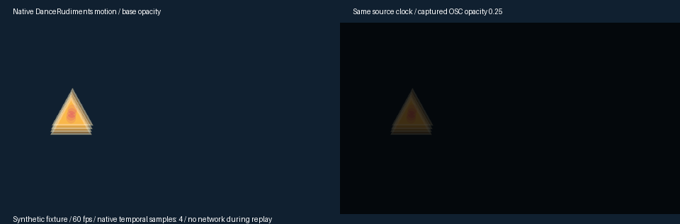

# M15.5 — finite OSC control takes

FrameRudiments 0.4.35 adds experimental numeric OSC capture and hash-pinned
replay through the ordinary compositor. Capture uses explicitly configured IPv4
loopback UDP. Ordinary project loads and exports open no socket.

Actual output frame 30 of the synthetic 60 fps qualification, with native
DanceRudiments movement and four temporal samples per encoded frame. Both
panels retain the same source clock. This is implemented output.

[Play the native 60 fps demonstration](https://kieransimkin.github.io/FrameRudiments/m15-5/).
The gallery retains the video, frozen take and independent full-decode hashes.
CI also retains an osc-controls artifact for each Python 3.13 host.

## Capture using the existing media owner

    from framerudiments import Project
    from framerudiments.osc_controls_m15 import OSCControlCapture

    project = Project.load("project.json")
    bindings = [{"address": "/gain", "node": "gain", "property": "opacity"}]
    with OSCControlCapture(project, bindings, bind=("127.0.0.1", 9000),
                           peer=("127.0.0.1", 9001), lease_frames=45) as capture:
        for frame in existing_transport_frames:
            capture.sample(frame)
    take = capture.freeze()
    reference = take.write("control-take.json")

The project must already have an effect graph. Bind the sender to the exact
peer endpoint. Entering the context opens the socket; every exit closes that
owned descriptor. There is no receiver thread, discovery, wall-clock playback
loop or automatic reconnection.

Capture starts at zero and accepts increasing encoded frame positions.
Datagrams received between samples belong to the next supplied frame. Last
valid value per address wins within that sample. UDP can drop/reorder messages:
the saved accepted take is the replay authority, not unsaved sender intent.
The optional wait_for_input(0.5) waits for I/O without advancing media time.

Freeze requires a closed receiver, a sampled final programme frame and a
nonempty bounded take. Every event records encoded frame, native source seconds
and continuous beat. Repeated audio can return to the same source time while
the continuous beat and take frame continue forward.

## Pin and replay

Add the returned reference as the optional project field:

    "osc_control_take": {
      "path": "control-take.json",
      "sha256": "<SHA-256 returned by take.write>"
    }

    framerudiments-osc inspect
    framerudiments-osc validate project.json
    framerudiments preflight project.json --output preflight
    framerudiments render project.json --output render

Replay checks the audio hash, sample slice, repeats, FPS, frame extent, clock,
graph and native control configuration. Take bytes join the normal input ledger.
Moving pinned files is allowed; changing source/timing/graph requires a new take.
The writer atomically refuses overwrite.

A/B/A frame reads return identical controls and pixels. Values apply through
event_frame + lease_frames; the next frame releases the native base. Skipped
capture positions do not extend that lease. Native temporal movement still
uses fractional source/beat samples; OSC values hold for their encoded frame.

Targets must be unique, animatable native numeric properties. Integers require
OSC int32. Native ranges and cross-property constraints still apply. Overlap
with native motion bindings, categorical values and unknown properties fail
before socket creation.

## Protocol, resources and qualification

The supported [OSC 1.0 subset, by Matt Wright](https://opensoundcontrol.stanford.edu/spec-1_0.html)
uses literal ASCII addresses, one big-endian int32/float32, strict four-byte
string padding and finite values. Bundles, timetags, patterns, MIDI, LAN
endpoints and device discovery are unsupported. Exact peer filtering is not
authentication.

Limits: 64 combined targets, 1,024-byte semantic packets, 64 packets per sample,
8,192 events and a 2 MiB take. The socket requests a 16 KiB receive buffer and
checks its observed bound. Packet/event overload closes before partially
publishing that sample. Malformed/oversized messages, other peers and invalid
values are counted. These counters cannot observe kernel-level UDP loss.

Run the reproducible adapter in a fresh output directory:

    python integration/qualify_osc_controls_m15.py --output osc-proof

It uses an independent producer, real sockets, native movement, source-clock
and expiry checks, A/B/A pixels, an ordinary export and independent FFmpeg
decoding. Synthetic audio is silent. A measured preflight records render
ownership before encoding. Focused Windows/Linux 3.11/3.13 tests cover wire
rejections, closure, pins, overload and replay with socket creation forbidden.

M15.5 remains in progress: MIDI, bundles/timetags, authenticated LAN profiles,
NDI/Spout/Syphon and physical Vulkan/WebGPU parity are separate increments.
This loopback profile does not establish hardware, latency or perceptual
acceptance. The actual demo supplies useful evidence; an invented illustration
would not add technical evidence.
