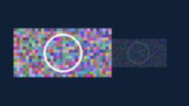

# S7: preview measurements, native profiling and release gates

**Status: implementation candidate.** S7 completes the streaming plan's
measurement UI, content-free session receipts, native load/seek gallery and CI
profiling route. Successful local checks qualify their observed inputs and
runtime. Exact-change CI, external feedback engines, physical adapters, encoded
output and human perceptual approval are separate acceptance states.

## Authoring controls and observations

Enable **Adaptive cache preview** in the existing authoring workspace. The image
label distinguishes the displayed frame, requested frame, stale preview, actual
cached quality and foreground/cache/refinement origin. The timeline and audio
remain the only playback clock.

The target control accepts every whole-number rate from 15 through 120 FPS and
shows the server-accepted target separately from a pending request. Changing
that target never changes the project FPS, source samples, frame ledger or
production settings. S6 feedback stays at authored Q5 within its reconstruction
budgets; ordinary adaptive profiles keep the existing supported quality floor.

The measurement panel shows fresh-render and decoded-acknowledgement rates,
foreground service and queue percentiles, indexed Q5 coverage, PNG cache usage,
hits/misses, upgrades/evictions, refinement progress and invalidations. Expand
the details for seek timings and scoped server CPU/memory observations. Unknown
measurements remain unknown; zero is a measured zero. The panel scrolls
independently of the preview and timeline and has a narrow-screen arrangement.

**Download measurement report** exports a bounded JSON receipt for the current
session. Draft/session changes and invalidation abort old observation/export
requests. The client rejects old sample sequences, invalid shapes, unbounded
arrays and unexpected approval claims. It copies only known fields and strips
the session token and unknown text before creating the download.

## Measurement meanings

| Field | Meaning |
| --- | --- |
| `rates.fresh_fps` | Successful current foreground render completions in a rolling three-second window; excludes cache hits, discarded work and background refinement |
| `rates.decoded_fps` | Accepted acknowledgements for nonrepeated frame ordinals in the same window; does not measure physical display refresh |
| `rates.acknowledgement_source` | `client_decode_ack` for the authoring route; `harness_png_decode` for the native profiling harness |
| `latency_ms.render` | Current successful foreground service, including native setup, PNG verification and cache publication |
| `latency_ms.queue` | Time from enqueue to foreground service, including any wait for refinement to release resources |
| `latency_ms.seek_ack` | Server processing of an accepted seek command; excludes HTTP delivery to the client |
| `latency_ms.seek_first_frame` | Accepted seek to first current `frame-ready` publication on the server |
| `latency_ms.seek_decode` | Accepted seek to first accepted decoded-image acknowledgement; client network/decode or harness decode according to the declared source |
| `cache.frames` / `q5_frames` | Current indexed frame coverage, with Q5 counted only at current section generations |
| `cache.bytes` | Deduplicated PNG payload bytes referenced by the cache index; excludes SQLite, temporary files and generated report files |
| `cache.hits` / `misses` | Accepted foreground request lookups; extra image downloads and background cache inspections do not inflate these counts |
| `cache.upgrades` / `evictions` | Cache operations since this session opened; persistent coverage is reported separately |
| `resources.cpu_seconds` | CPU time consumed by the preview server process since session creation |
| `resources.rss_bytes` | Current resident memory of that server process where available; excludes child processes and GPU memory |
| `resources.gpu_memory_bytes` | Unavailable in the general session observer; native GPU profiling has a separately scoped driver-memory observation |

Timing percentiles use nearest-rank p50/p95 over the latest 512 samples. Rate
percentiles summarize sampled rolling-window observations at least 250 ms apart;
they are not reciprocal render times or a hardware benchmark. A saturated
timestamp buffer makes the current rate unavailable until the retained window
can support an exact count. Repeated acknowledgements count separately and
cannot inflate decoded FPS. A stale completion is counted as discarded work and
does not enter successful-render latency or rate evidence.

Storage/resource probes are cached for one second in routine control responses.
Explicit status polls and exports refresh them. No per-frame PNG recovery scan,
filesystem walk or hardware-wide process enumeration is added to rendering.

## Receipt and transport contract

`GET /api/stream/status?session=...` adds a small `qualification` summary.
`GET /api/stream/qualification?session=...` returns:

```json
{
  "session": "current opaque session token",
  "cursor_seq": 12,
  "frame": 91,
  "qualification": {
    "schema": "framerudiments.preview-stream-qualification.v1"
  }
}
```

The example omits the receipt fields described below. The envelope follows the
existing local same-origin/token policy and is not the downloadable artifact.
Missing, repeated, blank extra or unknown query fields are refused. Replaced,
foreign and closed sessions cannot export. The client cannot supply profiler
source labels, cache limits, performance values or approval flags via HTTP.

A full receipt includes exact project/pipeline/renderer/profile/implementation
digests, allowlisted package versions, current half-open section ranges and
dependency hashes, bounded quality-transition and invalidation history,
operation counters, timing/rate summaries and measurement-scope declarations.
It does not contain canonical paths, private titles/lyrics/cues, source text,
frame pixels or session tokens. Unsupported package version metadata becomes
unavailable rather than arbitrary exported text.

Histories retain at most 128 entries each and report dropped-entry counts.
Timing/rate buffers retain at most 512 samples and section exports at most
2,048 entries. The authoring client bounds a JSON response at 2 MiB before
parsing it. Local receipts always leave release/production/display approval
flags false: measurements cannot approve their own deployment or perceptual
quality.

## Native profiling and gallery

From a source checkout with the declared development dependencies:

```powershell
python scripts/profile_preview_stream.py --output preview-s7-smoke --preset smoke --size small --backend cpu
```

The output must be a new directory. The command preflights its intended parent
using the actual interpreter, creates an owned temporary work tree, and removes
that tree after native owners retire. It publishes `qualification.json` and a
self-contained `index.html` with actual native PNGs and an embedded JSON download.
It does not overwrite existing evidence. On failure it writes a bounded,
content-free failure receipt and returns nonzero; it never labels a partial run
passed or creates a passing gallery.

| Option | Values |
| --- | --- |
| `--preset` | `smoke`: 12 random seeks; `standard`: 64; `stress`: 1,000 |
| `--size` | `small`: 320×180; `hd`: 1920×1080; `uhd`: 3840×2160 |
| `--backend` | `cpu`, or strict native `gpu` with no automatic fallback |
| `--revision` | Require the exact actual checkout SHA; dirty-source status and implementation hashes remain explicit |
| `--max-seconds` | 10–1,800 seconds, default 180, checked between operations; CI owns the outer timeout for a blocked native call |

The harness admits only its generated, pinned synthetic audio/sprite/cue
fixtures. It invokes the shipping `PreviewStreamAPI`, `SeekStream`, native
renderer, SQLite/PNG cache, adaptive controller and spawned Q5 worker. It
preserves source sample identity and repeat clocks, compares five Q5 frames to
the native production compositor with zero RGBA8 tolerance, and confirms that
its source inputs remain unchanged.

Four native scenarios cover:



Actual native PNG from the generated, pinned fixture. It documents the pixel
comparison input; the receipt supplies the queue, timing and cleanup evidence.
A recording of this still would add no proof of the concurrent test.

The harness instruments `NativePreviewRenderer.render_cancellable`, the entry
point used by adaptive streams. Pressure and GPU observations must wrap that
call rather than an unused convenience method. The obsolete-result scenario
also uses a bounded, explicitly injected post-render barrier: it waits until a
real PNG exists, queues newer cursor commands, then releases the PNG to the
shipping stream's publication fence. This proves discarded completed work
without assuming that an active worker has already produced a result. The
barrier is always released on command failure and is not a production clock,
renderer or performance measurement.

1. Cold/warm random seeks, latest-intent work, manual target changes and a local
   edit with independent Q5 cache retention.
2. An explicitly injected 70 ms foreground delay, actual adaptive downgrade,
   stopped-anchor refinement in a native child, and exact Q5 parity.
3. Zero PNG RAM cache, a small measured disk budget and explicitly injected
   12 ms write delays, with observed quota evictions.
4. One explicitly injected allocation failure followed by the existing
   controller's downgrade and a successful native frame.

The harness separately exercises the real controller at 5/12/30/70 ms virtual
service costs and 24/30/60/120 FPS targets, checking pressure, one-rank changes,
cooldown and recovery. Virtual costs, deliberate delays and allocation faults
are labelled synthetic pressure; their rates are not unthrottled host results.
Harness PNG decode acknowledgements are not browser paint evidence.

The companion `framerudiments.preview-stream-profile.v1` report embeds the
session qualification receipts, actual pixel comparisons, source/implementation
identity, cleanup state and explicitly scoped aggregate CPU/disk observations.
GPU mode records native graph dispatch, transport/pool statistics and driver
memory hints from the context-owning thread. Unavailable driver memory is not
zero. A software EGL renderer is identified and cannot qualify a physical GPU.

## CI and release integration

The reusable `preview-stream-qualification` workflow is called by the existing
main CI workflow, which is also the release validation dependency. It runs
native CPU profiling on Windows and Linux and a strict software-EGL GPU graph
profile on Linux. Actual JSON/HTML/JUnit evidence is uploaded for the exact
source revision. Profiling tests must execute without skips; native GPU dispatch
must be observed and fallback rejected. Manual workflow dispatch allows the
larger workload/resolution options.

The existing external Butterchurn/projectM acceptance matrix, production render
baseline, immutable release identity and publication destinations remain their
own gates. This workflow strengthens validation; it does not publish a release,
site, package or user media. Physical-device, long-project, encoded-output and
perceptual approval require their corresponding evidence. The delivery receipt
states exactly which local/CI runs were observed.

S7 also corrects two issues exposed by the merged S6 external-engine job. The
owned Butterchurn launch awaits the pinned Puppeteer's asynchronous argument
builder before starting its process. The synthetic projectM acceptance preset
uses an explicit MilkDrop2 composite shader to exclude the native legacy
VideoEcho path's randomly initialized hue. This changes the reviewed fixture,
not production presets or the zero-tolerance replay gate. A nonrepeatable user
preset still fails closed. Exact-change native CI must qualify both corrections.
