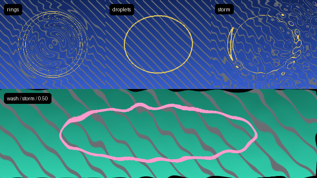

# Refractive raindrop ripples and wash-away transitions

FrameRudiments supplies one deterministic, random-access ripple field through
two existing effect-graph routes:

- `spatial_warp` with `warp_type: "raindrop_ripples"` refracts one ordinary
  graph layer or completed branch;
- `transition` with `transition_style: "wash"` distorts both sources while the
  same seeded field reveals the incoming source.

Both routes offer `rings`, `droplets` and `storm` variants. They share the same
independent implementation rather than embedding a web shader or starting a
second renderer. No model, texture, browser, mutable wave simulation or global
random state is required. Exact frame seeks, chunk replay and repeated renders
therefore produce the same pixels.



*Actual FrameRudiments CPU output on synthetic artwork. It demonstrates the
implemented refraction and transition mechanics, not campaign art, rainfall
physics, GPU parity or artistic approval.*

[Play the two-second 60 fps demonstration](media/raindrop-ripples.mp4) and read
the [accessible description](media/raindrop-ripples-transcript.md). Playback is
user controlled.

## The three variants

| Variant | Mechanic | Useful character |
| --- | --- | --- |
| `rings` | One analytical travelling radial wave packet, with a Gaussian spatial envelope and gradient-derived refraction | Clean lyric/cue accents and legible expanding rings |
| `droplets` | Deterministic spherical-cap approximations whose bounded radial normals refract the source inside each seeded lens | Rain-on-glass lenses without a texture asset |
| `storm` | Several seeded, phase-offset ring packets plus a weaker retained droplet lens, normalized before displacement | Dense rain and multi-source interference without mutable PDE state |

The implementation is physically inspired rather than a ray tracer. RGB remains
display-referred, refraction is a screen-space inverse sample, and there is no
reflection, Fresnel term, fluid collision, gravity, caustic energy conservation
or claim of water's real index of refraction.

## Layer configuration

```json
{
  "id": "rain-on-title",
  "type": "spatial_warp",
  "inputs": ["layer:title"],
  "warp_type": "raindrop_ripples",
  "warp_ripple_variant": "storm",
  "warp_amplitude": [18, 14],
  "warp_scale": [24, 24],
  "warp_radius": 180,
  "warp_phase": 0,
  "warp_segments": 10,
  "warp_seed": 42,
  "warp_border": "clamp"
}
```

`warp_amplitude` is the maximum physical-pixel X/Y refraction. For this warp,
`warp_scale.x` is the analytical wavelength, `warp_radius` is the principal
packet/lens radius, `warp_segments` is the seeded drop count (`rings` uses the
authored centre only), and `warp_phase` is radians with a `2*pi` cycle. The
ordinary `warp_center`, `warp_mix`, `warp_border` and universal `opacity`
contracts remain intact. Bind `warp_phase`, amplitude or radius through the
existing DanceRudiment graph controls; do not add a second timebase.

## Wash-away transition

```json
{
  "id": "rain-wash",
  "type": "transition",
  "inputs": ["verse", "chorus"],
  "transition_style": "wash",
  "wash_variant": "droplets",
  "wash_seed": 42,
  "segments": 12,
  "frequency": 7,
  "amplitude": 28,
  "strength": 0.85,
  "phase": 0,
  "feather": 0.08,
  "timing": {
    "start_beat": 16,
    "duration_beats": 2,
    "preset": "smoothstep"
  }
}
```

`progress` or the existing beat-authoritative `timing` object owns the reveal.
The transition keeps exact byte-identical source endpoints at progress 0 and 1.
At intermediate progress, the outgoing and incoming sources receive opposing
refraction from the shared field; its magnitude peaks at the midpoint and returns
to zero at both endpoints. `frequency` selects the number of analytical ring
cycles across the image radius, `segments` selects seeded drops, `amplitude`
is physical pixels and `wash_seed` is an integer 0–10000. `direction: left` or
`up` reverses the arrival field, producing an inward rather than outward wash.

## Research route and independent adaptation

The implementation was informed by several existing primary implementations:

- [RainyGlassShader](https://github.com/toadstorm/RainyGlassShader) uses a
  screen grab for plausible refractive rain-on-glass and separates its higher-
  end and mobile routes.
- [liquid-ripple](https://github.com/AsimRauf/liquid-ripple) exposes analytical
  expanding rings, decay, wavelength, refraction and specular controls in a
  single WebGL fragment-shader design.
- [liquid-glass](https://github.com/StarKnightt/liquid-glass) uses a signed-
  distance-field dome normal for refraction and a damped sinusoidal wave packet
  for click ripples.
- The authors' [CS184 Rain Simulation in WebGL](https://athakrar1.github.io/projects/184_final/index.html)
  describe back-traced refraction vectors from drop depth/normal data and the
  use of soft alpha at droplet edges.
- [Four Elements' ripple study](https://www.fourelementscorp.com/en/showcases/interactive-water-ripple-effect)
  compares a mutable finite-difference height map with closed-form radial waves
  and gradient-based screen-space refraction.

FrameRudiments independently implements the closed-form/random-access route in
NumPy/Pillow, because a mutable finite-difference surface would require replay
from frame zero and would not suit arbitrary frame seeks or ordinary layer
branches. No source code, shader text or texture from those projects is bundled.

## Backend, resources and acceptance

Starting with 0.4.28, the layer warp can run on GPU with all three variants and
all four borders and up to 32 seeded drops. In 0.4.29, a driver with
`GL_ARB_gpu_shader5` supports up to 4096 pixels of displacement per axis
and X wavelengths down to one pixel for rings and storm. Other drivers
support up to 128 pixels of displacement and wavelengths of at least
16 pixels. Droplets use no wavelength. `auto` falls back to the CPU for
settings outside the device's range.
See the [CPU and GPU comparison](effect-graph-m8-9-gpu-spatial.md#raindrop-ripples).

A configured `warp_amplitude: [0,0]` or `warp_mix: 0` is an exact layer
identity. Refraction transports original-alpha lineage through the same
coordinates. The CPU wash transition keeps exact source copies at its
endpoints and begins a new lineage under the existing merge contract.

Inspect final encoded text, faces, safe regions and borders. `transparent`
borders can intentionally remove displaced edge pixels; use `clamp`, `repeat`
or `mirror` where that is not wanted. A synthetic regression or documentation
video proves deterministic rendering only, not song fit, rain realism, flash
safety, listening approval, publication or GPU performance.

Regenerate the actual documentation media with:

```powershell
python integration/build_raindrop_ripple_visuals.py `
  --output docs/media --ffmpeg ffmpeg
```
