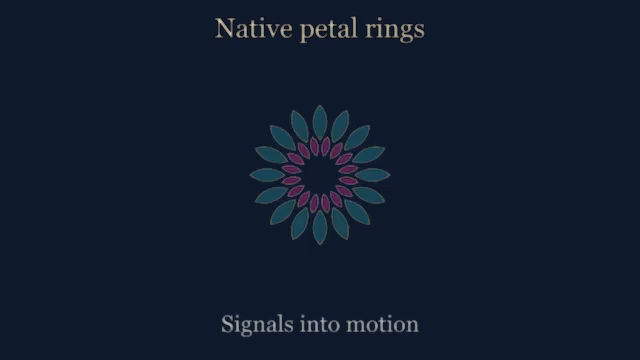

# Native rangoli petal rings

`renderer: "rangoli"` redraws a radial ring of cubic Bezier petals directly
from independent native dimensions, rather than resizing and expanding rotated
bitmap rectangles. Stack rings with separate pinned bass, drum, voice or treble
recordings. The shared source clock, caption ledger, encoder and QA stay intact.
This geometric vocabulary does not assert cultural authenticity or endorsement.

Create a portable synthetic example with `framerudiments demo demo --rangoli
--font /path/to/licensed.ttf --width 640 --height 360`, then use the normal
`plan`, `preflight` and `render` commands. No private artwork is required.



[Play the actual synthetic demonstration](media/rangoli.mp4), with user-controlled
playback. [Transcript and evidence context](media/rangoli-transcript.md).
The demo uses synthetic audio and example words, never a private song/master.

```json
{
  "id": "bass-centre", "type": "rudiment", "renderer": "rangoli",
  "bounds": [80, 80, 560, 560],
  "motion": {"kind": "recording", "file": {"path": "bass.json", "sha256": "<hash>"},
             "axes": ["pulse", "angle"]},
  "history_frames": 1,
  "style": {"petals": 16, "radius": 0.4, "petal_length": 0.7,
    "petal_width": 0.2, "scale_axis": 0, "scale_gain": 0.6,
    "rotation_axis": 1, "rotation_gain": 16384,
    "fill": "#dd339955", "outline": "#fff3d9ee", "line_width": 2}
}
```

`radius` is the fraction of the padded viewport half-short-edge. Length and
width are relative to that radius; angles are degrees. `scale_gain` multiplies
the selected native value, giving `1 + value * gain`. `rotation_gain` maps its
own axis in degrees; a retained cumulative angle recording may be scaled back
from its documented normalization. `dy_gain` is a fraction of viewport height.
All axis choices are explicit and missing axes fail. Geometry, stroke and halo
must fit the viewport; overflow aborts rather than silently clipping a large bop.

Styles: `petals` 3–128; `radius` .01–1; `petal_length` .01–1;
`petal_width` .001–.5; finite `angle`; `line_width` 1–64 pixels;
`fill` and `outline` CSS RGBA colours; `glow` 0–.1 of short edge;
`scale_gain` -.99–.99; `rotation_gain` ±1,000,000; `dy_gain` ±.5;
`scale_axis`, `rotation_axis`, `dy_axis` 0–255. Shared palette, padding,
background, opacity, modulation and gates remain supported.

## Font and projectM composition

Use existing `render_quality.spatial_scale: 4` for genuinely higher-resolution
TTF/OTF outlines and vector petals. Temporal samples are distinct source times,
not interpolated video frames; select an explicit preview budget when needed.
The existing rich-text stroke/shadow/gradient options improve contrast without
blurring the glyph itself. Fonts remain pinned licensed inputs, not bundled.

The supplied `visualiser_assets/rangoli-background.milk` is an original,
texture-free, restrained audio-reactive projectM preset. Pin its exact bytes
with an external-preset file reference and `trusted_preset: true`. It uses
the established projectM bridge/PCM/time contract, not another engine.
Route only `background` into projectM, and overlay each petal layer, identity
and caption cleanly using `visualiser_routing`. This keeps the song legible
while the background responds to the real soundtrack. ProjectM GPU acceptance
and cleanup evidence are separate from a static synthetic drawing.

Smoothing and stem analysis remain in StemLab. Native sampling and bounded
recordings remain in DanceRudiments. No hidden envelope normalization,
beat-estimation, integrator, wrapping or substituted recording phase is added.
Rendering alone authorizes no campaign publication. Inspect final glyphs,
contrast, flash/motion comfort, mobile scale and attended listening separately.
