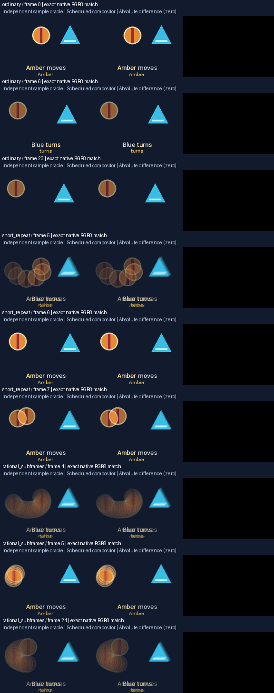

# M11.1 — Exact temporal dependencies and deterministic native scheduling

M11.1 makes the native compositor's temporal work explicit and executable.
Each output has an immutable dependency plan containing exact source sample
positions, ordered input ports, supersampling, the historical shutter when
configured, and final output. `Compositor.frame()` executes that plan. The
same planning surface is available to Python callers and the CLI.

With [M11.2 native feedback](feedback-history-m11-2.md), this is the schedule
for one native recurrence input. `Compositor.feedback_plan()` separately
describes the earlier encoded frames required to reconstruct feedback history.

This is an unreleased implementation candidate on the consolidated roadmap.
Existing `framerudiments.project.v1` fields, pinned inputs, source audio clocks,
native DanceRudiments motion/recordings and the effect graph remain authoritative.
There is no new project field, timing override or persistent pixel cache.

## Exact coordinates and explicit boundaries

`FrameRef(stage, frame)` names one stage at an exact position on the encoded
frame ruler. Positions are integers or `fractions.Fraction`; binary floats and
booleans are rejected. With four temporal samples, native sample index 13 is
`Fraction(13, 4)`, not a new 13th encoded output frame.

`TemporalDependency(source_stage, offsets, boundary, repeat_local)` declares
ordered signed offsets. Negative offsets read the past, positive offsets read
the future, and zero reads the current position. `resolve()` requires the
owner's inclusive final sample position and exact sample grid. It preserves
input order and multiplicity, including repeated references after clamping.

| Boundary policy | Result when a requested tap is outside the admitted interval |
| --- | --- |
| `error` | Reject before any rendering callback. |
| `drop` | Remove that tap, retaining the order of remaining taps. |
| `clamp` | Use the nearest admitted point on the declared sample grid. |

`repeat_local=True` also restricts taps to the anchor's exact half-open source
cycle. The cycle span is `(end_sample - start_sample) * fps / sample_rate`.
It may be fractional. A boundary is calculated on this rational ruler before
the interval is intersected with the available sample grid.

This corrects a historical-shutter bug for short excerpts. At output frame 6
of a six-frame repeat, an eight-frame shutter previously admitted frames
`[0, 6]`: both wrapped to the same source timestamp. The exact-cycle rule admits
only `[6]`. A complete prior repeat cannot leak into the current exposure.
Ordinary and longer-repeat behaviour retains the existing native sampling
semantics; the short-repeat correction deliberately changes affected pixels.

## Immutable plans and bounded execution

`FrameTask(ref, inputs)` declares the ordered dependencies of one result.
`build_schedule(tasks, outputs)` validates the complete declared graph before
callbacks, rejecting duplicate declarations, missing inputs and cycles, then
prunes valid unreachable tasks. Task declaration order does not change the
canonical execution order. Input port order and requested output order remain
significant; repeated ports reuse the same evaluated result.

`execute_schedule(schedule, evaluate)` calls `evaluate(ref, ordered_inputs)`
once per required task and releases scheduler-owned values after their final
use. Requested outputs remain live until returned. Failure clears scheduler
locals even when the exception traceback is retained. Callback-owned aliases,
traceback locals and private scratch are the callback owner's responsibility.
Treat values passed to consumers as immutable. This is synchronous dependency
scheduling; it does not create worker threads or transfer GPU contexts.

The generic scheduler limits declarations to 4,096 tasks, 65,536 input edges,
256 live results and 4,096 requested outputs. A dependency accepts at most 256
offsets with absolute reach at most 4,096 frames. Exact coordinate magnitudes,
numerators and denominators are bounded. Callers may choose smaller limits;
they cannot raise the hard limits. Resource validation precedes callbacks and
also applies when a caller constructs a `FrameSchedule` directly.

Each plan has a JSON document and SHA-256 digest. **That digest identifies the
dependency topology, addresses, input/output order and limits.** It does not
identify source files, shader contents, modulation values, output pixels or
persistent cache entries. Inspection records the project hash and native clock
contract separately; ordinary source-pin validation still applies.

## Production compositor integration

The executed stages are:

1. `native`: draw one authoritative native source sample, using existing
   source time, beat, cue, text, motion, graph and spatial-quality routes.
2. `supersample`: integrate the configured native subframes in linear light,
   preserving routing surfaces and public per-frame reports.
3. `shutter`, when configured: blend the declared current-cycle encoded frames
   with the existing weights and strength.
4. `output`: restore the current frame's metadata and apply final output
   quality when requested.

At the final programme boundary, repeated clamped subframe ports preserve their
weights while their shared native source task runs once. Native subframes use
the existing programme grid and can cross an internal repeat boundary. The
historical shutter's encoded-frame taps remain local to their source cycle.
Custom scene hooks keep the existing encoded-frame identity and fractional
source timestamp semantics. Optional external visualisers still execute once
per encoded frame in their existing downstream pipeline.

When `post_effects.feedback` is configured, each reconstruction frame executes
these native stages without final output quality, then updates the encoded-frame
feedback recurrence. Final quality applies once to the requested feedback
result. The feedback owner restores the current target's metadata and owns its
separate history/checkpoint budget; custom scene hooks are not admitted by that
owner because they have no supported checkpoint identity.

Native plans have stricter limits of 128 tasks, 256 edges and 24 live results,
plus a 512 MiB preflight budget for retained RGB task results and captured or
averaged RGBA routing surfaces. Historical task results do not retain extra
route sets; current-frame routes are averaged incrementally. Inspection and
native execution both reject an excessive plan before drawing. GPU allocations,
callback-private scratch and existing native renderer caches keep their own
limits; this budget is not a process-RSS guarantee. Existing layer source caches
and the bounded custom scene-hook adapter remain part of their owning renderers.

`compositor.evidence()['temporal_schedule']` reports the structural contract
and the last successfully executed plan's digest, task count, actual callback
count, source sample addresses and retained-result estimate. A failed native
render clears the success receipt, restores public metadata and retires its
partially advanced private temporal compositor.

## Inspect a real project without rendering

```sh
framerudiments inspect-temporal project.json --frame 0 --frame 12 --frame 24
framerudiments inspect-temporal project.json --frame 12 --output temporal-plan.json
```

The command accepts 1–64 encoded frame selections and preserves selection
order and duplicates. It validates the project and pinned inputs before and
after planning, samples native modulation as needed, and emits finite bounded
JSON. It creates no virtual renderer, GPU context or pixel output. A requested
output file must be new, with an existing parent directory; exclusive creation
preserves existing files and symlinks. Without `--output`, JSON goes to stdout.
Inspection reports contain hashes, clock coordinates and counts, not private
source paths or lyric text. The output limit is 8 MiB.

`framerudiments plan` also includes `temporal_schedule` structural metadata.
That contract describes conservative capability and reach; use
`inspect-temporal` to see the actual tasks for selected frames and use native
render evidence to establish which tasks executed.

For projects configuring `post_effects.feedback`, `plan` also includes its
structural `feedback` contract. `inspect-temporal` includes top-level `feedback`
and a reconstruction plan in each `frames[i].feedback`. The existing `schedule`
and `digest` continue to identify the selected frame's native input work. A
fresh CLI inspector has no checkpoints, so the additional reconstruction plans
start at their exact resets and do not claim executed pixels.

## Python sampling and reusable dependency declarations

```python
from framerudiments.compositor import Compositor
from framerudiments.project import Project

project = Project.load("project.json")
compositor = Compositor(project)
try:
    plan = compositor.temporal_plan(12)
    print(plan.digest, plan.document())
    samples = compositor.sample_frames(
        12, (-2, 0, 2, 2), boundary="clamp", repeat_local=True
    )
    # Ordered (Pillow image, FrameContext) pairs; repeated images are detached.
finally:
    compositor.close()
```

`sample_frames` accepts 1–64 signed integer offsets for complete encoded frames.
Integral `Fraction` values are accepted; off-grid complete-frame requests are
rejected. `repeat_local` defaults to true and the default boundary policy is
`error`. Dropped taps can return an empty tuple. Shared complete-frame requests
render once per call, and each returned image is copied so a caller can modify
one duplicate without changing another. The retained output/copy RGB estimate
is capped at 256 MiB before callbacks; each nested native plan must also pass
its own resource limits. The M11.1 scheduler adds no persistent inter-call frame
cache. If M11.2 feedback is configured, complete-frame requests use that owner's
separate bounded history and checkpoint reconstruction.
Projects configuring sequential external visualisers are rejected by this
API because these results stop before those engines.

For exact fractional or custom stage dependencies, use the reusable kernel:

```python
from fractions import Fraction
from framerudiments.temporal_schedule import (
    FrameRef, FrameTask, TemporalDependency, build_schedule, execute_schedule,
)

dependency = TemporalDependency(
    "source", (Fraction(-1), Fraction(0), Fraction(1, 2)), boundary="clamp"
)
inputs = dependency.resolve(4, last_frame=Fraction(19, 2), sample_step=Fraction(1, 2))
output = FrameRef("combine", 4)
tasks = [FrameTask(ref) for ref in dict.fromkeys(inputs)]
plan = build_schedule([*tasks, FrameTask(output, inputs)], (output,))
# The owner supplies evaluate(ref, ordered_inputs) and its authoritative source clock.
# result, = execute_schedule(plan, evaluate)
```

This provides past/future scheduling to adapters. It does not add arbitrary
temporal ports to the current same-frame authored effect graph.

## Preview invalidation

Preview dependency reach comes from native settings: a configured historical
shutter conservatively reaches eight encoded frames into the past, including
its modulation range. More than one native temporal sample reaches less than
one frame forwards, represented as one conservative whole frame for segment
invalidation. A forward-only quality dependency keeps the existing independent
seek UI mode; it is not feedback history. External sequential engines retain
the existing separately verified feedback-seek route. M11.2's explicit native
feedback has its own authored-Q5 `checkpoint_replay` mode and source-clock reset
boundaries; it does not enable checkpoint restoration of external engines.

## Qualification and next milestone

Run the checked-in synthetic route with installed FFmpeg, ffprobe and a font:

```sh
python integration/qualify_temporal_schedule_m11_1.py --output temporal-evidence
```

The fixture covers ordinary frames, a six-frame repeat with an eight-frame
shutter, and a 49/10-frame repeat with four native subframes. An independent
rational oracle selects source addresses and shutter taps, then uses existing
native raster and linear-light blend operations. It compares 73 full-programme
frames and 85 shuffled/repeated requests, plus seven complete-frame future
samples and eight generic future/fork graph results. It also checks actual
execution receipts against the plans, source immutability, detached duplicates,
and CLI inspection for all three cases.

Both temporal cases run actual CLI plan, complete preflight and FFmpeg render.
All 49 decoded output frames are compared with separate reference encodes made
from independently selected native pixels. These comparisons test the same
encoder route and do not claim lossless identity with unencoded RGB. Existing
CI runs the qualifier on Windows and Linux and uploads the receipts and media.



The [synthetic qualification receipt](media/temporal-scheduling-m11-1.json)
records the actual runtime, source/implementation hashes and measured results.
Local CPU/CLI evidence does not establish GPU parity, browser interaction,
physical-device behaviour, listening approval or artistic approval.
Exact-candidate CI remains a separate gate.

[M11.2](feedback-history-m11-2.md) adds explicit delayed feedback, bounded
history, checkpoints and random-access reconstruction as a separate owner.
The M11.1 dependency graph still rejects cycles; it does not infer feedback
resets or checkpoint semantics from a cyclic graph. Creative temporal effects
and rational video adapters remain the later M11.3 and M11.4 milestones.
