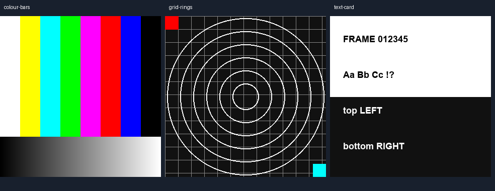

# Full-frame Butterchurn and projectM visualisers

The optional `effects` list in `framerudiments.project.v1` processes the complete
composed frame **after** the scene hook, sprite/atlas and rudiment layers,
identity text, LRC captions and lyric artwork. That frame enters each engine's
feedback texture **before** its MilkDrop warp/composite passes. Lyrics and
DanceRudiments-animated sprites therefore bend, distort and leave feedback
together with the rest of the image. Nothing redraws clean lyrics over the result.

```json
"effects": [
  {"id": "feedback", "engine": "butterchurn", "preset": "feedback", "input_mix": 0.75, "seed": 7},
  {"id": "distortion", "engine": "projectm", "preset": "julia", "input_mix": 0.9}
]
```

Use either engine alone or both in the desired list order, with up to eight
stages. Each stage has independent feedback state. `input_mix` (0.001–1) is the
new full-frame contribution; lower values retain more previous processed pixels.
Original paired presets are `feedback` (audio-reactive swirl/echo),
`kaleidoscope` (sixfold angular distortion) and `julia` (bounded Julia-orbit
distortion of the frame's texture coordinates). They are examples, not a claim
that two independent MilkDrop implementations produce identical pixels.

## Pin and install the optional runtimes

`framerudiments visualisers` prints the exact required pins. Rendering never
silently downloads an engine or falls back to another renderer.

* Butterchurn **2.6.7**, Puppeteer Core **25.14.0**, and every transitive npm
  dependency are pinned by the packaged `package-lock.json`. Node.js >=22.12
  and a local Chromium/Chrome/Edge executable with WebGL2 are required.
* projectM uses the **unreleased 4.2 development source** at commit
  `349b7cc2db312d47cef6be24c6856ced6643a385`, with projectm-eval submodule
  `22fb0cfd8f2dfbcd2b68f2443e7f44e19b32c09a`. Released 4.1 is insufficient:
  this integration needs 4.2's texture burn-in and explicit frame-time APIs.
  An OpenGL 3.3 context, CMake, Git and a C++17 compiler are required to build it.
  The optional Python extra pins GLFW 2.10.2 and PyOpenGL 3.1.10.

```sh
python -m pip install 'framerudiments[projectm]'
framerudiments effects-setup butterchurn /path/to/butterchurn-runtime
framerudiments effects-setup projectm /path/to/projectm-runtime
```

Setup verifies the source/submodule commits and clean working trees, builds an
unmodified shared library and writes `framerudiments-projectm.json` beside it.
Rendering checks the receipt's source pin and library hash. Keep this receipt
with the library. This is build provenance, not a signature from upstream.
Do not substitute an unrelated library with a fabricated receipt.

Set these environment variables in the rendering process:

| Variable | Value |
| --- | --- |
| `FRAMERUDIMENTS_BUTTERCHURN_RUNTIME` | Directory containing the installed pinned npm runtime |
| `FRAMERUDIMENTS_BROWSER` | Absolute path to the chosen Chromium/Chrome/Edge executable |
| `FRAMERUDIMENTS_NODE` | Optional absolute Node executable; otherwise `node` on PATH |
| `FRAMERUDIMENTS_PROJECTM_LIBRARY` | Exact built projectM DLL / .so / .dylib |
| `FRAMERUDIMENTS_PROJECTM_DLL_DIRS` | Optional Windows dependency directories, separated by the native path separator |

Linux build dependencies include OpenGL development libraries and GLFW; headless
GLFW tests can use Mesa under Xvfb. On Windows, choose a working MSVC or MinGW
toolchain. For Ninja/MinGW setup, pass e.g. `--cmake-arg=-G` then
`--cmake-arg=Ninja`, compiler and make-program definitions as separate arguments.
No registry-wide environment or existing user browser profile is changed.

## Animated sprites and lyric scenes

All existing sprite contracts remain available: native named/table/matched and
composite motions, bounded recording playback, axis mapping, position/rotation/
scale, cue/source gates, trails and tick-based atlas animation. Keep these in
`layers`; effect configuration belongs in `effects`, not a replacement scene.
The source-time motion clock and atlas beat clock advance normally before the
composed image enters the visualiser. No duplicate movement engine is embedded.

```sh
framerudiments demo ./effect-demo --font /path/to/font.ttf \
  --effect butterchurn --effect projectm --effect-preset kaleidoscope
framerudiments render ./effect-demo/project.json --output ./effect-render
```

The synthetic demo includes a native moving sprite and a native moving,
beat-animated atlas alongside timed captions. Add `--rudiments` for the four
modular panels too. Saved StemLab Fourier/recording views can be composed in
the same frame. These tests do not establish a song's creative or listening approval.

## Clock, PCM, evidence and lifecycle

Both engines receive output time `frame / fps`; no real-time playback, RAF or
screen recording drives the render. Butterchurn's version-specific host bridge
replaces its wall-time FPS smoothing and injects into the texture that becomes
the next warp input. This touches pinned internal properties, so changing the
Butterchurn version requires adapter review and real-engine acceptance tests.
projectM uses the public 4.2 burn-in/FBO/time APIs and one zero-time allocation
warmup. Preset selection is locked; failures abort instead of retaining an idle
or previous preset unnoticed. Native error/fallback log messages are captured
through the pinned 4.2 API; malformed warp/composite shaders abort too.

`effects-audio.f32` is stereo native-rate PCM decoded with the **same shared
FFmpeg trim, repeat and qsin fade filters** as the encoded soundtrack. Each
engine sees a trailing 1024-sample window ending at the current output sample,
zero padded at the beginning. projectM receives float PCM; Butterchurn's offline
interface receives WebAudio-style 8-bit PCM. No future audio samples are read.
This window is effect input, not a replacement for StemLab's calibrated Fourier
evidence or a claim of audio true-peak measurement.

`manifest.json` records stage order, preset/source/library/bridge/lock hashes,
GPU/runtime identity, exact clock, PCM sample count/filter chain, processed
frame count and resource-cleanup receipts. `qa/composed-*.png` preserves the
pre-effect frame; `qa/source-*.png` is the processed frame and
`qa/encoded-*.png` comes from the actual final MP4. SRT/ASS exports retain the
canonical words and timing; they do not contain the rendered distortion.

Feedback requires sequential frames from zero. To seek, recreate the chain and
replay its earlier frames. A seek cannot reuse an arbitrary old feedback state.
GPU, driver and engine noise can change output across runs/platforms; projectM
has no public seed API. Butterchurn's owned page has a seeded random source.
The exact source/audio/frame clock remains traceable; GPU pixels are not a
cross-platform bit-exact contract.

The headless helper creates its own temporary profile, blocks external requests,
and closes its page/browser through Puppeteer on success and failure before
removing only that owned profile. Bounded retries handle transient Windows file
locks after browser closure; an unresolved cleanup failure aborts the render. It does not attach to a signed-in browser.
projectM destroys its instance, textures, framebuffer and hidden GLFW window.

## Portrait mapping

In 0.1.4+, the pinned projectM legacy VideoEcho path's portrait stretch is
avoided with a square overscan canvas: the whole input frame is placed at its
original pixel size in the centre, processed by the unmodified engine, and
cropped back to the requested dimensions. The manifest records frame/canvas
sizes and mapping. Landscape/square projectM and Butterchurn use native viewports.
Presets use the engine canvas coordinates, so material can move through the
overscan margin. No post-effect lyric or sprite overlay is drawn. Neutral mapping
is tested in portrait, landscape and square formats for both engines.

## External presets and potential problems

A preset may instead be a pinned `{ "path": "...", "sha256": "..." }` file
reference: Butterchurn JSON or projectM `.milk`. Set `trusted_preset: true` only
after reviewing it: equations/shaders are executable, and Butterchurn compiles
JavaScript. Keep required textures and licences with a trusted preset; engine
format compatibility is not automatic. The bundled presets need no external textures.

Visual distortion can reduce legibility or move glyphs outside their original
safe region. Recorded text bounds describe **pre-effect** composition. Inspect
processed and encoded output and recheck platform safe zones before delivery.
Adjust the preset/input mix or use a less aggressive stage when necessary.
Do not report a pre-effect text-bounds pass as final-image acceptance.

Butterchurn/Chromium startup and frame readback cost time, especially on software
WebGL. CPU↔GPU copies are deliberate offline boundaries; no real-time throughput
is promised. An unavailable GPU, mismatched pin, missing executable, shader
failure or changed input fails explicitly and retains failure evidence.

Butterchurn is MIT; projectM is dynamically linked LGPL-2.1-or-later. Optional
runtime setup uses their original distributions/source. FrameRudiments' MIT
wheel does not bundle the native library, browser or npm modules. When
redistributing those runtimes, retain their own licences and corresponding
source/relinking obligations. See the upstream [Butterchurn repository](https://github.com/jberg/butterchurn)
and [pinned projectM source](https://github.com/projectM-visualizer/projectm/tree/349b7cc2db312d47cef6be24c6856ced6643a385).


Actual FrameRudiments 0.1.4 candidate output: timed captions and native moving
sprites/atlas before composition effects (left) and after both real engines
(right). Synthetic oscillator audio and example words; this is a software demo.
[Play the four-second demonstration](https://raw.githubusercontent.com/kieransimkin/FrameRudiments/v0.1.4/docs/media/full-frame-demo.mp4)
and [read its transcript](https://github.com/kieransimkin/FrameRudiments/blob/v0.1.4/docs/media/demo-transcript.md).
Playback is user-controlled; no automatic media playback is required.


Generated vector illustration of the processing order. The comparison above
and linked video are captured renderer output; the diagram is explanatory.

## Expanded libraries and response experiments

The [preset profiling workflow](preset-profiling.md) installs the complete pinned
upstream catalogue and uses matching-time captures, three static test cards,
programme/silence controls and released PrismMoves/PixelCue comparisons.



Generated input illustrations. Per-preset rendered captures and statistical
reports are retained separately by each experiment; catalogue presence does
not establish GPU compatibility or public-use rights.
