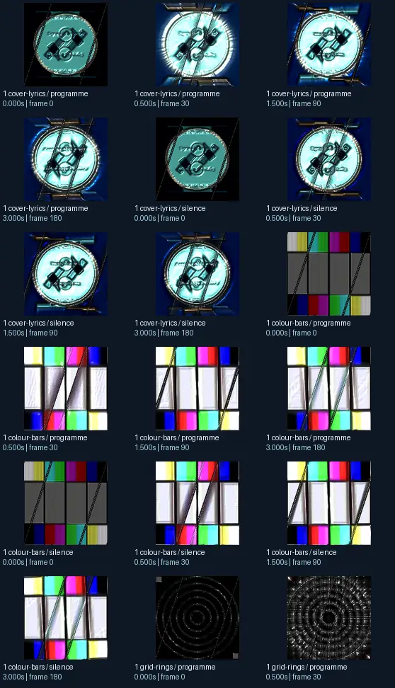
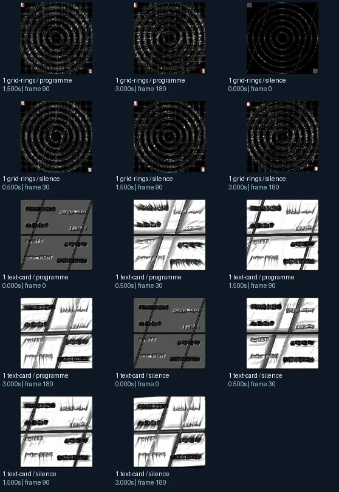

# A HD ADAMFX Creation !!FT Martin + flexi + Rovastar MDropFX Collaboration E Adam HD INFECTIONFX

- Identity: `projectm:36100ac3eec22203bcf66be59f887bad359fce311f1fe4d6401bd534032c0643`
- Engine: projectm
- Status: **complete**

## What this preset does across the tested inputs

Observed 32 paired source/output measurements across 8 declared conditions, including 2 cover/lyric conditions and output times 0, 0.5, 1.5, 3 seconds.

Across input families, colour-bars: hue divergence median 0.071 bits, texture divergence median 0.337 bits across 8 observed pairs; cover-lyrics: hue divergence median 0.070 bits, texture divergence median 0.395 bits across 8 observed pairs; grid-rings: hue divergence median 0.005 bits, texture divergence median 0.134 bits across 8 observed pairs; text-card: hue divergence median unavailable bits, texture divergence median 0.339 bits across 8 observed pairs.

## Repeated model interpretations (not verified facts)

Repeated model-generated captions included a clock with a blue background and a clock face (3 frames); a colorful cube with a black background (3 frames); a black and white image of a spiral (3 frames). Frequent prompt-relative hypotheses: light: neon lighting (16/32 frames); material: smooth digital surfaces (16/32 frames); medium: a graphic poster (22/32 frames); setting: an abstract composition (29/32 frames); tone: a tense ominous image (31/32 frames).

## Changes over time

For successive captures of the same input condition, median measured texture divergence was 0.020 bits across 24 transitions.

## Music versus silence

16 matched programme-versus-silence comparisons had median hue divergence 0.002 bits. Differences may also reflect unseeded projectM rendering or feedback evolution, not just musical response.

## Complete capture overview

## Per-input quantitative responses

- **colour-bars** (8 paired observations): median hue divergence 0.07066824689585738, texture divergence 0.33680014814590575 bits
- **cover-lyrics** (8 paired observations): median hue divergence 0.06990659950010192, texture divergence 0.3953631202845532 bits
- **grid-rings** (8 paired observations): median hue divergence 0.005297283430310487, texture divergence 0.13378744180941332 bits
- **text-card** (8 paired observations): median hue divergence None, texture divergence 0.33883143358728773 bits

## Individual caption hypothesis
the logo for the crypt crypt

## Prompt-relative visual characteristics
- medium: a 3D render
- light: soft diffuse lighting
- material: smooth digital surfaces
- tone: a tense ominous image
- setting: an abstract composition

## Tag hypotheses
NSFW, NSFW.

## OCR hypotheses
gee iui Webel andael

## Controlled visual response

- hue_js_divergence_bits: median 0.0674 (n=24); range 0.0002–0.6216
- texture_lbp_js_divergence_bits: median 0.3232 (n=32); range 0.0601–0.5044
- saturation_absolute_difference: median 0.0090 (n=32); range 0.0000–0.2795

## Evidence limits
PixelCue features quantify sampled rasters, not subjective quality or creative intention. BLIP captions, CLIP prompts and VLM tags are fallible per-frame hypotheses. Still frames cannot establish flash safety or perceived motion quality. Only an authenticated artist-provided suite can establish behaviour on actual album audio.
- Semantic captions, tags and prompts are model hypotheses, not verified facts.
- Static captures cannot establish motion comfort, flash safety or artistic intent.
- Renderer/GPU-dependent results require validation on the target system.
