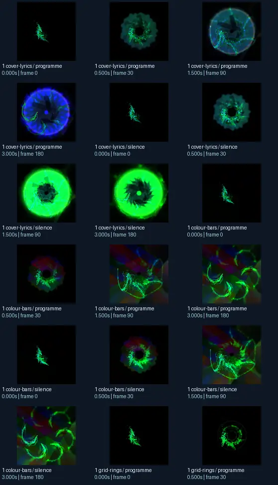
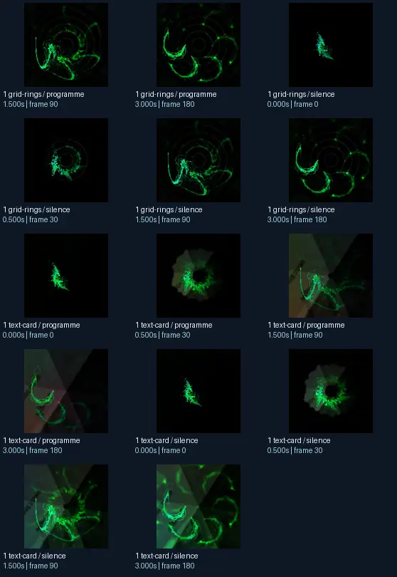

# ShadowHarlequin - Dancing Petals - [EoS + Phat - chasers 11 sentinel C]

- Identity: `projectm:c9b85b2951e9844fb53a10f089c260790391450a0215b2e4f9abaf1c9c773363`
- Engine: projectm
- Status: **complete**

## What this preset does across the tested inputs

Observed 32 paired source/output measurements across 8 declared conditions, including 2 cover/lyric conditions and output times 0, 0.5, 1.5, 3 seconds.

Across input families, colour-bars: hue divergence median 0.302 bits, texture divergence median 0.415 bits across 8 observed pairs; cover-lyrics: hue divergence median 0.583 bits, texture divergence median 0.145 bits across 8 observed pairs; grid-rings: hue divergence median 0.810 bits, texture divergence median 0.138 bits across 8 observed pairs; text-card: hue divergence median unavailable bits, texture divergence median 0.232 bits across 8 observed pairs.

## Repeated model interpretations (not verified facts)

Repeated model-generated captions included a green and white flower on a white background (6 frames); a green light in the center of a black background (3 frames); a green ring with a white background (2 frames). Frequent prompt-relative hypotheses: light: soft diffuse lighting (16/32 frames); material: smooth digital surfaces (29/32 frames); medium: a 3D render (32/32 frames); setting: outer space (24/32 frames); tone: a tense ominous image (22/32 frames).

## Changes over time

For successive captures of the same input condition, median measured texture divergence was 0.112 bits across 24 transitions.

## Music versus silence

16 matched programme-versus-silence comparisons had median hue divergence 0.031 bits. Differences may also reflect unseeded projectM rendering or feedback evolution, not just musical response.

## Complete capture overview

## Per-input quantitative responses

- **colour-bars** (8 paired observations): median hue divergence 0.30205489002192953, texture divergence 0.4154088372228131 bits
- **cover-lyrics** (8 paired observations): median hue divergence 0.5829028584408431, texture divergence 0.14476477191442352 bits
- **grid-rings** (8 paired observations): median hue divergence 0.810107156665405, texture divergence 0.13793762769452603 bits
- **text-card** (8 paired observations): median hue divergence None, texture divergence 0.23220446142391163 bits

## Individual caption hypothesis
a green and white flower on a white background

## Prompt-relative visual characteristics
- medium: a 3D render
- light: soft diffuse lighting
- material: glass surfaces
- tone: a tense ominous image
- setting: outer space

## Tag hypotheses
NSFW, NSFW.

## OCR hypotheses
No OCR result

## Controlled visual response

- hue_js_divergence_bits: median 0.5642 (n=24); range 0.2041–0.9288
- texture_lbp_js_divergence_bits: median 0.2149 (n=32); range 0.0282–0.6128
- saturation_absolute_difference: median 0.3137 (n=32); range 0.0001–0.6581

## Evidence limits
PixelCue features quantify sampled rasters, not subjective quality or creative intention. BLIP captions, CLIP prompts and VLM tags are fallible per-frame hypotheses. Still frames cannot establish flash safety or perceived motion quality. Only an authenticated artist-provided suite can establish behaviour on actual album audio.
- Semantic captions, tags and prompts are model hypotheses, not verified facts.
- Static captures cannot establish motion comfort, flash safety or artistic intent.
- Renderer/GPU-dependent results require validation on the target system.
