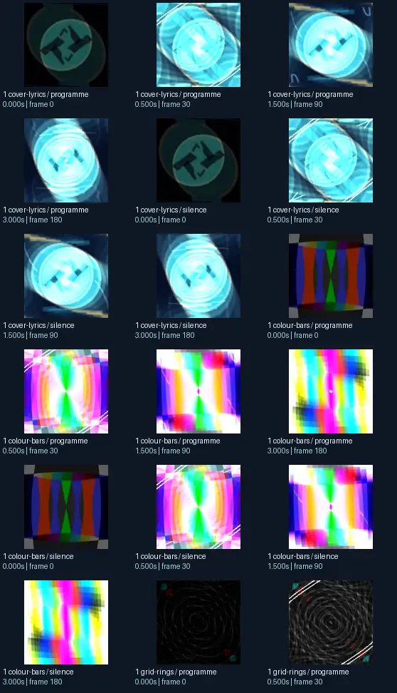
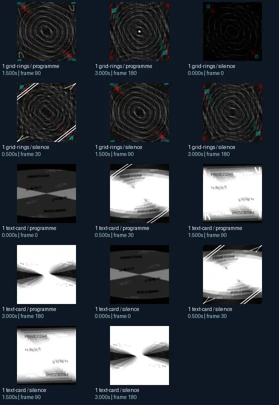

# Unchained &amp; Rovastar - Waves Of Waves

- Identity: `butterchurn:cbfea8b269090b48f80e29c95276042035787c70b563e5cf7f87cc6d113f7663`
- Engine: butterchurn
- Status: **complete**

## What this preset does across the tested inputs

Observed 32 paired source/output measurements across 8 declared conditions, including 2 cover/lyric conditions and output times 0, 0.5, 1.5, 3 seconds.

Across input families, colour-bars: hue divergence median 0.152 bits, texture divergence median 0.465 bits across 8 observed pairs; cover-lyrics: hue divergence median 0.415 bits, texture divergence median 0.453 bits across 8 observed pairs; grid-rings: hue divergence median 0.001 bits, texture divergence median 0.245 bits across 8 observed pairs; text-card: hue divergence median unavailable bits, texture divergence median 0.098 bits across 8 observed pairs.

## Repeated model interpretations (not verified facts)

Repeated model-generated captions included a colorful pattern with a white background (4 frames); a green circle with a black background (2 frames); a blue circular with a white circle in the middle (2 frames). Frequent prompt-relative hypotheses: light: soft diffuse lighting (28/32 frames); material: smooth digital surfaces (29/32 frames); medium: a graphic poster (20/32 frames); setting: an abstract composition (31/32 frames); tone: a tense ominous image (27/32 frames). Frequent optional PixelCue tag hypotheses: 131 (2), n (1), FaceIdentity (1).

## Changes over time

For successive captures of the same input condition, median measured texture divergence was 0.045 bits across 24 transitions.

## Music versus silence

16 matched programme-versus-silence comparisons had median hue divergence 0.000 bits. Differences may also reflect unseeded projectM rendering or feedback evolution, not just musical response.

## Complete capture overview

## Per-input quantitative responses

- **colour-bars** (8 paired observations): median hue divergence 0.15173711127326012, texture divergence 0.4645455967102744 bits
- **cover-lyrics** (8 paired observations): median hue divergence 0.41516147781361246, texture divergence 0.4533237040305661 bits
- **grid-rings** (8 paired observations): median hue divergence 0.0014746355660828973, texture divergence 0.24518626603118243 bits
- **text-card** (8 paired observations): median hue divergence None, texture divergence 0.09751488624443866 bits

## Individual caption hypothesis
a green circle with a black background

## Prompt-relative visual characteristics
- medium: a graphic poster
- light: flat even lighting
- material: smooth digital surfaces
- tone: a tense ominous image
- setting: an abstract composition

## Tag hypotheses
131, NSFW, n, NSFW., FaceIdentity

## OCR hypotheses
_—&lt; -_ _-—&lt;

## Controlled visual response

- hue_js_divergence_bits: median 0.1517 (n=24); range 0.0000–0.6305
- texture_lbp_js_divergence_bits: median 0.2452 (n=32); range 0.0358–0.6267
- saturation_absolute_difference: median 0.0103 (n=32); range 0.0000–0.1091

## Evidence limits
PixelCue features quantify sampled rasters, not subjective quality or creative intention. BLIP captions, CLIP prompts and VLM tags are fallible per-frame hypotheses. Still frames cannot establish flash safety or perceived motion quality. Only an authenticated artist-provided suite can establish behaviour on actual album audio.
- Semantic captions, tags and prompts are model hypotheses, not verified facts.
- Static captures cannot establish motion comfort, flash safety or artistic intent.
- Renderer/GPU-dependent results require validation on the target system.
