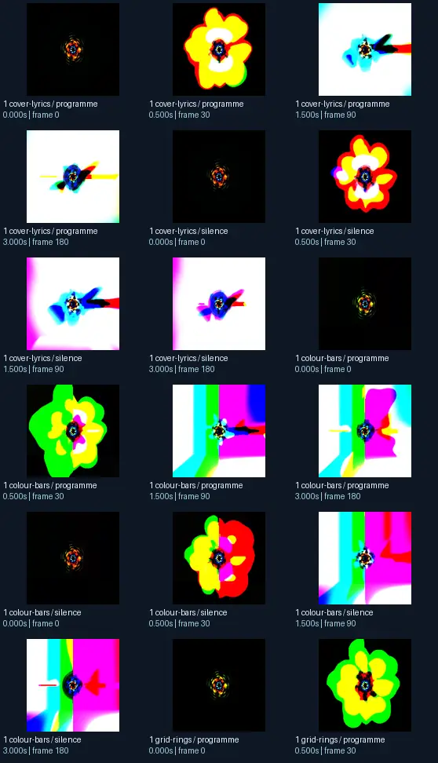
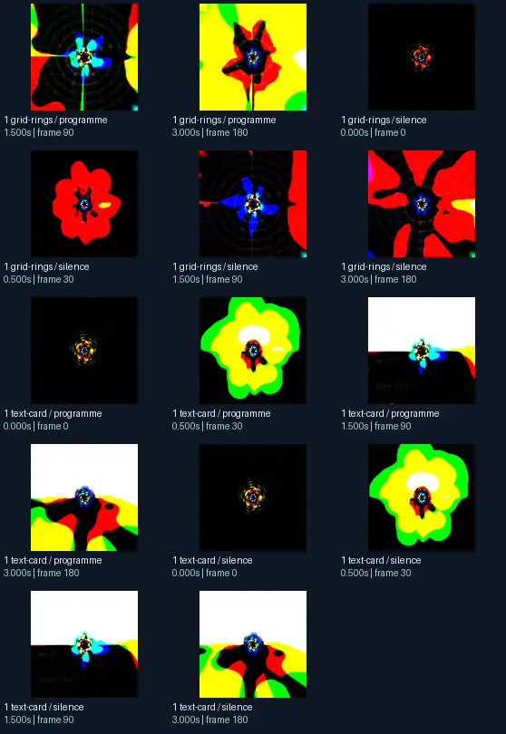

# EoS - more waveforms 6

- Identity: `projectm:0854f9a8f9db355e5a1d8877cd7580101a5f2d9048ed3659e5ba37a8037f67d9`
- Engine: projectm
- Status: **complete**

## What this preset does across the tested inputs

Observed 32 paired source/output measurements across 8 declared conditions, including 2 cover/lyric conditions and output times 0, 0.5, 1.5, 3 seconds.

Across input families, colour-bars: hue divergence median 0.267 bits, texture divergence median 0.175 bits across 8 observed pairs; cover-lyrics: hue divergence median 0.584 bits, texture divergence median 0.039 bits across 8 observed pairs; grid-rings: hue divergence median 0.483 bits, texture divergence median 0.162 bits across 8 observed pairs; text-card: hue divergence median unavailable bits, texture divergence median 0.027 bits across 8 observed pairs.

## Repeated model interpretations (not verified facts)

Repeated model-generated captions included a white background with a red and blue dot (4 frames); a white background with a blue and red dot (4 frames); a small yellow and black object with a white background (2 frames). Frequent prompt-relative hypotheses: light: soft diffuse lighting (29/32 frames); material: smooth digital surfaces (29/32 frames); medium: a 3D render (23/32 frames); setting: an abstract composition (18/32 frames); tone: a tense ominous image (23/32 frames). Frequent optional PixelCue tag hypotheses: Booru-like tags for this image. (1).

## Changes over time

For successive captures of the same input condition, median measured texture divergence was 0.021 bits across 24 transitions.

## Music versus silence

16 matched programme-versus-silence comparisons had median hue divergence 0.104 bits. Differences may also reflect unseeded projectM rendering or feedback evolution, not just musical response.

## Complete capture overview

## Per-input quantitative responses

- **colour-bars** (8 paired observations): median hue divergence 0.2669095513063885, texture divergence 0.17502129324752946 bits
- **cover-lyrics** (8 paired observations): median hue divergence 0.5838810804451584, texture divergence 0.03932983481468344 bits
- **grid-rings** (8 paired observations): median hue divergence 0.48327355508611974, texture divergence 0.16177996261163574 bits
- **text-card** (8 paired observations): median hue divergence None, texture divergence 0.026651609981207823 bits

## Individual caption hypothesis
a white background with a red and blue dot

## Prompt-relative visual characteristics
- medium: a vector illustration
- light: soft diffuse lighting
- material: metallic surfaces
- tone: a tense ominous image
- setting: outer space

## Tag hypotheses
NSFW., NSFW, Booru-like tags for this image.

## OCR hypotheses
No OCR result

## Controlled visual response

- hue_js_divergence_bits: median 0.4097 (n=24); range 0.1934–0.7306
- texture_lbp_js_divergence_bits: median 0.0876 (n=32); range 0.0223–0.2636
- saturation_absolute_difference: median 0.4256 (n=32); range 0.0063–0.8937

## Evidence limits
PixelCue features quantify sampled rasters, not subjective quality or creative intention. BLIP captions, CLIP prompts and VLM tags are fallible per-frame hypotheses. Still frames cannot establish flash safety or perceived motion quality. Only an authenticated artist-provided suite can establish behaviour on actual album audio.
- Semantic captions, tags and prompts are model hypotheses, not verified facts.
- Static captures cannot establish motion comfort, flash safety or artistic intent.
- Renderer/GPU-dependent results require validation on the target system.
