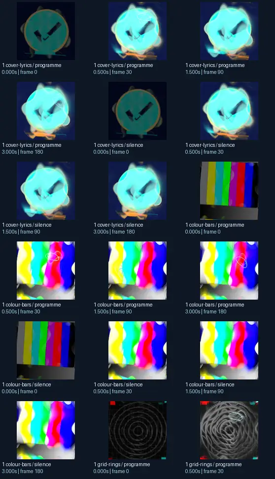
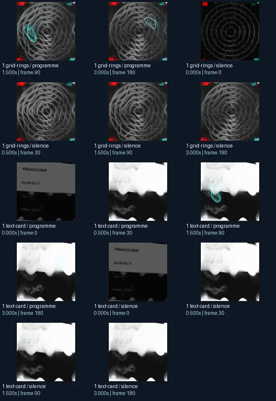

# Geiss - Cauldron - Tendrils (saturation remix)

- Identity: `butterchurn:051537b3288a432d5b7927a97e26a69a5fbde37eff6575f17bf1de3c50b54fa1`
- Engine: butterchurn
- Status: **complete**

## What this preset does across the tested inputs

Observed 32 paired source/output measurements across 8 declared conditions, including 2 cover/lyric conditions and output times 0, 0.5, 1.5, 3 seconds.

Across input families, colour-bars: hue divergence median 0.111 bits, texture divergence median 0.557 bits across 8 observed pairs; cover-lyrics: hue divergence median 0.047 bits, texture divergence median 0.297 bits across 8 observed pairs; grid-rings: hue divergence median 0.019 bits, texture divergence median 0.292 bits across 8 observed pairs; text-card: hue divergence median unavailable bits, texture divergence median 0.205 bits across 8 observed pairs.

## Repeated model interpretations (not verified facts)

Repeated model-generated captions included a colorful abstract background with a white background (3 frames); a clock with a green face and a yellow face (2 frames); a blue flower with a green center (2 frames). Frequent prompt-relative hypotheses: light: soft diffuse lighting (25/32 frames); material: smooth digital surfaces (32/32 frames); medium: a 3D render (23/32 frames); setting: an abstract composition (31/32 frames); tone: a tense ominous image (18/32 frames). Frequent optional PixelCue tag hypotheses: AS BOTTLE CO 17 (2).

## Changes over time

For successive captures of the same input condition, median measured texture divergence was 0.006 bits across 24 transitions.

## Music versus silence

16 matched programme-versus-silence comparisons had median hue divergence 0.000 bits. Differences may also reflect unseeded projectM rendering or feedback evolution, not just musical response.

## Complete capture overview

## Per-input quantitative responses

- **colour-bars** (8 paired observations): median hue divergence 0.11095469579747934, texture divergence 0.5571129363465162 bits
- **cover-lyrics** (8 paired observations): median hue divergence 0.04743477264411518, texture divergence 0.29711997651010347 bits
- **grid-rings** (8 paired observations): median hue divergence 0.019440672745911686, texture divergence 0.2920380068401205 bits
- **text-card** (8 paired observations): median hue divergence None, texture divergence 0.20497610504222025 bits

## Individual caption hypothesis
a clock with a green face and a yellow face

## Prompt-relative visual characteristics
- medium: a graphic poster
- light: soft diffuse lighting
- material: smooth digital surfaces
- tone: a tense ominous image
- setting: an abstract composition

## Tag hypotheses
NSFW., NSFW, AS BOTTLE CO 17

## OCR hypotheses
1 a Ne _ —- =

## Controlled visual response

- hue_js_divergence_bits: median 0.0441 (n=24); range 0.0001–0.1606
- texture_lbp_js_divergence_bits: median 0.2920 (n=32); range 0.0176–0.5925
- saturation_absolute_difference: median 0.0308 (n=32); range 0.0000–0.2503

## Evidence limits
PixelCue features quantify sampled rasters, not subjective quality or creative intention. BLIP captions, CLIP prompts and VLM tags are fallible per-frame hypotheses. Still frames cannot establish flash safety or perceived motion quality. Only an authenticated artist-provided suite can establish behaviour on actual album audio.
- Semantic captions, tags and prompts are model hypotheses, not verified facts.
- Static captures cannot establish motion comfort, flash safety or artistic intent.
- Renderer/GPU-dependent results require validation on the target system.
