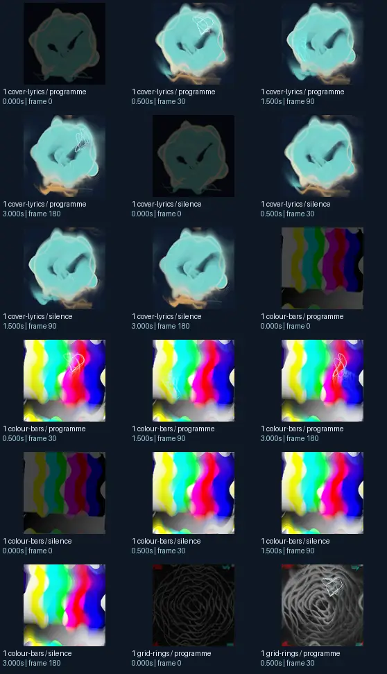
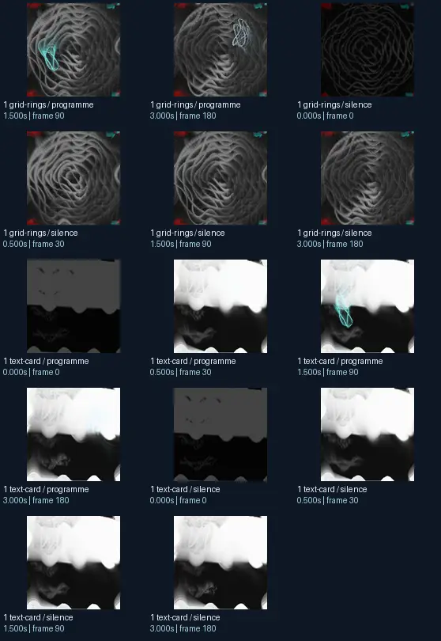

# Geiss - Cauldron - Tendrils

- Identity: `projectm:9fe5443cfb5020b0f2c652f865316b94749f669d3fd375a472a2f19b04230b0f`
- Engine: projectm
- Status: **complete**

## What this preset does across the tested inputs

Observed 32 paired source/output measurements across 8 declared conditions, including 2 cover/lyric conditions and output times 0, 0.5, 1.5, 3 seconds.

Across input families, colour-bars: hue divergence median 0.198 bits, texture divergence median 0.729 bits across 8 observed pairs; cover-lyrics: hue divergence median 0.072 bits, texture divergence median 0.300 bits across 8 observed pairs; grid-rings: hue divergence median 0.020 bits, texture divergence median 0.296 bits across 8 observed pairs; text-card: hue divergence median unavailable bits, texture divergence median 0.203 bits across 8 observed pairs.

## Repeated model interpretations (not verified facts)

Repeated model-generated captions included a colorful cloud with a rainbow colored pattern (3 frames); a black and green rose with a white outline (2 frames); a blue and white flower (2 frames). Frequent prompt-relative hypotheses: light: soft diffuse lighting (25/32 frames); material: smooth digital surfaces (32/32 frames); medium: a 3D render (24/32 frames); setting: an abstract composition (29/32 frames); tone: a tense ominous image (24/32 frames).

## Changes over time

For successive captures of the same input condition, median measured texture divergence was 0.008 bits across 24 transitions.

## Music versus silence

16 matched programme-versus-silence comparisons had median hue divergence 0.000 bits. Differences may also reflect unseeded projectM rendering or feedback evolution, not just musical response.

## Complete capture overview

## Per-input quantitative responses

- **colour-bars** (8 paired observations): median hue divergence 0.19813095071686979, texture divergence 0.7290051038505154 bits
- **cover-lyrics** (8 paired observations): median hue divergence 0.07201052305904151, texture divergence 0.3002313117665564 bits
- **grid-rings** (8 paired observations): median hue divergence 0.019682286231465736, texture divergence 0.2956488170957843 bits
- **text-card** (8 paired observations): median hue divergence None, texture divergence 0.20290569308142556 bits

## Individual caption hypothesis
a black and green rose with a white outline

## Prompt-relative visual characteristics
- medium: a vector illustration
- light: soft diffuse lighting
- material: smooth digital surfaces
- tone: a tense ominous image
- setting: outer space

## Tag hypotheses
NSFW, NSFW.

## OCR hypotheses
i

## Controlled visual response

- hue_js_divergence_bits: median 0.0688 (n=24); range 0.0028–0.2625
- texture_lbp_js_divergence_bits: median 0.2922 (n=32); range 0.0162–0.7510
- saturation_absolute_difference: median 0.0252 (n=32); range 0.0000–0.1226

## Evidence limits
PixelCue features quantify sampled rasters, not subjective quality or creative intention. BLIP captions, CLIP prompts and VLM tags are fallible per-frame hypotheses. Still frames cannot establish flash safety or perceived motion quality. Only an authenticated artist-provided suite can establish behaviour on actual album audio.
- Semantic captions, tags and prompts are model hypotheses, not verified facts.
- Static captures cannot establish motion comfort, flash safety or artistic intent.
- Renderer/GPU-dependent results require validation on the target system.
