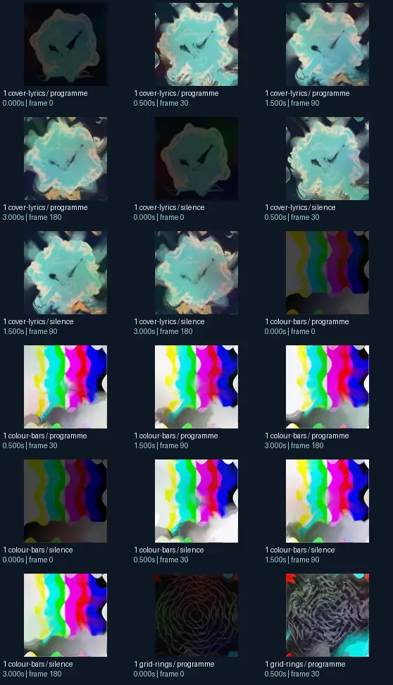
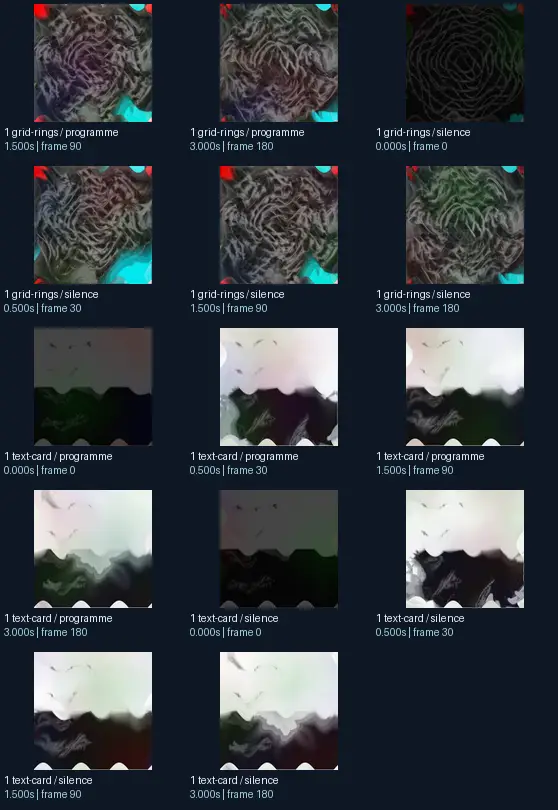

# placebo heal drift backfire

- Identity: `projectm:0ee5ad4a1c5cddb920de96afeca366dbc835b431ca60649c1a204eea9c8e4662`
- Engine: projectm
- Status: **complete**

## What this preset does across the tested inputs

Observed 32 paired source/output measurements across 8 declared conditions, including 2 cover/lyric conditions and output times 0, 0.5, 1.5, 3 seconds.

Across input families, colour-bars: hue divergence median 0.206 bits, texture divergence median 0.680 bits across 8 observed pairs; cover-lyrics: hue divergence median 0.252 bits, texture divergence median 0.501 bits across 8 observed pairs; grid-rings: hue divergence median 0.505 bits, texture divergence median 0.316 bits across 8 observed pairs; text-card: hue divergence median unavailable bits, texture divergence median 0.577 bits across 8 observed pairs.

## Repeated model interpretations (not verified facts)

Repeated model-generated captions included a clock with a clock face on it (2 frames); a picture of a cloud with a bird flying in the sky (2 frames); a picture of a clock with a blue face (1 frames). Frequent prompt-relative hypotheses: light: soft diffuse lighting (23/32 frames); material: smooth digital surfaces (32/32 frames); medium: a 3D render (16/32 frames); setting: an abstract composition (26/32 frames); tone: a tense ominous image (22/32 frames). Frequent optional PixelCue tag hypotheses: unanswerable (1).

## Changes over time

For successive captures of the same input condition, median measured texture divergence was 0.020 bits across 24 transitions.

## Music versus silence

16 matched programme-versus-silence comparisons had median hue divergence 0.141 bits. Differences may also reflect unseeded projectM rendering or feedback evolution, not just musical response.

## Complete capture overview

## Per-input quantitative responses

- **colour-bars** (8 paired observations): median hue divergence 0.20557160924123247, texture divergence 0.6804425054007655 bits
- **cover-lyrics** (8 paired observations): median hue divergence 0.25243808619717956, texture divergence 0.5013629580038733 bits
- **grid-rings** (8 paired observations): median hue divergence 0.504679475748782, texture divergence 0.31631786562445957 bits
- **text-card** (8 paired observations): median hue divergence None, texture divergence 0.5766494922271657 bits

## Individual caption hypothesis
a clock with a clock face on it

## Prompt-relative visual characteristics
- medium: a vector illustration
- light: soft diffuse lighting
- material: smooth digital surfaces
- tone: a tense ominous image
- setting: outer space

## Tag hypotheses
NSFW., NSFW, unanswerable

## OCR hypotheses
Gr Be 4.4

## Controlled visual response

- hue_js_divergence_bits: median 0.2666 (n=24); range 0.1515–0.6003
- texture_lbp_js_divergence_bits: median 0.5014 (n=32); range 0.2159–0.7070
- saturation_absolute_difference: median 0.1463 (n=32); range 0.0036–0.3307

## Evidence limits
PixelCue features quantify sampled rasters, not subjective quality or creative intention. BLIP captions, CLIP prompts and VLM tags are fallible per-frame hypotheses. Still frames cannot establish flash safety or perceived motion quality. Only an authenticated artist-provided suite can establish behaviour on actual album audio.
- Semantic captions, tags and prompts are model hypotheses, not verified facts.
- Static captures cannot establish motion comfort, flash safety or artistic intent.
- Renderer/GPU-dependent results require validation on the target system.
