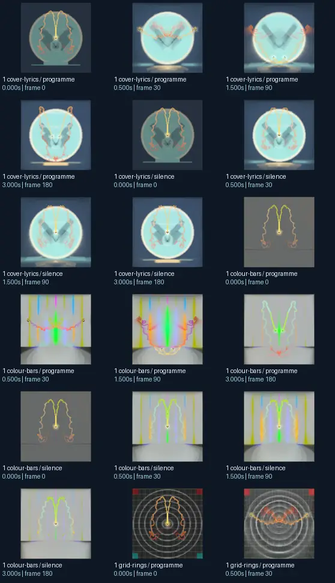
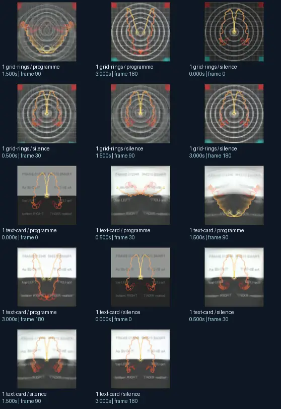

# Krash &amp; Rovastar - Cerebral Demons - Phat + Eo.S. Killer Death Bunny Remix

- Identity: `butterchurn:c9571ac979e56053cb31a0dd0f6d152a6ddf3aa73fba8b755375ece5e06738f4`
- Engine: butterchurn
- Status: **complete**

## What this preset does across the tested inputs

Observed 32 paired source/output measurements across 8 declared conditions, including 2 cover/lyric conditions and output times 0, 0.5, 1.5, 3 seconds.

Across input families, colour-bars: hue divergence median 0.405 bits, texture divergence median 0.330 bits across 8 observed pairs; cover-lyrics: hue divergence median 0.058 bits, texture divergence median 0.226 bits across 8 observed pairs; grid-rings: hue divergence median 0.249 bits, texture divergence median 0.215 bits across 8 observed pairs; text-card: hue divergence median unavailable bits, texture divergence median 0.275 bits across 8 observed pairs.

## Repeated model interpretations (not verified facts)

Repeated model-generated captions included a clock with a clock face on it (2 frames); the diagram shows the location of the heart and the location of the heart (2 frames); the symbol for the sun and the sun &#x27; s rays (2 frames). Frequent prompt-relative hypotheses: light: soft diffuse lighting (30/32 frames); material: smooth digital surfaces (32/32 frames); medium: a graphic poster (15/32 frames); setting: an abstract composition (27/32 frames); tone: a tense ominous image (28/32 frames). Frequent optional PixelCue tag hypotheses: FaceIdentity (3), unanswerable (2), BORU-LIGHT THANKFUL (2), SFNW. (1), SFSW. (1), suggestive (1), Frame 01235 SMEO SMASH 001. (1), Frame American Emulsion Oil Filter Glass. (1).

## Changes over time

For successive captures of the same input condition, median measured texture divergence was 0.041 bits across 24 transitions.

## Music versus silence

16 matched programme-versus-silence comparisons had median hue divergence 0.006 bits. Differences may also reflect unseeded projectM rendering or feedback evolution, not just musical response.

## Complete capture overview

## Per-input quantitative responses

- **colour-bars** (8 paired observations): median hue divergence 0.4046340523019927, texture divergence 0.3297058728324514 bits
- **cover-lyrics** (8 paired observations): median hue divergence 0.05828921897359374, texture divergence 0.22570985776082672 bits
- **grid-rings** (8 paired observations): median hue divergence 0.24861032748684606, texture divergence 0.2151807164972075 bits
- **text-card** (8 paired observations): median hue divergence None, texture divergence 0.2746216847150724 bits

## Individual caption hypothesis
a clock with a clock face on it

## Prompt-relative visual characteristics
- medium: a vector illustration
- light: soft diffuse lighting
- material: smooth digital surfaces
- tone: a tense ominous image
- setting: outer space

## Tag hypotheses
unanswerable, NSFW., NSFW, SFNW., SFSW., FaceIdentity, suggestive, BORU-LIGHT THANKFUL, Frame 01235 SMEO SMASH 001., Frame American Emulsion Oil Filter Glass., Top left corner: frame016b.

## OCR hypotheses
rid ©

## Controlled visual response

- hue_js_divergence_bits: median 0.2432 (n=24); range 0.0303–0.5290
- texture_lbp_js_divergence_bits: median 0.2526 (n=32); range 0.0264–0.6502
- saturation_absolute_difference: median 0.1427 (n=32); range 0.0413–0.5128

## Evidence limits
PixelCue features quantify sampled rasters, not subjective quality or creative intention. BLIP captions, CLIP prompts and VLM tags are fallible per-frame hypotheses. Still frames cannot establish flash safety or perceived motion quality. Only an authenticated artist-provided suite can establish behaviour on actual album audio.
- Semantic captions, tags and prompts are model hypotheses, not verified facts.
- Static captures cannot establish motion comfort, flash safety or artistic intent.
- Renderer/GPU-dependent results require validation on the target system.
