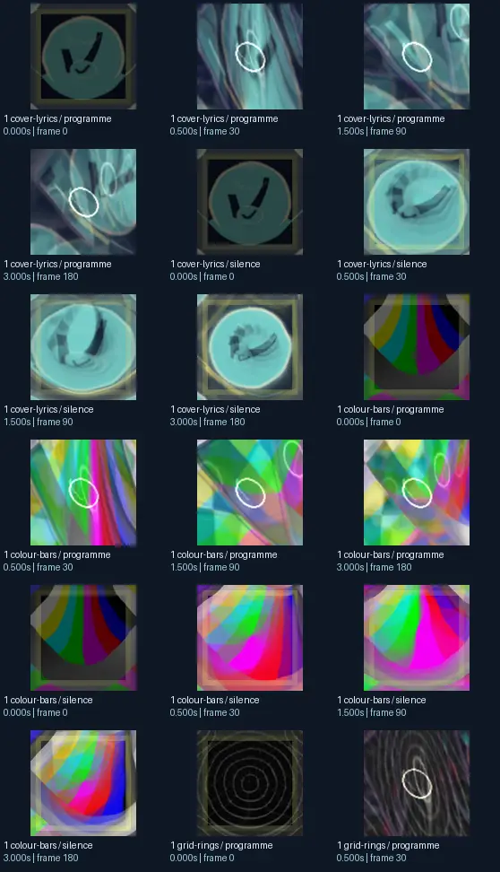
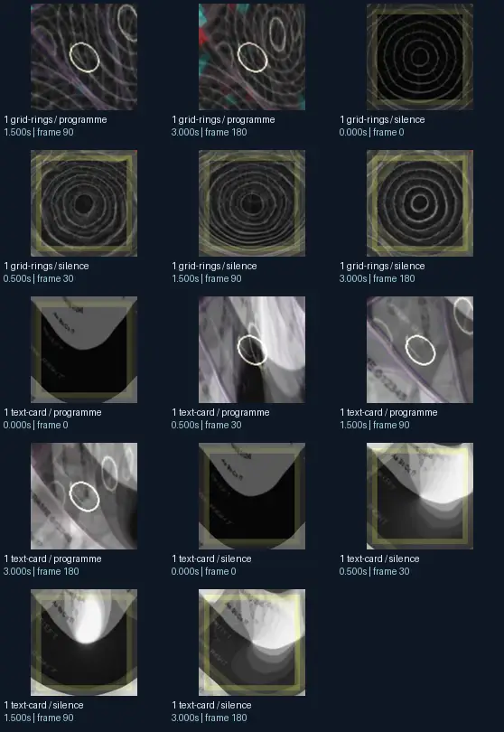

# Unchained - Beat Demo 2.1

- Identity: `butterchurn:4be2a14eed575c491c0ff727d27a0f71b391baedb7ebd51f021fdc69772647e4`
- Engine: butterchurn
- Status: **complete**

## What this preset does across the tested inputs

Observed 32 paired source/output measurements across 8 declared conditions, including 2 cover/lyric conditions and output times 0, 0.5, 1.5, 3 seconds.

Across input families, colour-bars: hue divergence median 0.250 bits, texture divergence median 0.585 bits across 8 observed pairs; cover-lyrics: hue divergence median 0.370 bits, texture divergence median 0.431 bits across 8 observed pairs; grid-rings: hue divergence median 0.981 bits, texture divergence median 0.250 bits across 8 observed pairs; text-card: hue divergence median unavailable bits, texture divergence median 0.321 bits across 8 observed pairs.

## Repeated model interpretations (not verified facts)

Repeated model-generated captions included a colorful square with a square in the middle (3 frames); the logo for the new website (2 frames); a square with a black background and a white square with a black background (2 frames). Frequent prompt-relative hypotheses: light: soft diffuse lighting (30/32 frames); material: smooth digital surfaces (31/32 frames); medium: a graphic poster (17/32 frames); setting: an abstract composition (32/32 frames); tone: a tense ominous image (27/32 frames). Frequent optional PixelCue tag hypotheses: Booru-like tags for this image. (2), FaceIdentity (1), suggestive (1).

## Changes over time

For successive captures of the same input condition, median measured texture divergence was 0.078 bits across 24 transitions.

## Music versus silence

16 matched programme-versus-silence comparisons had median hue divergence 0.297 bits. Differences may also reflect unseeded projectM rendering or feedback evolution, not just musical response.

## Complete capture overview

## Per-input quantitative responses

- **colour-bars** (8 paired observations): median hue divergence 0.24997093514477292, texture divergence 0.5846491147910463 bits
- **cover-lyrics** (8 paired observations): median hue divergence 0.3696645220407422, texture divergence 0.4305747938695063 bits
- **grid-rings** (8 paired observations): median hue divergence 0.9814649323151444, texture divergence 0.25049715107298043 bits
- **text-card** (8 paired observations): median hue divergence None, texture divergence 0.32101116499642846 bits

## Individual caption hypothesis
the logo for the new website

## Prompt-relative visual characteristics
- medium: a graphic poster
- light: soft diffuse lighting
- material: smooth digital surfaces
- tone: a tense ominous image
- setting: an abstract composition

## Tag hypotheses
Booru-like tags for this image., NSFW., NSFW, FaceIdentity, SFW, suggestive

## OCR hypotheses
\) y A ue 7 = a ——— ‘

## Controlled visual response

- hue_js_divergence_bits: median 0.3707 (n=24); range 0.0213–1.0000
- texture_lbp_js_divergence_bits: median 0.3681 (n=32); range 0.0217–0.7621
- saturation_absolute_difference: median 0.0564 (n=32); range 0.0247–0.2341

## Evidence limits
PixelCue features quantify sampled rasters, not subjective quality or creative intention. BLIP captions, CLIP prompts and VLM tags are fallible per-frame hypotheses. Still frames cannot establish flash safety or perceived motion quality. Only an authenticated artist-provided suite can establish behaviour on actual album audio.
- Semantic captions, tags and prompts are model hypotheses, not verified facts.
- Static captures cannot establish motion comfort, flash safety or artistic intent.
- Renderer/GPU-dependent results require validation on the target system.
