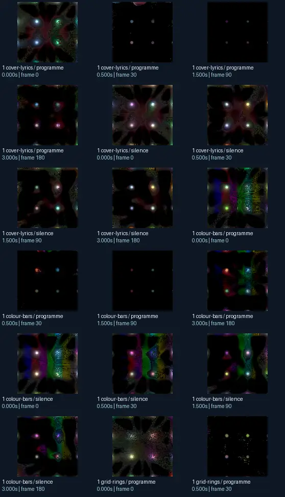
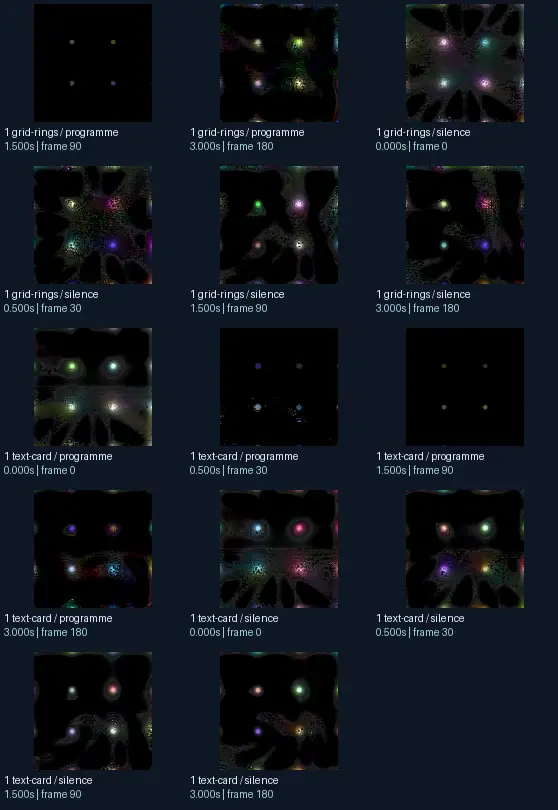

# suksma - doubting the gods but with horrible logic roam3 ODing on morgues nz

- Identity: `projectm:1b53d83153710a4bfdb2556e87f1f95aeaaa2d14ac4a1c8f8a016b404fa4688b`
- Engine: projectm
- Status: **complete**

## What this preset does across the tested inputs

Observed 32 paired source/output measurements across 8 declared conditions, including 2 cover/lyric conditions and output times 0, 0.5, 1.5, 3 seconds.

Across input families, colour-bars: hue divergence median 0.172 bits, texture divergence median 0.287 bits across 8 observed pairs; cover-lyrics: hue divergence median 0.805 bits, texture divergence median 0.084 bits across 8 observed pairs; grid-rings: hue divergence median 0.646 bits, texture divergence median 0.165 bits across 8 observed pairs; text-card: hue divergence median unavailable bits, texture divergence median 0.091 bits across 8 observed pairs.

## Repeated model interpretations (not verified facts)

Repeated model-generated captions included a black background with many different colored lights (4 frames); a computer generated image of a flower (3 frames); a black background with a lot of colorful lights (3 frames). Frequent prompt-relative hypotheses: light: soft diffuse lighting (17/32 frames); material: smooth digital surfaces (23/32 frames); medium: a 3D render (26/32 frames); setting: outer space (19/32 frames); tone: a tense ominous image (30/32 frames).

## Changes over time

For successive captures of the same input condition, median measured texture divergence was 0.024 bits across 24 transitions.

## Music versus silence

16 matched programme-versus-silence comparisons had median hue divergence 0.093 bits. Differences may also reflect unseeded projectM rendering or feedback evolution, not just musical response.

## Complete capture overview

## Per-input quantitative responses

- **colour-bars** (8 paired observations): median hue divergence 0.17200824491599748, texture divergence 0.28694506335220926 bits
- **cover-lyrics** (8 paired observations): median hue divergence 0.8047124443411411, texture divergence 0.08400643996372102 bits
- **grid-rings** (8 paired observations): median hue divergence 0.6464676116919301, texture divergence 0.1645004399267423 bits
- **text-card** (8 paired observations): median hue divergence None, texture divergence 0.09067760349543583 bits

## Individual caption hypothesis
a computer generated image of a flower

## Prompt-relative visual characteristics
- medium: a 3D render
- light: soft diffuse lighting
- material: glass surfaces
- tone: a tense ominous image
- setting: an abstract composition

## Tag hypotheses
NSFW

## OCR hypotheses
—_ * a ss o 94 q Rie oadaneh&#x27; cater: cya e © « oo 8 4 | ae Ce ee , es _® F 2. po OT oe

## Controlled visual response

- hue_js_divergence_bits: median 0.6465 (n=24); range 0.1427–0.9348
- texture_lbp_js_divergence_bits: median 0.1645 (n=32); range 0.0388–0.4588
- saturation_absolute_difference: median 0.2030 (n=32); range 0.0016–0.5560

## Evidence limits
PixelCue features quantify sampled rasters, not subjective quality or creative intention. BLIP captions, CLIP prompts and VLM tags are fallible per-frame hypotheses. Still frames cannot establish flash safety or perceived motion quality. Only an authenticated artist-provided suite can establish behaviour on actual album audio.
- Semantic captions, tags and prompts are model hypotheses, not verified facts.
- Static captures cannot establish motion comfort, flash safety or artistic intent.
- Renderer/GPU-dependent results require validation on the target system.
