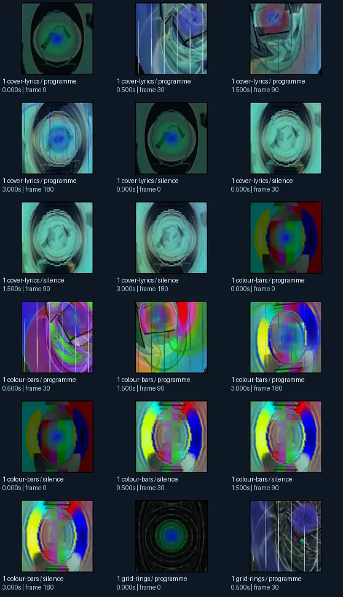
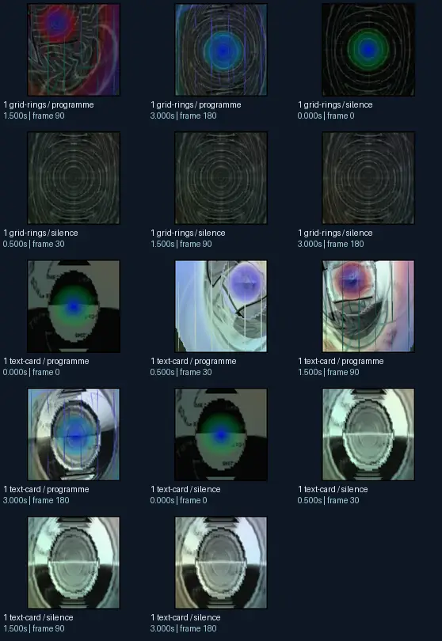

# Eo.S.+Phat Speak with the orb_rotation_mix_time_mod

- Identity: `butterchurn:6354253151aa55fab9ad805de2f9da10ab8f03eadd10a2988ce2313b3a645631`
- Engine: butterchurn
- Status: **complete**

## What this preset does across the tested inputs

Observed 32 paired source/output measurements across 8 declared conditions, including 2 cover/lyric conditions and output times 0, 0.5, 1.5, 3 seconds.

Across input families, colour-bars: hue divergence median 0.215 bits, texture divergence median 0.627 bits across 8 observed pairs; cover-lyrics: hue divergence median 0.280 bits, texture divergence median 0.422 bits across 8 observed pairs; grid-rings: hue divergence median 0.678 bits, texture divergence median 0.208 bits across 8 observed pairs; text-card: hue divergence median unavailable bits, texture divergence median 0.461 bits across 8 observed pairs.

## Repeated model interpretations (not verified facts)

Repeated model-generated captions included a picture of a circular object with a blue background (3 frames); a colorful circular with a black background (3 frames); a black and white photo of a circular pattern (3 frames). Frequent prompt-relative hypotheses: light: soft diffuse lighting (19/32 frames); material: smooth digital surfaces (30/32 frames); medium: a 3D render (17/32 frames); setting: an abstract composition (30/32 frames); tone: a tense ominous image (25/32 frames). Frequent optional PixelCue tag hypotheses: suggestive (3), Booru. (1), Unsure. (1).

## Changes over time

For successive captures of the same input condition, median measured texture divergence was 0.024 bits across 24 transitions.

## Music versus silence

16 matched programme-versus-silence comparisons had median hue divergence 0.166 bits. Differences may also reflect unseeded projectM rendering or feedback evolution, not just musical response.

## Complete capture overview

## Per-input quantitative responses

- **colour-bars** (8 paired observations): median hue divergence 0.21451506235287088, texture divergence 0.6265514809219938 bits
- **cover-lyrics** (8 paired observations): median hue divergence 0.2800866605700021, texture divergence 0.42168788228341814 bits
- **grid-rings** (8 paired observations): median hue divergence 0.6778499054572931, texture divergence 0.20804528480404194 bits
- **text-card** (8 paired observations): median hue divergence None, texture divergence 0.4608816014648928 bits

## Individual caption hypothesis
a green and blue circular with a black background

## Prompt-relative visual characteristics
- medium: a 3D render
- light: neon lighting
- material: smooth digital surfaces
- tone: a tense ominous image
- setting: an abstract composition

## Tag hypotheses
NSFW., NSFW, Booru., Unsure., suggestive

## OCR hypotheses
No OCR result

## Controlled visual response

- hue_js_divergence_bits: median 0.3085 (n=24); range 0.1471–0.7902
- texture_lbp_js_divergence_bits: median 0.4217 (n=32); range 0.0720–0.6622
- saturation_absolute_difference: median 0.1488 (n=32); range 0.0016–0.3736

## Evidence limits
PixelCue features quantify sampled rasters, not subjective quality or creative intention. BLIP captions, CLIP prompts and VLM tags are fallible per-frame hypotheses. Still frames cannot establish flash safety or perceived motion quality. Only an authenticated artist-provided suite can establish behaviour on actual album audio.
- Semantic captions, tags and prompts are model hypotheses, not verified facts.
- Static captures cannot establish motion comfort, flash safety or artistic intent.
- Renderer/GPU-dependent results require validation on the target system.
