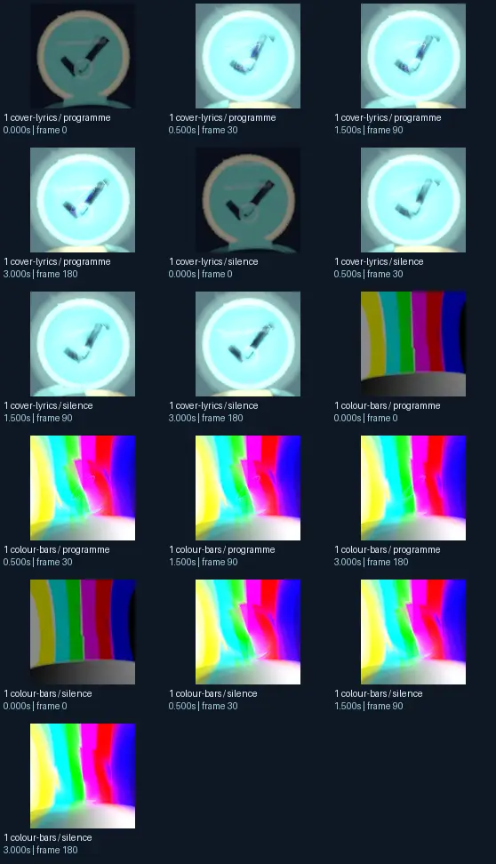
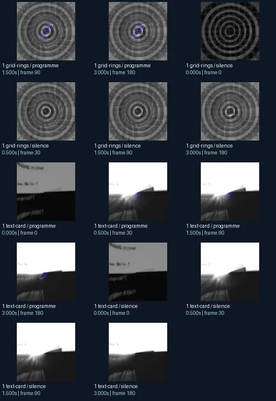

# _Mig_304 - geiss remix 3

- Identity: `butterchurn:3e82303f13d95133db5d875f3046aa1edaa014c0d032dc8ff17b92da184d5175`
- Engine: butterchurn
- Status: **complete**

## What this preset does across the tested inputs

Observed 32 paired source/output measurements across 8 declared conditions, including 2 cover/lyric conditions and output times 0, 0.5, 1.5, 3 seconds.

Across input families, colour-bars: hue divergence median 0.148 bits, texture divergence median 0.511 bits across 8 observed pairs; cover-lyrics: hue divergence median 0.484 bits, texture divergence median 0.286 bits across 8 observed pairs; grid-rings: hue divergence median 1.000 bits, texture divergence median 0.261 bits across 8 observed pairs; text-card: hue divergence median unavailable bits, texture divergence median 0.052 bits across 8 observed pairs.

## Repeated model interpretations (not verified facts)

Repeated model-generated captions included a clock with a clock face on it (5 frames); a clock with a blue light on it (2 frames); a television screen with a colorful television screen (2 frames). Frequent prompt-relative hypotheses: light: soft diffuse lighting (30/32 frames); material: smooth digital surfaces (32/32 frames); medium: a 3D render (22/32 frames); setting: an abstract composition (26/32 frames); tone: a tense ominous image (26/32 frames). Frequent optional PixelCue tag hypotheses: Booru-like tags for this image. (2), FaceIdentity (2).

## Changes over time

For successive captures of the same input condition, median measured texture divergence was 0.007 bits across 24 transitions.

## Music versus silence

16 matched programme-versus-silence comparisons had median hue divergence 0.000 bits. Differences may also reflect unseeded projectM rendering or feedback evolution, not just musical response.

## Complete capture overview

## Per-input quantitative responses

- **colour-bars** (8 paired observations): median hue divergence 0.14779041510576263, texture divergence 0.511430322724247 bits
- **cover-lyrics** (8 paired observations): median hue divergence 0.48369363933954956, texture divergence 0.28612362651902257 bits
- **grid-rings** (8 paired observations): median hue divergence 1.0, texture divergence 0.2614629199862488 bits
- **text-card** (8 paired observations): median hue divergence None, texture divergence 0.05228598279535017 bits

## Individual caption hypothesis
a clock with a clock face on it

## Prompt-relative visual characteristics
- medium: a vector illustration
- light: soft diffuse lighting
- material: smooth digital surfaces
- tone: a tense ominous image
- setting: an abstract composition

## Tag hypotheses
NSFW., NSFW, Booru-like tags for this image., FaceIdentity

## OCR hypotheses
q ql WW “ae

## Controlled visual response

- hue_js_divergence_bits: median 0.1805 (n=19); range 0.0157–1.0000
- texture_lbp_js_divergence_bits: median 0.2615 (n=32); range 0.0262–0.5585
- saturation_absolute_difference: median 0.0438 (n=32); range 0.0000–0.2678

## Evidence limits
PixelCue features quantify sampled rasters, not subjective quality or creative intention. BLIP captions, CLIP prompts and VLM tags are fallible per-frame hypotheses. Still frames cannot establish flash safety or perceived motion quality. Only an authenticated artist-provided suite can establish behaviour on actual album audio.
- Semantic captions, tags and prompts are model hypotheses, not verified facts.
- Static captures cannot establish motion comfort, flash safety or artistic intent.
- Renderer/GPU-dependent results require validation on the target system.
