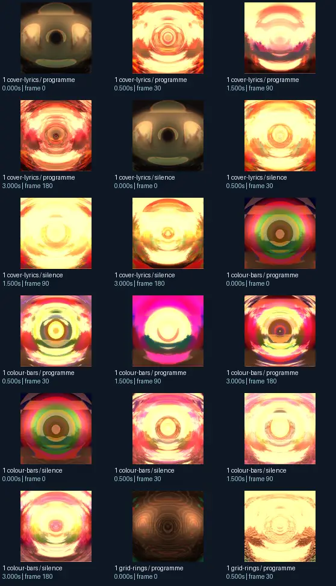
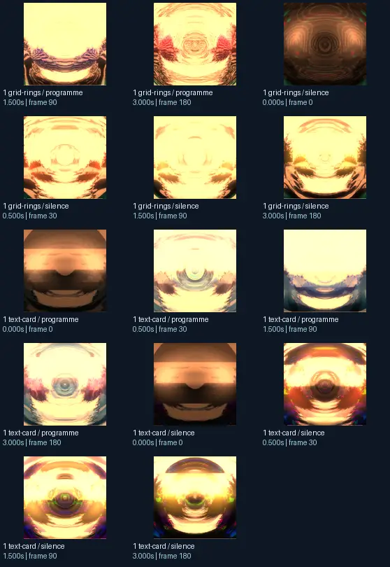

# suksma - arrange-a-tang

- Identity: `projectm:37b8facfac09303240746055f89fa7e7c2c0b2a45383160953d4b1bee46e1b33`
- Engine: projectm
- Status: **complete**

## What this preset does across the tested inputs

Observed 32 paired source/output measurements across 8 declared conditions, including 2 cover/lyric conditions and output times 0, 0.5, 1.5, 3 seconds.

Across input families, colour-bars: hue divergence median 0.470 bits, texture divergence median 0.744 bits across 8 observed pairs; cover-lyrics: hue divergence median 0.917 bits, texture divergence median 0.473 bits across 8 observed pairs; grid-rings: hue divergence median 0.531 bits, texture divergence median 0.238 bits across 8 observed pairs; text-card: hue divergence median unavailable bits, texture divergence median 0.530 bits across 8 observed pairs.

## Repeated model interpretations (not verified facts)

Repeated model-generated captions included a red and yellow background (3 frames); a picture of a yellow and black background (2 frames); a picture of a circular object with a sky background (2 frames). Frequent prompt-relative hypotheses: light: soft diffuse lighting (31/32 frames); material: smooth digital surfaces (32/32 frames); medium: a 3D render (28/32 frames); setting: an abstract composition (29/32 frames); tone: a tense ominous image (17/32 frames). Frequent optional PixelCue tag hypotheses: FaceIdentity (3), Booru (1), Booru-like tags for this image. (1).

## Changes over time

For successive captures of the same input condition, median measured texture divergence was 0.035 bits across 24 transitions.

## Music versus silence

16 matched programme-versus-silence comparisons had median hue divergence 0.048 bits. Differences may also reflect unseeded projectM rendering or feedback evolution, not just musical response.

## Complete capture overview

## Per-input quantitative responses

- **colour-bars** (8 paired observations): median hue divergence 0.46997765800040464, texture divergence 0.7435311940036288 bits
- **cover-lyrics** (8 paired observations): median hue divergence 0.9169840427833582, texture divergence 0.4730984735285603 bits
- **grid-rings** (8 paired observations): median hue divergence 0.5310111821776702, texture divergence 0.23819845852251575 bits
- **text-card** (8 paired observations): median hue divergence None, texture divergence 0.5297220117094585 bits

## Individual caption hypothesis
a picture of a black hole with a yellow center

## Prompt-relative visual characteristics
- medium: a 3D render
- light: soft diffuse lighting
- material: smooth digital surfaces
- tone: a tense ominous image
- setting: outer space

## Tag hypotheses
NSFW, FaceIdentity, Booru, Booru-like tags for this image.

## OCR hypotheses
«% C) Te ™ wr, J ‘hee PS = fo | ©). —_

## Controlled visual response

- hue_js_divergence_bits: median 0.5310 (n=24); range 0.2783–0.9436
- texture_lbp_js_divergence_bits: median 0.4818 (n=32); range 0.1651–0.7807
- saturation_absolute_difference: median 0.2211 (n=32); range 0.0005–0.6024

## Evidence limits
PixelCue features quantify sampled rasters, not subjective quality or creative intention. BLIP captions, CLIP prompts and VLM tags are fallible per-frame hypotheses. Still frames cannot establish flash safety or perceived motion quality. Only an authenticated artist-provided suite can establish behaviour on actual album audio.
- Semantic captions, tags and prompts are model hypotheses, not verified facts.
- Static captures cannot establish motion comfort, flash safety or artistic intent.
- Renderer/GPU-dependent results require validation on the target system.
