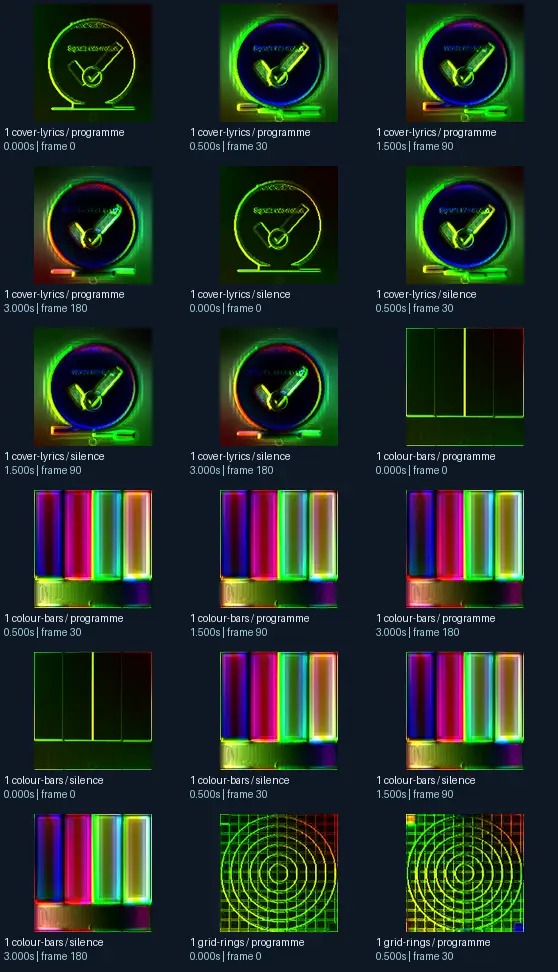
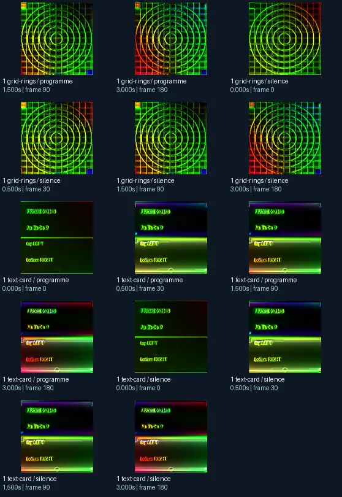

# Flexi - truly soft piece of software - this is generic texturing (Jelly)

- Identity: `butterchurn:791316b0e0d98609cb123208fae7a2ea7e21980aa1123a3725b412cbf3586279`
- Engine: butterchurn
- Status: **complete**

## What this preset does across the tested inputs

Observed 32 paired source/output measurements across 8 declared conditions, including 2 cover/lyric conditions and output times 0, 0.5, 1.5, 3 seconds.

Across input families, colour-bars: hue divergence median 0.294 bits, texture divergence median 0.587 bits across 8 observed pairs; cover-lyrics: hue divergence median 0.665 bits, texture divergence median 0.470 bits across 8 observed pairs; grid-rings: hue divergence median 0.843 bits, texture divergence median 0.244 bits across 8 observed pairs; text-card: hue divergence median unavailable bits, texture divergence median 0.507 bits across 8 observed pairs.

## Repeated model interpretations (not verified facts)

Repeated model-generated captions included a colorful background with a lot of different colors (6 frames); a clock with a neon glow on it (4 frames); a colorful display with a number of different colors (4 frames). Frequent prompt-relative hypotheses: light: neon lighting (32/32 frames); material: smooth digital surfaces (20/32 frames); medium: a graphic poster (16/32 frames); setting: an abstract composition (28/32 frames); tone: a tense ominous image (18/32 frames). Frequent optional PixelCue tag hypotheses: unanswerable (2), bed for rright (2).

## Changes over time

For successive captures of the same input condition, median measured texture divergence was 0.009 bits across 24 transitions.

## Music versus silence

16 matched programme-versus-silence comparisons had median hue divergence 0.000 bits. Differences may also reflect unseeded projectM rendering or feedback evolution, not just musical response.

## Complete capture overview

## Per-input quantitative responses

- **colour-bars** (8 paired observations): median hue divergence 0.2944183229134759, texture divergence 0.5866486111962002 bits
- **cover-lyrics** (8 paired observations): median hue divergence 0.6646880850008893, texture divergence 0.47027103079075616 bits
- **grid-rings** (8 paired observations): median hue divergence 0.8426998804136081, texture divergence 0.24383596572672264 bits
- **text-card** (8 paired observations): median hue divergence None, texture divergence 0.5067102599005157 bits

## Individual caption hypothesis
a clock with the word &#x27; time &#x27; in green

## Prompt-relative visual characteristics
- medium: a vector illustration
- light: neon lighting
- material: smooth digital surfaces
- tone: a tense ominous image
- setting: an abstract composition

## Tag hypotheses
NSFW., NSFW, unanswerable, bed for rright

## OCR hypotheses
(7) FRIED aD? quest ete HET ety Re exten RET ey | PALO ane

## Controlled visual response

- hue_js_divergence_bits: median 0.6647 (n=24); range 0.2669–0.9591
- texture_lbp_js_divergence_bits: median 0.4703 (n=32); range 0.1378–0.5961
- saturation_absolute_difference: median 0.6348 (n=32); range 0.2211–0.9998

## Evidence limits
PixelCue features quantify sampled rasters, not subjective quality or creative intention. BLIP captions, CLIP prompts and VLM tags are fallible per-frame hypotheses. Still frames cannot establish flash safety or perceived motion quality. Only an authenticated artist-provided suite can establish behaviour on actual album audio.
- Semantic captions, tags and prompts are model hypotheses, not verified facts.
- Static captures cannot establish motion comfort, flash safety or artistic intent.
- Renderer/GPU-dependent results require validation on the target system.
