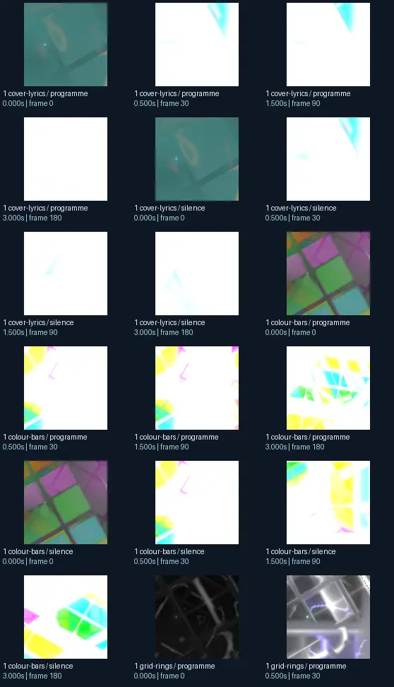
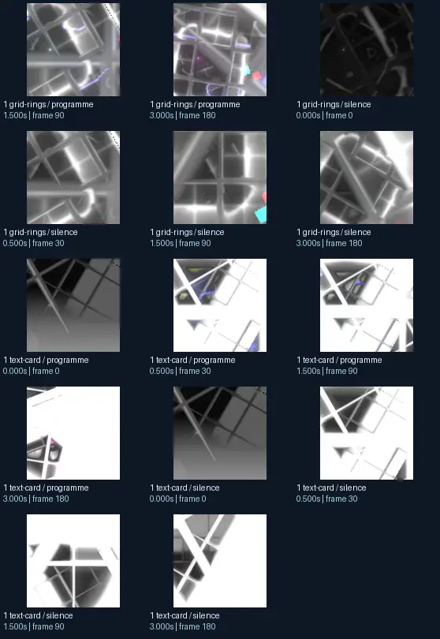

# An AdamFX n Martin Infusion 2 flexi - Why The Sky Looks Diffrent Today - AdamFx n Martin Infusion - Tack Tile Disfunction B

- Identity: `butterchurn:701856137558a0d7e0646a92ab7203386d261b61b526f866fafaa4e43ae36356`
- Engine: butterchurn
- Status: **complete**

## What this preset does across the tested inputs

Observed 32 paired source/output measurements across 8 declared conditions, including 2 cover/lyric conditions and output times 0, 0.5, 1.5, 3 seconds.

Across input families, colour-bars: hue divergence median 0.337 bits, texture divergence median 0.216 bits across 8 observed pairs; cover-lyrics: hue divergence median 0.507 bits, texture divergence median 0.069 bits across 8 observed pairs; grid-rings: hue divergence median 0.292 bits, texture divergence median 0.279 bits across 8 observed pairs; text-card: hue divergence median unavailable bits, texture divergence median 0.128 bits across 8 observed pairs.

## Repeated model interpretations (not verified facts)

Repeated model-generated captions included a green background with a black and white pattern (2 frames); a colorful abstract background with squares and squares (2 frames); a black and white background with a pattern (2 frames). Frequent prompt-relative hypotheses: light: soft diffuse lighting (24/32 frames); material: smooth digital surfaces (27/32 frames); medium: a 3D render (28/32 frames); setting: an abstract composition (29/32 frames); tone: a tense ominous image (22/32 frames). Frequent optional PixelCue tag hypotheses: FaceIdentity (3).

## Changes over time

For successive captures of the same input condition, median measured texture divergence was 0.067 bits across 24 transitions.

## Music versus silence

16 matched programme-versus-silence comparisons had median hue divergence 0.029 bits. Differences may also reflect unseeded projectM rendering or feedback evolution, not just musical response.

## Complete capture overview

## Per-input quantitative responses

- **colour-bars** (8 paired observations): median hue divergence 0.3366193424271064, texture divergence 0.2161062764610276 bits
- **cover-lyrics** (8 paired observations): median hue divergence 0.5069361005947468, texture divergence 0.06861904249545966 bits
- **grid-rings** (8 paired observations): median hue divergence 0.2921136208377344, texture divergence 0.2790184869766763 bits
- **text-card** (8 paired observations): median hue divergence None, texture divergence 0.12780481270954125 bits

## Individual caption hypothesis
a green background with a black and white pattern

## Prompt-relative visual characteristics
- medium: a 3D render
- light: soft diffuse lighting
- material: smooth digital surfaces
- tone: a tense ominous image
- setting: an abstract composition

## Tag hypotheses
NSFW, FaceIdentity

## OCR hypotheses
RN da x ~ 4 mI AS im \T% Y RV, ee: - 34 ae,

## Controlled visual response

- hue_js_divergence_bits: median 0.3914 (n=24); range 0.0101–0.9643
- texture_lbp_js_divergence_bits: median 0.1564 (n=32); range 0.0448–0.4412
- saturation_absolute_difference: median 0.0819 (n=32); range 0.0000–0.5303

## Evidence limits
PixelCue features quantify sampled rasters, not subjective quality or creative intention. BLIP captions, CLIP prompts and VLM tags are fallible per-frame hypotheses. Still frames cannot establish flash safety or perceived motion quality. Only an authenticated artist-provided suite can establish behaviour on actual album audio.
- Semantic captions, tags and prompts are model hypotheses, not verified facts.
- Static captures cannot establish motion comfort, flash safety or artistic intent.
- Renderer/GPU-dependent results require validation on the target system.
