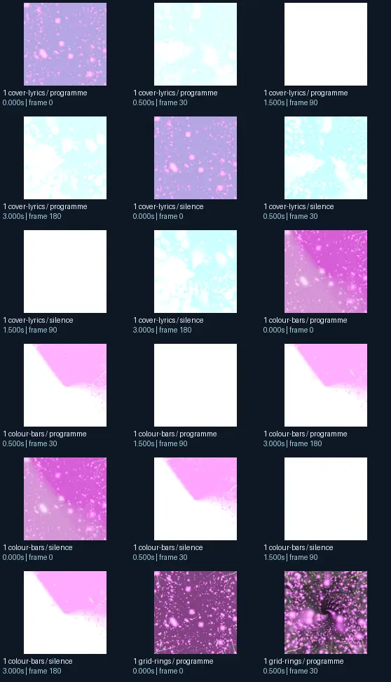
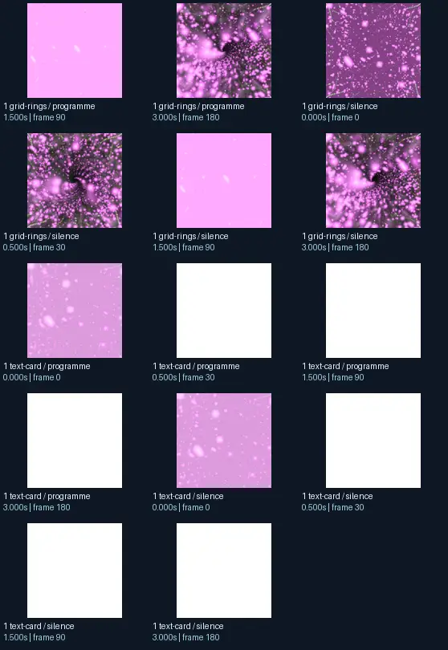

# martin + stahlregen - martin in da mash 10 (infinity mix)

- Identity: `butterchurn:34e28479b1cde042a0dcd636b61fbfb7b4080c23768530c57ee6d5bb19d4526a`
- Engine: butterchurn
- Status: **complete**

## What this preset does across the tested inputs

Observed 32 paired source/output measurements across 8 declared conditions, including 2 cover/lyric conditions and output times 0, 0.5, 1.5, 3 seconds.

Across input families, colour-bars: hue divergence median 0.666 bits, texture divergence median 0.204 bits across 8 observed pairs; cover-lyrics: hue divergence median 0.520 bits, texture divergence median 0.065 bits across 8 observed pairs; grid-rings: hue divergence median 0.997 bits, texture divergence median 0.329 bits across 8 observed pairs; text-card: hue divergence median unavailable bits, texture divergence median 0.056 bits across 8 observed pairs.

## Repeated model interpretations (not verified facts)

Repeated model-generated captions included a white and black striped rug with a white border (10 frames); a purple and black background with lots of small white dots (3 frames); a purple background with small pink dots (2 frames). Frequent prompt-relative hypotheses: light: soft diffuse lighting (32/32 frames); material: smooth digital surfaces (32/32 frames); medium: a 3D render (19/32 frames); setting: outer space (21/32 frames); tone: a tense ominous image (32/32 frames).

## Changes over time

For successive captures of the same input condition, median measured texture divergence was 0.091 bits across 24 transitions.

## Music versus silence

16 matched programme-versus-silence comparisons had median hue divergence 0.000 bits. Differences may also reflect unseeded projectM rendering or feedback evolution, not just musical response.

## Complete capture overview

## Per-input quantitative responses

- **colour-bars** (8 paired observations): median hue divergence 0.666374785688286, texture divergence 0.20375711006606972 bits
- **cover-lyrics** (8 paired observations): median hue divergence 0.5203078547281144, texture divergence 0.06519563821764479 bits
- **grid-rings** (8 paired observations): median hue divergence 0.9965682836460401, texture divergence 0.3288351594396274 bits
- **text-card** (8 paired observations): median hue divergence None, texture divergence 0.056334911976948183 bits

## Individual caption hypothesis
a purple background with small pink dots

## Prompt-relative visual characteristics
- medium: a 3D render
- light: soft diffuse lighting
- material: smooth digital surfaces
- tone: a tense ominous image
- setting: outer space

## Tag hypotheses
NSFW

## OCR hypotheses
a

## Controlled visual response

- hue_js_divergence_bits: median 0.8124 (n=20); range 0.5183–1.0000
- texture_lbp_js_divergence_bits: median 0.1254 (n=32); range 0.0449–0.3570
- saturation_absolute_difference: median 0.3465 (n=32); range 0.0000–0.5619

## Evidence limits
PixelCue features quantify sampled rasters, not subjective quality or creative intention. BLIP captions, CLIP prompts and VLM tags are fallible per-frame hypotheses. Still frames cannot establish flash safety or perceived motion quality. Only an authenticated artist-provided suite can establish behaviour on actual album audio.
- Semantic captions, tags and prompts are model hypotheses, not verified facts.
- Static captures cannot establish motion comfort, flash safety or artistic intent.
- Renderer/GPU-dependent results require validation on the target system.
