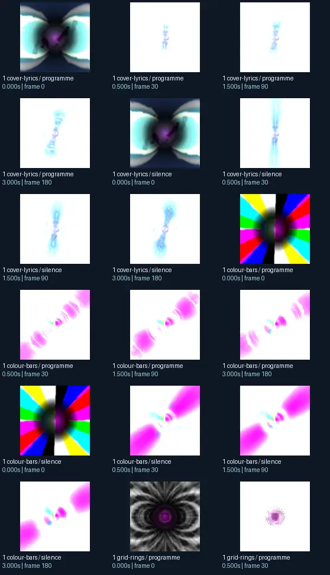
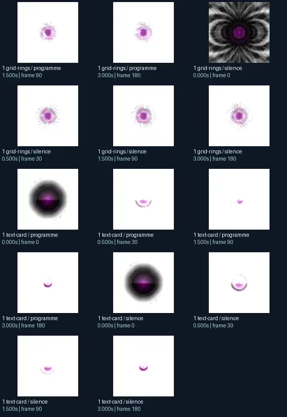

# LuxXx - Ain′t Life a Motherfucker iv

- Identity: `butterchurn:3be0b3f1b75d807e1047c227601f3c7ed68ab9158393f8fdbc84a1b6165f59bd`
- Engine: butterchurn
- Status: **complete**

## What this preset does across the tested inputs

Observed 32 paired source/output measurements across 8 declared conditions, including 2 cover/lyric conditions and output times 0, 0.5, 1.5, 3 seconds.

Across input families, colour-bars: hue divergence median 0.594 bits, texture divergence median 0.254 bits across 8 observed pairs; cover-lyrics: hue divergence median 0.316 bits, texture divergence median 0.051 bits across 8 observed pairs; grid-rings: hue divergence median 0.983 bits, texture divergence median 0.232 bits across 8 observed pairs; text-card: hue divergence median unavailable bits, texture divergence median 0.032 bits across 8 observed pairs.

## Repeated model interpretations (not verified facts)

Repeated model-generated captions included a purple flower with a white background (4 frames); a purple and white butterfly with wings (2 frames); a colorful rainbow colored background with a black hole (2 frames). Frequent prompt-relative hypotheses: light: soft diffuse lighting (30/32 frames); material: smooth digital surfaces (32/32 frames); medium: a 3D render (26/32 frames); setting: outer space (24/32 frames); tone: a tense ominous image (26/32 frames). Frequent optional PixelCue tag hypotheses: booru (2).

## Changes over time

For successive captures of the same input condition, median measured texture divergence was 0.010 bits across 24 transitions.

## Music versus silence

16 matched programme-versus-silence comparisons had median hue divergence 0.001 bits. Differences may also reflect unseeded projectM rendering or feedback evolution, not just musical response.

## Complete capture overview

## Per-input quantitative responses

- **colour-bars** (8 paired observations): median hue divergence 0.5944141334215949, texture divergence 0.254482173734201 bits
- **cover-lyrics** (8 paired observations): median hue divergence 0.3155487345490619, texture divergence 0.05145295493366704 bits
- **grid-rings** (8 paired observations): median hue divergence 0.9827783565306004, texture divergence 0.23159885225438379 bits
- **text-card** (8 paired observations): median hue divergence None, texture divergence 0.03210181931936888 bits

## Individual caption hypothesis
a purple and white butterfly with wings

## Prompt-relative visual characteristics
- medium: a 3D render
- light: soft diffuse lighting
- material: smooth digital surfaces
- tone: a tense ominous image
- setting: an abstract composition

## Tag hypotheses
NSFW, booru

## OCR hypotheses
| aa 1 in_—i\ \y ww ¢ ~~ wy i Ney, HO

## Controlled visual response

- hue_js_divergence_bits: median 0.5944 (n=24); range 0.0321–1.0000
- texture_lbp_js_divergence_bits: median 0.2056 (n=32); range 0.0228–0.5175
- saturation_absolute_difference: median 0.1169 (n=32); range 0.0002–0.5257

## Evidence limits
PixelCue features quantify sampled rasters, not subjective quality or creative intention. BLIP captions, CLIP prompts and VLM tags are fallible per-frame hypotheses. Still frames cannot establish flash safety or perceived motion quality. Only an authenticated artist-provided suite can establish behaviour on actual album audio.
- Semantic captions, tags and prompts are model hypotheses, not verified facts.
- Static captures cannot establish motion comfort, flash safety or artistic intent.
- Renderer/GPU-dependent results require validation on the target system.
