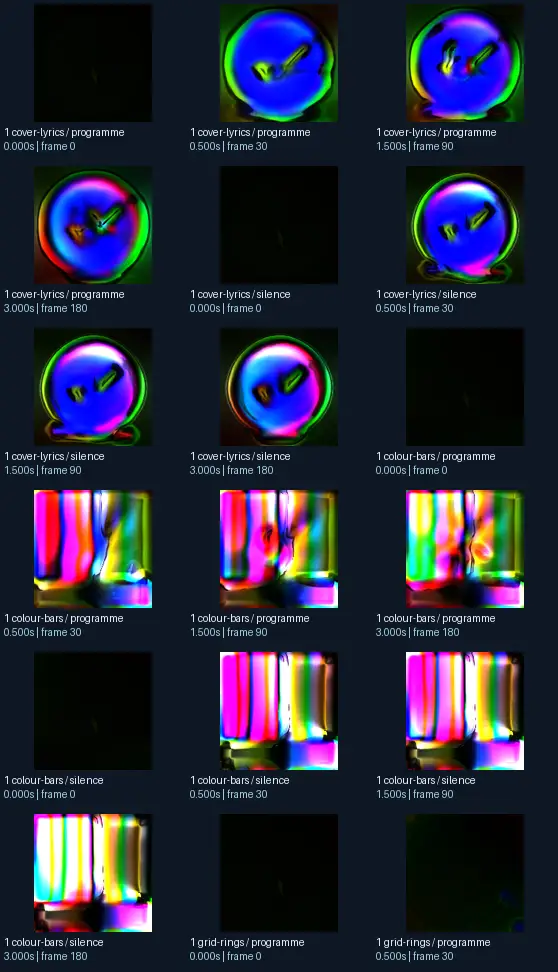
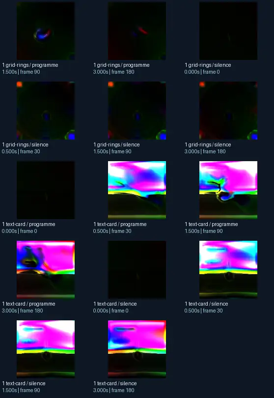

# Eo.S. - glowsticks v2 03 music shifter edit b (Jelly V2)

- Identity: `butterchurn:24461b4a130b9e82c137d6dab8ae00654ab9fe6957b1f713f7c9babb2d86395a`
- Engine: butterchurn
- Status: **complete**

## What this preset does across the tested inputs

Observed 32 paired source/output measurements across 8 declared conditions, including 2 cover/lyric conditions and output times 0, 0.5, 1.5, 3 seconds.

Across input families, colour-bars: hue divergence median 0.239 bits, texture divergence median 0.558 bits across 8 observed pairs; cover-lyrics: hue divergence median 0.606 bits, texture divergence median 0.385 bits across 8 observed pairs; grid-rings: hue divergence median 0.739 bits, texture divergence median 0.152 bits across 8 observed pairs; text-card: hue divergence median unavailable bits, texture divergence median 0.471 bits across 8 observed pairs.

## Repeated model interpretations (not verified facts)

Repeated model-generated captions included a black background with a green circle (2 frames); a colorful orb with a black background (2 frames); a black and white cat (2 frames). Frequent prompt-relative hypotheses: light: neon lighting (22/32 frames); material: smooth digital surfaces (32/32 frames); medium: a 3D render (31/32 frames); setting: an abstract composition (21/32 frames); tone: a tense ominous image (24/32 frames).

## Changes over time

For successive captures of the same input condition, median measured texture divergence was 0.014 bits across 24 transitions.

## Music versus silence

16 matched programme-versus-silence comparisons had median hue divergence 0.024 bits. Differences may also reflect unseeded projectM rendering or feedback evolution, not just musical response.

## Complete capture overview

## Per-input quantitative responses

- **colour-bars** (8 paired observations): median hue divergence 0.2391947685827775, texture divergence 0.5581837482201143 bits
- **cover-lyrics** (8 paired observations): median hue divergence 0.6062692857523972, texture divergence 0.38511016094449335 bits
- **grid-rings** (8 paired observations): median hue divergence 0.7388557306164218, texture divergence 0.1523426200444669 bits
- **text-card** (8 paired observations): median hue divergence None, texture divergence 0.4710212624107851 bits

## Individual caption hypothesis
a black background with a green circle

## Prompt-relative visual characteristics
- medium: a 3D render
- light: soft diffuse lighting
- material: smooth digital surfaces
- tone: a tense ominous image
- setting: outer space

## Tag hypotheses
NSFW, NSFW.

## OCR hypotheses
No OCR result

## Controlled visual response

- hue_js_divergence_bits: median 0.6275 (n=24); range 0.1218–0.9555
- texture_lbp_js_divergence_bits: median 0.3851 (n=32); range 0.0300–0.7153
- saturation_absolute_difference: median 0.5778 (n=32); range 0.0082–1.0000

## Evidence limits
PixelCue features quantify sampled rasters, not subjective quality or creative intention. BLIP captions, CLIP prompts and VLM tags are fallible per-frame hypotheses. Still frames cannot establish flash safety or perceived motion quality. Only an authenticated artist-provided suite can establish behaviour on actual album audio.
- Semantic captions, tags and prompts are model hypotheses, not verified facts.
- Static captures cannot establish motion comfort, flash safety or artistic intent.
- Renderer/GPU-dependent results require validation on the target system.
