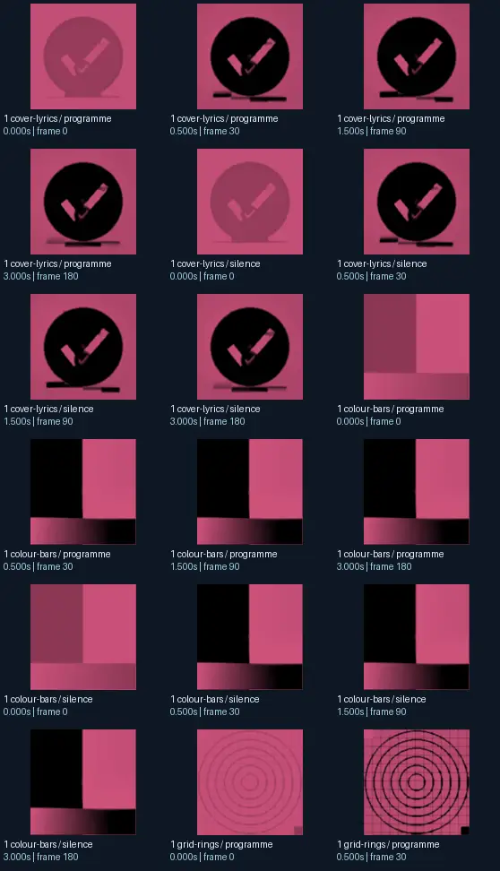
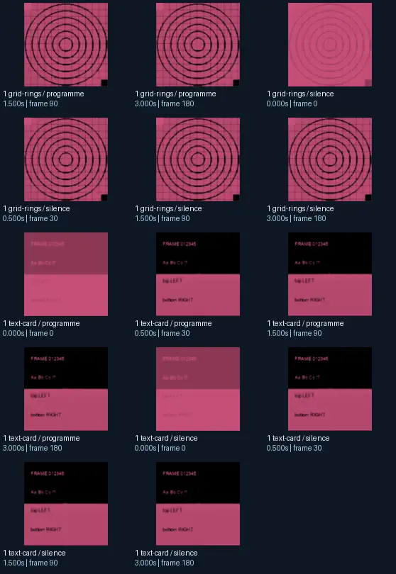

# Flexi - flower demo 5

- Identity: `projectm:b4e4045cd66cdb7f6642999fb8f937c4f2f83b67797e6e82b0337da440e3a301`
- Engine: projectm
- Status: **complete**

## What this preset does across the tested inputs

Observed 32 paired source/output measurements across 8 declared conditions, including 2 cover/lyric conditions and output times 0, 0.5, 1.5, 3 seconds.

Across input families, colour-bars: hue divergence median 0.911 bits, texture divergence median 0.129 bits across 8 observed pairs; cover-lyrics: hue divergence median 1.000 bits, texture divergence median 0.048 bits across 8 observed pairs; grid-rings: hue divergence median 0.999 bits, texture divergence median 0.179 bits across 8 observed pairs; text-card: hue divergence median unavailable bits, texture divergence median 0.017 bits across 8 observed pairs.

## Repeated model interpretations (not verified facts)

Repeated model-generated captions included a pink and black background with a black and white square (6 frames); a square with a spiral in the center (6 frames); a pink and black phone with the text &#x27; i am am am am am am am am am am am (6 frames). Frequent prompt-relative hypotheses: light: soft diffuse lighting (30/32 frames); material: smooth digital surfaces (30/32 frames); medium: a graphic poster (24/32 frames); setting: an abstract composition (32/32 frames); tone: a tense ominous image (24/32 frames). Frequent optional PixelCue tag hypotheses: bottom RIGHT (6), As Be Co. ? (6), FRAME 012345 (6), Booru (4), b.l.e.l.f. 1 (3), pink check mark with black outline. (2), pink (2), pink-outlined check mark (2).

## Changes over time

For successive captures of the same input condition, median measured texture divergence was 0.001 bits across 24 transitions.

## Music versus silence

16 matched programme-versus-silence comparisons had median hue divergence 0.000 bits. Differences may also reflect unseeded projectM rendering or feedback evolution, not just musical response.

## Complete capture overview

## Per-input quantitative responses

- **colour-bars** (8 paired observations): median hue divergence 0.9111722319992406, texture divergence 0.12876517242644578 bits
- **cover-lyrics** (8 paired observations): median hue divergence 0.9996706562335615, texture divergence 0.047529340346660384 bits
- **grid-rings** (8 paired observations): median hue divergence 0.9987402084366723, texture divergence 0.17875289320342128 bits
- **text-card** (8 paired observations): median hue divergence None, texture divergence 0.01656482310532167 bits

## Individual caption hypothesis
a pink background with a check mark mark

## Prompt-relative visual characteristics
- medium: a vector illustration
- light: soft diffuse lighting
- material: metallic surfaces
- tone: a playful cheerful image
- setting: an abstract composition

## Tag hypotheses
Booru, pink check mark with black outline., pink, pink-outlined check mark, NSFW, As So Co If?, FRAME 012345, As Be Co. ?, bottom RIGHT, b.l.e.l.f. 1

## OCR hypotheses
FRAME o12m8

## Controlled visual response

- hue_js_divergence_bits: median 0.9987 (n=24); range 0.9112–1.0000
- texture_lbp_js_divergence_bits: median 0.0784 (n=32); range 0.0165–0.1788
- saturation_absolute_difference: median 0.2671 (n=32); range 0.0377–0.5980

## Evidence limits
PixelCue features quantify sampled rasters, not subjective quality or creative intention. BLIP captions, CLIP prompts and VLM tags are fallible per-frame hypotheses. Still frames cannot establish flash safety or perceived motion quality. Only an authenticated artist-provided suite can establish behaviour on actual album audio.
- Semantic captions, tags and prompts are model hypotheses, not verified facts.
- Static captures cannot establish motion comfort, flash safety or artistic intent.
- Renderer/GPU-dependent results require validation on the target system.
