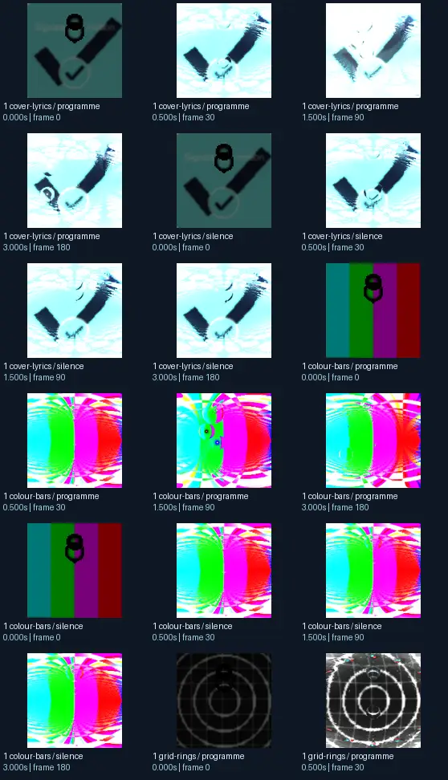
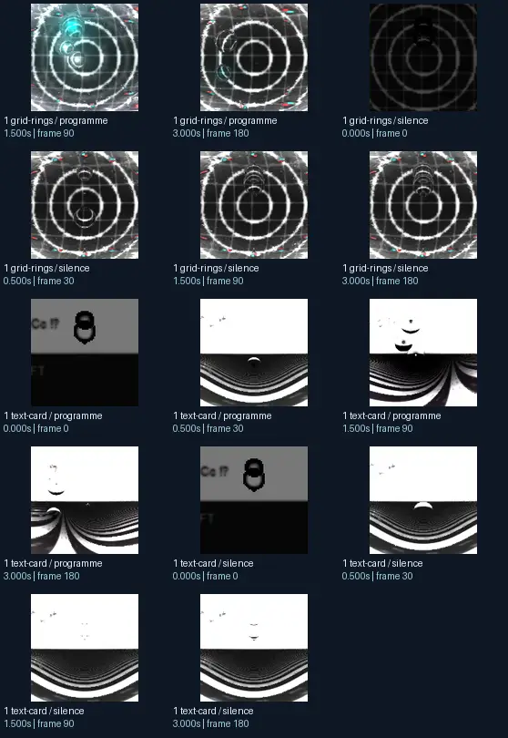

# martin - glassball dance

- Identity: `butterchurn:4beedf26ac8f6d145d968bf9ee0ce9048d8af8748d91d446a4d08ce94fc4246e`
- Engine: butterchurn
- Status: **complete**

## What this preset does across the tested inputs

Observed 32 paired source/output measurements across 8 declared conditions, including 2 cover/lyric conditions and output times 0, 0.5, 1.5, 3 seconds.

Across input families, colour-bars: hue divergence median 0.216 bits, texture divergence median 0.550 bits across 8 observed pairs; cover-lyrics: hue divergence median 0.215 bits, texture divergence median 0.288 bits across 8 observed pairs; grid-rings: hue divergence median 0.098 bits, texture divergence median 0.233 bits across 8 observed pairs; text-card: hue divergence median unavailable bits, texture divergence median 0.121 bits across 8 observed pairs.

## Repeated model interpretations (not verified facts)

Repeated model-generated captions included a black and white image of a circular object (4 frames); a colorful, abstract image of a sphere (3 frames); a black and white image of a target (3 frames). Frequent prompt-relative hypotheses: light: soft diffuse lighting (24/32 frames); material: smooth digital surfaces (30/32 frames); medium: a 3D render (19/32 frames); setting: an abstract composition (26/32 frames); tone: a tense ominous image (22/32 frames). Frequent optional PixelCue tag hypotheses: suggestive (6), Booru (5), Hwurr (1), SFNW (1).

## Changes over time

For successive captures of the same input condition, median measured texture divergence was 0.022 bits across 24 transitions.

## Music versus silence

16 matched programme-versus-silence comparisons had median hue divergence 0.025 bits. Differences may also reflect unseeded projectM rendering or feedback evolution, not just musical response.

## Complete capture overview

## Per-input quantitative responses

- **colour-bars** (8 paired observations): median hue divergence 0.2157858061460472, texture divergence 0.5502014626826681 bits
- **cover-lyrics** (8 paired observations): median hue divergence 0.214565397041609, texture divergence 0.28803004891121525 bits
- **grid-rings** (8 paired observations): median hue divergence 0.0979290275078172, texture divergence 0.23335040548807134 bits
- **text-card** (8 paired observations): median hue divergence None, texture divergence 0.1213207019973088 bits

## Individual caption hypothesis
a black and white image of a black and white image of a black and white image of a black and

## Prompt-relative visual characteristics
- medium: a graphic poster
- light: soft diffuse lighting
- material: smooth digital surfaces
- tone: a tense ominous image
- setting: an abstract composition

## Tag hypotheses
NSFW., NSFW, Booru, Hwurr, suggestive, SFNW, SFW

## OCR hypotheses
8 re f 4 w y rd

## Controlled visual response

- hue_js_divergence_bits: median 0.2118 (n=22); range 0.0440–0.6656
- texture_lbp_js_divergence_bits: median 0.2234 (n=32); range 0.0158–0.5727
- saturation_absolute_difference: median 0.0534 (n=32); range 0.0000–0.4433

## Evidence limits
PixelCue features quantify sampled rasters, not subjective quality or creative intention. BLIP captions, CLIP prompts and VLM tags are fallible per-frame hypotheses. Still frames cannot establish flash safety or perceived motion quality. Only an authenticated artist-provided suite can establish behaviour on actual album audio.
- Semantic captions, tags and prompts are model hypotheses, not verified facts.
- Static captures cannot establish motion comfort, flash safety or artistic intent.
- Renderer/GPU-dependent results require validation on the target system.
